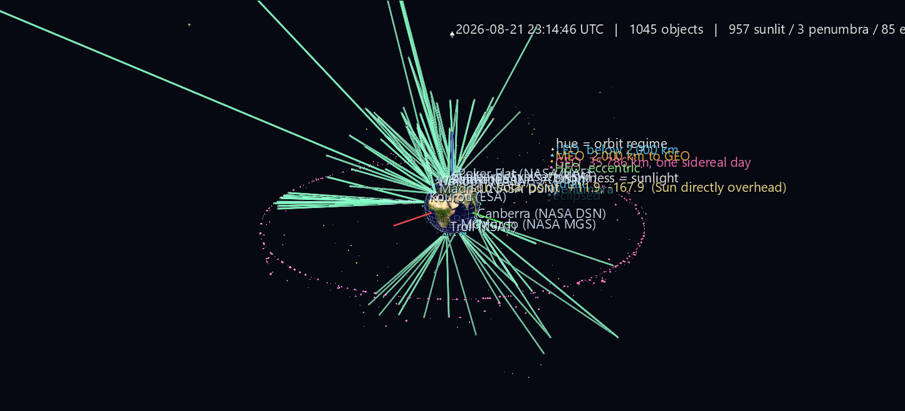

# Orbital Traffic — Live Sky

Every tracked satellite where it is *right now*, on a Blue Marble globe, at its true sub-satellite point and its true altitude — rewritten once a second. Hue says which orbital regime an object is in; brightness says whether the Sun is currently shining on it. Nothing here is a simulation: the element sets are the ones the US Space Surveillance Network published this morning, propagated with the standard SGP4 model.



**Try it:** download this example below (or [the full examples set](../getting-started/installation.md#example-scenes)), then open `Orbital_Traffic_Example/Live_Sky/live_sky_gv_node.csv` — or drag its folder onto the window. Press **T** for the full label set; Alt+click any satellite to open its CelesTrak catalogue record.

[:material-download: Live_Sky (1 MB)](https://iluvdata.org/glyphviz/zips/Orbital_Traffic_Example_Live_Sky.zip){ .md-button }

## What you're looking at

| Element | Meaning |
|---|---|
| Globe | World Grid (type 6) in globe form, NASA Blue Marble texture |
| Small glyphs above it | One per catalogued object, at its real lon/lat/altitude |
| Glyph **hue** | Orbit regime — cyan LEO, amber MEO, rose GEO, green eccentric |
| Glyph **brightness** | Sunlight: full = lit, half = penumbra, quarter = eclipsed |
| Glyph **shape** | Octahedron = payload, cylinder = rocket body, tetrahedron = debris |
| Glyph **size** | Radar cross section from the SATCAT, log-compressed |
| Amber ring on the surface | The day/night terminator — a real great circle, 90° from the Sun |
| Yellow sphere | The sub-solar point: where the Sun is directly overhead |
| White pins | Ten real ground stations, on their true coordinates |
| Green edges | Station → satellite, for the ten highest passes at that station |
| Caption overhead | UTC clock, object and illumination tallies, element age |

1,528 nodes in all: 1,045 objects, 10 stations, the terminator ring, and a fixed pool of 280 link nodes.

## The scale is honest, and that is the point

A World Grid globe places children on a sphere of radius 180/π ≈ 57.3 world units, so **one world unit is 111.32 km** — one degree of latitude. The scene uses that scale straight, with no compression:

| Orbit | Altitude | Height above the globe |
|---|---|---|
| ISS | 419 km | 3.8 units — 0.07 Earth radii |
| Starlink shell | 550 km | 4.9 units |
| GPS / Galileo | 20,200 km | 181 units — 3.2 R |
| GEO belt | 35,786 km | **321.5 units — 5.6 R** |

So the default view is about eleven Earth-diameters across, and Earth is a small ball at the centre of a very large, very empty volume with three distinct inhabited shells in it: a fuzzy layer clinging to the surface, two GNSS shells halfway out, and a razor-thin rose ring at the edge. Rebuild with `--max-alt-km 2000` for the LEO close-up.

## What to look for

- **The ISS is in the dark for 38.7% of its orbit.** 36 of every 93 minutes — and that fraction is not fixed. It tracks the beta angle between the Sun and the orbit plane over a roughly 60-day cycle, and near the top of that cycle the station runs for days without a sunset at all.
- **A GEO satellite is normally never eclipsed** — the belt sits about 12° off the shadow axis in late August, and the umbra only subtends 8.4° there. GEO eclipse season is roughly three weeks either side of each equinox.
- **Except for the ones that are.** On 21 August 2026 six of 568 GEO objects sat in shadow, all of them within 7.5° of the anti-solar longitude and at latitudes between −3.6° and −10.4°. They are **inclined** GEO satellites — old birds that have given up north–south stationkeeping and now swing above and below the equator each day, into a shadow their well-stationkept neighbours a few degrees away miss entirely. Two satellites side by side in the same belt, one lit and one dark, for a reason you can see.
- **Why polar stations exist.** Averaged over 24 hours, LEO objects above 5° elevation: McMurdo (−77.8°) sees **25.1**, Svalbard (+78.2°) **24.6**, Kiruna 18.8, Madrid 9.7, Kourou (+5.3°) 7.6. A clean monotonic slide with latitude and a **3.3× advantage** for the polar sites — most LEO satellites are in near-polar orbits, so their ground tracks converge at high latitude. Svalbard's whole commercial existence is in that column, and running the scene live for a minute shows it happening.
- **Most of what a station can see is not worth tracking.** Across the ten stations there are 2,065 station–satellite pairs above 5° elevation at once. Restrict the scene to LEO and the same tally drops to 145. A geostationary satellite is visible from about 42% of the planet at once; a 550 km LEO satellite from about 3%.

## Going live

```bash
python build_live_sky.py --watch 1
```

Open the scene and turn on **File > Watch and Reload** (Ctrl+R). The viewer polls the file's mtime once a second and hot-reloads in place, preserving camera, selection and playback. A full frame — propagate 1,045 objects, classify illumination, compute ten stations' worth of look angles, and write 1,528 nodes — takes **31 ms**, so the generator is nowhere near the bottleneck. Writes are atomic, so a reload never sees a torn CSV.

**Node ids never move**, which matters more than it sounds. Every id comes from a fixed layout computed once from the configuration, never from the moment being rendered; objects that fail to propagate or that an altitude filter excludes are written as hidden rows rather than dropped, and the station-link pool is a fixed block whose unused slots are hidden self-links. The set of visible edges churns completely every second while the file's shape never changes — which is what lets you keep a satellite selected and watch its properties update live.

!!! warning "CelesTrak's rate limit"
    CelesTrak refreshes GP data every 2 hours and temporarily firewalls IPs that poll faster. A too-soon repeat request does **not** return an error status — it returns HTTP 200 with a plain-text "GP data has not updated since your last successful download" body, which a fetcher that trusts the status code parses as an empty CSV. The example's fetcher sniffs for the `OBJECT_NAME` header, falls back to its on-disk cache, and never re-requests inside the 2-hour window. `--watch` only ever re-propagates; it does not re-fetch.

## The rest of the set

- **[One Orbit](orbital-one-orbit.md)** — the same sky, one full 93-minute revolution precomputed into Channels and replayable in twenty seconds.
- **[Orbital Shells](orbital-shells.md)** — the orbital planes themselves, in the inertial frame, turning by themselves.

The example ships four verification suites totalling 54 checks — the physics against independent implementations and published astronomy, and the picture against the real GlyphViz transform engine (globe children land at their written lon/lat/altitude to 2.3 × 10⁻¹³ world units; rendered altitude matches the label to 502 m over 1,045 satellites).

## Data and attribution

Orbital data and satellite catalogue courtesy of **CelesTrak** (Dr. T. S. Kelso, [celestrak.org](https://celestrak.org)), derived from US Space Surveillance Network observations. Globe texture: NASA Blue Marble. Rebuilding needs the `sgp4` package (a 148 KB pure wheel, no build step); the scene as shipped is pure CSV and needs nothing.

SGP4 is good to roughly a kilometre at epoch, degrading 1–3 km/day for LEO. That is right for a visualization and nowhere near good enough for conjunction assessment — don't fly anything using this.
