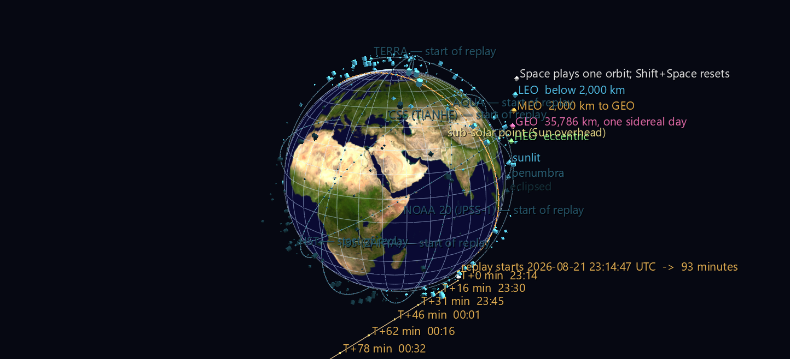

# Orbital Traffic — One Orbit

[Live Sky](orbital-live-sky.md) is honest about time and therefore unwatchable: the ISS takes 93 real minutes to go round once, so at 1× the orbital motion is invisible. This scene precomputes that entire revolution into GlyphViz Channels tracks. **Press Space** and it replays in about twenty seconds — and the motion that was imperceptible becomes the whole point.



**Try it:** download this example below (or [the full examples set](../getting-started/installation.md#example-scenes)), then open `Orbital_Traffic_Example/One_Orbit/one_orbit_gv_node.csv` — or drag its folder onto the window. The Channels panel appears by itself; **Space** plays, **Shift+Space** stops and restores the authored frame.

[:material-download: One_Orbit (4 MB)](https://iluvdata.org/glyphviz/zips/Orbital_Traffic_Example_One_Orbit.zip){ .md-button }

## Three things move together on one clock

- **The satellites**, along their real SGP4 trajectories — 335 LEO objects, 558 frames, 10 seconds apart.
- **Their colour**, as each crosses into and out of Earth's shadow. The shadow is modelled as a cone, not a cylinder — the Sun is an extended source, so there is a converging umbra ringed by a diverging penumbra — and the test is re-evaluated every frame.
- **The terminator ring and the sub-solar point**, sliding west while the shell goes round. The day/night line is not a backdrop here; it is what the satellites are flying through.

Six recognisable objects — ISS, Tiangong, Hubble, Terra, Aqua and NOAA 20 — carry a static trail marking their full path, so the eye has something to follow through the swarm. The scene is 1,711 nodes driven by 2,253 channel bindings across 457 channels.

## What to look for

- **984 illumination transitions** in 93 minutes. 265 of the 335 objects change state at least once; watch the shell wink dark as it sweeps into the cone behind Earth and brighten as it comes out.
- **70 objects never leave sunlight for the entire orbit.** Those are the dawn–dusk sun-synchronous satellites, flying permanently along the terminator so their solar panels never lose the Sun and their imagery always has the same lighting. They ride the amber ring for the whole replay — the scene shows you *why* that orbit is worth having.
- **Earth turns 23.30° beneath the ISS during one revolution.** Play two revolutions (`--minutes 186`) and the trail lays down twice, displaced west by that much — the reason a ground track is a slowly drifting sinusoid rather than a closed loop.
- **The sub-solar point sweeps 23.21°** in those 93 minutes. Not the sidereal 23.31°, because the Sun creeps east along the ecliptic while Earth turns — which is exactly why a solar day is four minutes longer than a sidereal one.

## Track economy

The tracks file is the one thing that gets expensive fast — 558 rows by 2,004 columns, 7.1 MB. Two things keep it from being much worse.

**Colour tracks are shared.** A satellite's hue is fixed by its regime and only its brightness changes, so any two objects with an identical *shadow history* need the same three colour tracks. Among 335 objects there are only 252 distinct histories — mostly because the 70 permanently-lit ones all share a single constant one. That is 756 colour tracks instead of 1,005.

**The terminator ring animates on longitude and latitude, and nothing else.** One thing that did *not* work: animating its longitude alone. The sub-solar longitude sweeps 23° while the declination drifts only 0.02°, so freezing latitude looks like a free win. It isn't — it leaves the ring up to 0.016° off the true terminator by the end of the replay. That is 1.8 km on the ground and completely invisible, but it means the amber circle would no longer be the day/night circle, and a check that says "the terminator is where the Sun sets" would have been quietly false. 120 extra tracks fixed it; the residual is now 1.0 × 10⁻⁴ degrees, which is the CSV's own rounding.

## Rebuilding

```bash
python build_one_orbit.py                     # as shipped
python build_one_orbit.py --minutes 186       # two revolutions
python build_one_orbit.py --step 5            # smoother, twice the tracks
python build_one_orbit.py --max-alt-km 800    # just the crowded shell
python build_one_orbit.py --max-alt-km 40000  # include MEO and GEO
python build_one_orbit.py --fetch             # refresh elements first
```

!!! note "Why each scene lives in its own folder"
    GlyphViz auto-loads Channels files by scanning the node CSV's directory, and **only** binds them when exactly one `ch-map` and one `ch-tracks` match. Two candidate map files in one folder disable Channels entirely, with no warning.

## Verifying an animation

A static scene being right at frame 0 says nothing about frame 557, so `verify_replay.py` drives the **real `ChannelEngine`** — the same object the app's Channels panel drives — through the replay, pulls each glyph's world position out of the transform engine at frames spread across the whole span, converts it back to lat/lon/altitude, and compares against an independent SGP4 propagation to that frame's wall clock. Worst error: **7.6 m** over 335 satellites × 6 frames, against a CSV rounding floor of about 11 m.

Two of its eleven checks are worth singling out. The completeness check matters more than it looks, because the Channels join is three-way (`node.ch_input_id` → `map.channel_id` → a `ch<id>` tracks column) and **every link in it fails silently**: a typo'd attribute name, a channel with no node, a track id with no column — nothing warns, the animation just doesn't happen. And the sub-solar sweep check is deliberately two-sided: it requires the sweep to match the solar rate *and* to differ from the sidereal one, because a one-sided tolerance would pass even if the solar model had stopped contributing entirely.

## The rest of the set

- **[Live Sky](orbital-live-sky.md)** — the whole tracked catalogue where it is right now, rewritten once a second.
- **[Orbital Shells](orbital-shells.md)** — the orbital planes themselves, in the inertial frame, turning by themselves.

## Data and attribution

Orbital data and satellite catalogue courtesy of **CelesTrak** (Dr. T. S. Kelso, [celestrak.org](https://celestrak.org)). Globe texture: NASA Blue Marble. Rebuilding needs the `sgp4` package; the scene as shipped is pure CSV and needs nothing.
