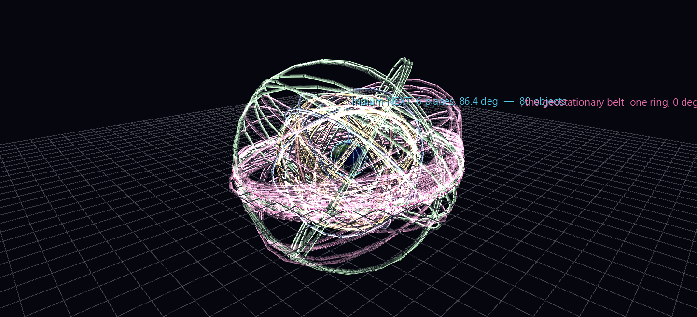

# Orbital Traffic — Orbital Shells

The other two scenes in this set are geographic: satellites over a map, placed by latitude and longitude. This one drops the map and shows the **structure** — the orbital planes themselves, in the inertial frame where they stand still and the Earth is the thing that spins.

**Try it:** download this example below (or [the full examples set](../getting-started/installation.md#example-scenes)), then open `Orbital_Traffic_Example/Orbital_Shells/orbital_shells_gv_node.csv` — or drag its folder onto the window. It starts turning immediately; there is nothing to press.

[:material-download: Orbital_Shells (2 MB)](https://iluvdata.org/glyphviz/zips/Orbital_Traffic_Example_Orbital_Shells.zip){ .md-button }

## It animates by itself

Every ring carries `rotate_rate_z` set to its own orbital angular rate and the viewport integrates it on a continuous 30 fps timer. There is no Channels panel, nothing to press, and nothing to keep running in a terminal — 2,344 nodes of pure CSV that move the moment they load. Earth spins on the same clock, at the sidereal rate: a sidereal day takes 4.8 minutes at the default 300× time scale.

## Constellations are not clouds

Seen from a map, GPS is thirty-two scattered dots. Seen as planes, it is obviously *engineering* — and you can read what each design is for.

| Constellation | Planes | Inclination | Altitude | Period | One turn at 300× |
|---|---|---|---|---|---|
| Iridium NEXT | **6**, ~31.6° apart | 86.4° | 767 km | 100.1 min | 20 s |
| GPS | **6**, ~60° apart | 55.1° | 20,163 km | 718 min | 144 s |
| GLONASS | **3**, ~120° apart | 64.8° | 19,131 km | 676 min | 135 s |
| Galileo | **3**, ~120° apart | 55.8° | 23,223 km | 840 min | 168 s |
| BeiDou | 7 (mixed MEO/IGSO/GEO) | varies | varies | varies | varies |
| GEO belt | 1 dense ring | ~0° | 35,786 km | 1436 min | 287 s |

Every one of those plane counts and spacings is **recovered from live element sets by clustering**, not written into the generator. The published designs are what the clustering finds.

## What to look for

- **Iridium's six planes span only ~180° of RAAN**, spaced 31.6° apart with one large seam — not 60° apart over the full circle. That is the near-polar Walker design: a plane at RAAN Ω and one at Ω+180° are the *same* ring travelled the other way, so a polar constellation only has half a circle to spread across. The lopsided gap in the scene is the co-rotating seam, and it is a real feature of Iridium, not an artefact.
- **GPS at 60° and Galileo at 120°** — six planes of four versus three planes of eight, two different answers to the same coverage problem, side by side and to scale.
- **The GEO belt is a single wall of satellites** in one plane, while everything else is a lattice. Turn the camera edge-on to the equator and the belt collapses to a line.
- **Relative speeds are true.** Iridium whips round while GPS crawls and the GEO ring keeps perfect pace with the Earth's surface underneath it — that last one *is* what geostationary means, and here it is a thing you watch rather than a definition you read.

### Galileo's two lost satellites

The plane clustering found something it was not looking for. Galileo has three nominal planes; the scene finds three clean ones of 11, 10 and 9 satellites at RAAN 120° apart — plus two satellites that belong to none of them:

| | Nominal Galileo | GSAT0201 / GSAT0202 |
|---|---|---|
| Inclination | 55.8° | **48.8°** |
| Eccentricity | ~0.0002 | **0.168** |
| Altitude | 23,223 km | **18,332 – 25,143 km** |

These are Galileo 5 and 6, launched together on a Soyuz in August 2014 and stranded in the wrong orbit when a frozen hydrazine line in the Fregat upper stage froze an attitude-control thruster. They are still up there, still broadcasting, still on a wrong and eccentric orbit — and they fall out of the data by themselves the moment you cluster by plane.

The scene deliberately **does not draw a ring for them**. A ring asserts "these satellites share a circular plane," and for an orbit of eccentricity 0.17 that would be fiction. They get their exact glyph and no claimed plane. The same rule retires five other small clusters of abandoned, high-inclination near-geosynchronous objects that CelesTrak files under `geo` but which are emphatically not in the geostationary belt.

## Every ring is a real orbit, and its satellite is on it

The first build drew one ring per *cluster*, at the cluster's mean elements, and hung each satellite on its own separate invisible ring at its own exact elements. Both halves were correct and the combination was misleading: the visible circles were not the paths the satellites were on. Measured across the scene, satellites sat a median of **450 km** and up to **9,700 km** from the nearest drawn ring. It read exactly as it was — paths with nothing following them.

Now the ring a satellite rides **is** the ring you see. A ring is only *drawn*, though, when it is not a duplicate of one already drawn: every satellite still keeps its own exact ring node, and a ring whose orbit comes within `--ring-tol-units` (default 3 world units, about one glyph) of an already-drawn one simply isn't rendered. That tolerance is a **distance, not an angle** — half a degree is 3,300 km out at GEO and only 7 km down at Iridium, so a fixed angular tolerance would be wrong at both ends. The guarantee is the one that matters visually: no satellite is ever further from the ring it appears to ride than the width of its own glyph. Worst case in the shipped scene is **2.72 world units, 302 km**.

773 orbits collapse to **170 drawn rings**: 8 for Iridium, 7 for Galileo, 11 for GLONASS, 29 for GPS, 25 for BeiDou — and 90 for the geostationary belt, which is the interesting number. The GEO "belt" is not a line. Its 548 objects span 15 degrees of inclination, because satellites that stop north–south stationkeeping keep drifting, so at glyph resolution it really is ninety distinct orbits forming a band. `--no-geo` drops it and leaves the GNSS lattice clean.

## Building with nested rotations

Scene 3 is built out of nested rotations, which is the kind of construction that looks plausible while being wrong, so the example ships `probe_torus.py` to settle the rules against the real engine before any scene code runs — the same discipline the [Geomagnetic Field](geomagnetic-field.md) example used for globe children. Five of its findings are worth knowing if you build anything similar:

**A torus or sphere parent puts its children at `radius = base_scale × parent scale`.** `base_scale` is the app's [Global Scale](../reference/properties-panel.md) — the slider starts at 1.0, while `Scene()` in the core library defaults to 3.0, so a generator that builds its own `Scene` and the viewer that opens the CSV do not agree unless you say which one you meant. This scene is authored against 3.0, which is why a ring of radius *R* carries `scale = R/3`. Because Global Scale multiplies rings, satellites and the Earth alike, the whole lattice simply renders smaller at a lower setting rather than distorting.

**A single node cannot express an orbital plane.** With `rotation_mode = 0` (Euler XYZ) a node composes as Rx · Ry · Rz — X outermost — while the classical perifocal→ECI transform is `Rz(RAAN) · Rx(inclination)`, which needs Z outermost. Writing inclination into `rotate_x` and RAAN into `rotate_z` on one node produces something quite different: the probe measures it at 42 world units of error on a radius-30 ring. **Two nested nodes do express it, exactly** — transforms compose down the hierarchy, so an outer node carrying RAAN and an inner torus carrying inclination give `Rz(RAAN) · Rx(inc)` whatever the single-node convention happens to be. Verified against the engine at 3.7 × 10⁻¹⁵ world units. That is why the hierarchy has a level in it that looks redundant; the geometry does not work without it.

**A parent's scale multiplies its children's rendered size, not just their positions.** This is the one that shipped a broken scene. A glyph authored at scale 0.5 under a GEO-sized torus draws **189 world units across** — three times the diameter of the Earth — and nothing in the CSV looks wrong. Divide the authored scale by the parent's, or keep the placement parent at scale 1 and carry the orbit radius in the child's `translate_z`.

**A child's `translate_z` is in the parent's local units.** Asking for "0.6 world units above the surface" on a scale-19 Earth puts the marker 1,275 km up, as a halo rather than a pin. Write `N / parent_scale`.

**A torus `ratio` under 0.005 makes an unselectable ring.** The torus mesh is cached per ratio rounded to two decimals, and picking renders the *solid* form of a wireframe so the whole silhouette is clickable — so a ratio of 0.0035 draws perfectly well as wires and has no solid silhouette at all. The ring is visible and cannot be selected, by click or by rubber band.

## Verifying

`verify_shells.py` reads the scene back through the transform engine and asks whether the rings are real planes — 14 checks, including that every glyph sits at its true inertial position (worst **3.9 m** over 773 satellites), that each drawn ring's plane is that satellite's real orbit plane (worst 1.2 × 10⁻⁶ degrees against the angular-momentum vector), and that Earth's prime meridian is at its true right ascension.

Two are subtly designed. The rate check does not test each ring against a fixed number but against that satellite's own mean motion, so it fails if any ring spins at a rate that merely looks plausible. And the plane-structure check compares each ring only against its own constellation's orbit normals — matching against every orbit in the scene would let a ring pass by coincidentally lining up with something unrelated. It is the check that matters most, because it asserts that the scene reproduces *published* constellation designs from live data: gps-ops 6/6, glo-ops 3/3, iridium-NEXT 6/6, galileo 3/3.

## The rest of the set

- **[Live Sky](orbital-live-sky.md)** — the whole tracked catalogue where it is right now, rewritten once a second.
- **[One Orbit](orbital-one-orbit.md)** — one full 93-minute revolution as a Channels replay.

## Data and attribution

Orbital data and satellite catalogue courtesy of **CelesTrak** (Dr. T. S. Kelso, [celestrak.org](https://celestrak.org)). Globe texture: NASA Blue Marble. Rebuilding needs the `sgp4` package; the scene as shipped is pure CSV and needs nothing.
