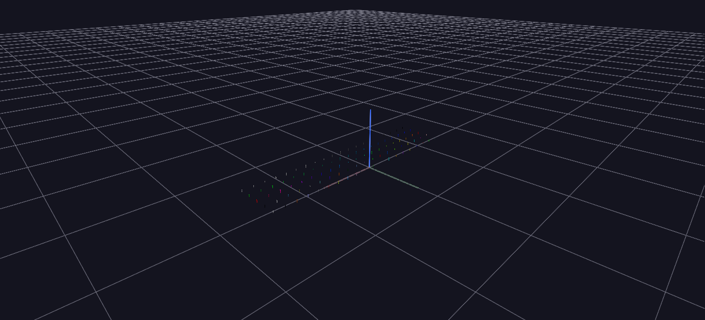

# Color Palettes

GlyphViz's 26 built-in color palettes and the `color_index` field, laid out for browsing — and pre-wired for interactive recoloring with the **=** / **−** and **Alt+=** / **Alt+−** keys.

**Try it:** [download the examples set](../getting-started/installation.md#example-scenes), then open `Palette_Example/Palette_Example_gv_node.csv` — or just drag its folder onto the GlyphViz window.

---

*A full write-up of this example is coming soon.*
