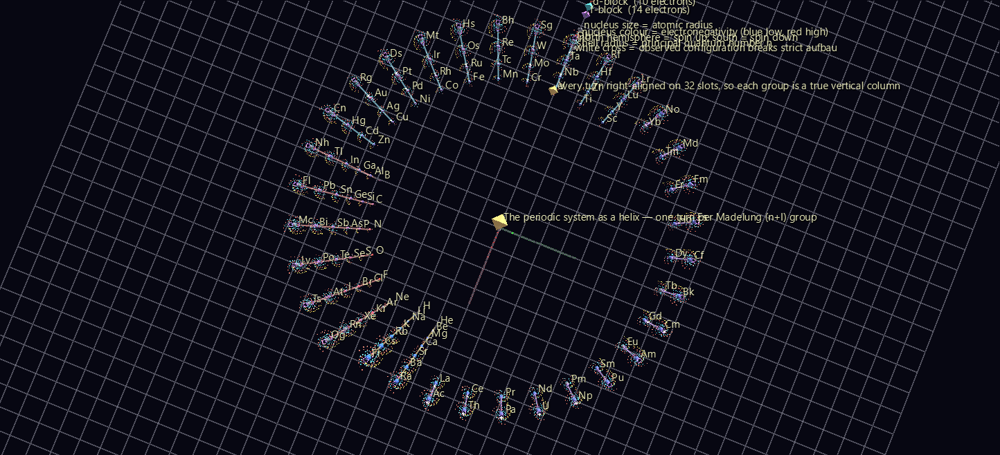

# The Periodic System

The periodic table is a spreadsheet with a ragged left edge and two rows exiled to a footnote. That shape is a printing compromise, not the physics.

This builds the same information as a **helix of nested atoms**: 118 elements on a Spiral topology, each one a hyperglyph carrying its real electron configuration — 7,021 individual electron glyphs on concentric shells. Periodicity stops being a caption and becomes geometry.



*Down the axis. Every radial spoke is a group — one column of the periodic table, seen end-on.*

**Try it:** [download the examples set](../getting-started/installation.md#example-scenes), then open `Periodic_System_Example/Madelung_Helix/PeriodicHelix_gv_node.csv` — or drag its folder onto the window.

## Why a helix, and why *this* helix

Order the subshells the way nature fills them — by increasing n+l, and within equal n+l by increasing n — and they fall into groups of length **2, 2, 8, 8, 18, 18, 32, 32**. The important part is that every group is a *suffix* of the longest one:

```
n+l=1   [s]                2      1s
n+l=2   [s]                2      2s
n+l=3   [p][s]             8      2p 3s
n+l=4   [p][s]             8      3p 4s
n+l=5   [d][p][s]         18      3d 4p 5s
n+l=6   [d][p][s]         18      4d 5p 6s
n+l=7   [f][d][p][s]      32      4f 5d 6p 7s
n+l=8   [f][d][p][s]      32      5f 6d 7p 8s
```

So if each turn of the helix is one n+l group, and every turn is **right-aligned** onto a common 32-slot angular grid, all eight turns line up. **Groups become exact vertical columns** — not by construction, but because the filling rule is nested. (The verifier measures the worst horizontal spread across a group at 3.1×10⁻¹³ world units.)

This is the Janet "left-step" arrangement, wound up. Two consequences are worth looking at rather than arguing about:

- **Helium lands above beryllium**, not above neon, because helium's valence structure is s². The left-step table's most contested claim, here a *position* rather than an opinion.
- **The f-block stops being a footnote.** It's simply the first fourteen slots of the two longest turns, in the same column system as everything else.

A third thing falls out for free: the helix stops **two slots short** at the top. The eighth n+l group runs to Z=120, so the two empty slots are elements 119 and 120 — undiscovered.

## Layout is idealised; the atoms are real

Elements are **placed** by the idealised Madelung rule but **drawn** from their observed configuration, parsed from PubChem, anomalies included. So the **19 elements that break the rule** visibly differ from the column they're standing in, each marked with a white cross: Cr, Cu, Nb, Mo, Ru, Rh, Pd, Ag, La, Ce, Gd, Pt, Au, Ac, Th, Pa, U, Np, Cm. Nothing reconciles the two. The disagreement is the content.

## The hyperglyph

Every visual channel carries one quantum number:

| Channel | Meaning |
|---|---|
| shell radius | **principal quantum number n** — the old K, L, M, N shells |
| latitude band | **orbital type l** — s near the equator, then p, d, f toward the poles |
| longitude | **which of the 2l+1 orbitals**, evenly spaced |
| hemisphere | **spin** — north up, south down |
| nucleus size | atomic radius |
| nucleus colour | electronegativity (blue low → red high; grey where none is published) |

Electrons fill by Hund's first rule, so **a half-filled subshell is a bare northern hemisphere**. Look at chromium, manganese or gadolinium: the asymmetry between north and south *is* the atom's unpaired-electron count, and therefore its magnetism. The verifier reads exactly that back off the geometry — for gadolinium, 36 − 28 = 8 unpaired, as expected.

## The two scenes

**`Madelung_Helix/`** — 7,258 nodes, static. All 118 elements, 7,021 electron glyphs, and 86 links joining each element to the one directly above it in its group. From the side those links are literal vertical columns; from above they're radial spokes. Good viewpoints: **straight down the axis** for the periodicity, **level with the equator** for the columns, **close in on any atom** for the shells. **T** toggles labels; **U** on a selected element opens its PubChem page.

**`Aufbau_Sequence/`** — 158 frames. The same helix built one element at a time in atomic order. Press **Space** and the system assembles itself: shells fill, the 4s slot takes an electron before 3d does, the f-block appears out of nowhere at lanthanum, and the anomaly crosses pop as each rule-breaker arrives.

## Data

**PubChem Periodic Table of Elements** (public domain, NCBI/NLM), vendored as a 15 KB CSV — the whole dataset. Coverage gaps are all at the bottom of the table: electronegativity for 95 of 118, atomic radius for 99. Missing radii fall back to the element directly above in the same column, a group trend and the least-invented substitute available; missing electronegativity renders grey rather than being guessed at. Configurations for elements 104+ are PubChem's *predicted* values — those atoms have never been observed long enough to measure.
