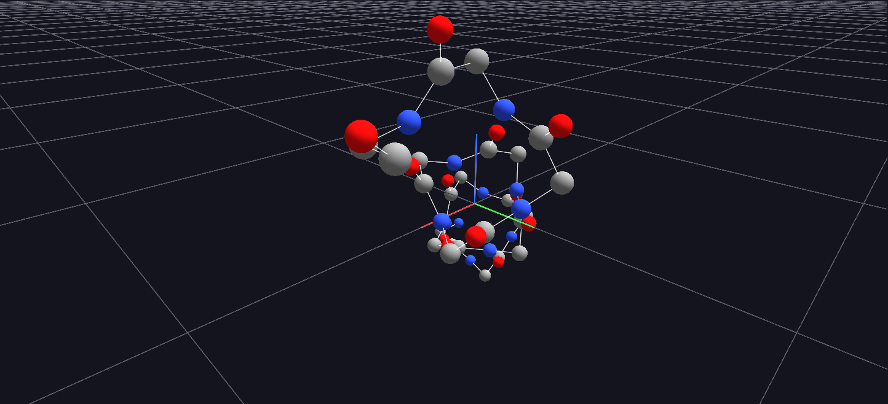

# Protein Import (PDB)

GlyphViz's PDB import path: a synthetic ideal α-helix backbone, built from first principles with textbook bond geometry, imported directly as a molecular scene.

**Try it:** download this example below (or [the full examples set](../getting-started/installation.md#example-scenes)), then use **File → Import PDB File…** to open `Protein_Import_Example/alpha_helix_example.pdb` — or drag the file onto the GlyphViz window.

[:material-download: Download this example (3 KB)](https://iluvdata.org/glyphviz/zips/Protein_Import_Example.zip){ .md-button }

---

*A full write-up of this example is coming soon.*
