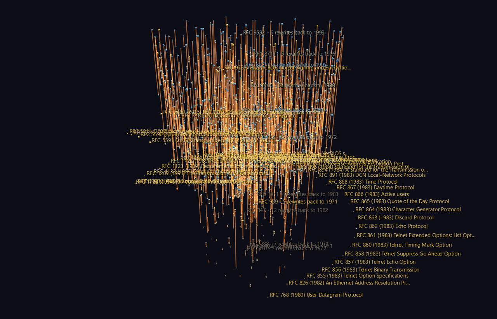

# RFC Genealogy

Every agreement the internet runs on is a numbered document, and the RFC Editor keeps all 9,819 of them in a single index that records, for each one, what it replaced and what replaced it. That makes the series something rarer than an archive: a **dated genealogy**, from RFC 1 in April 1969 to this year, of how a working infrastructure was argued into existence and then maintained.

Two relations live in that index and they are not the same thing. **Obsoletes** means A replaced B outright and B is dead. **Updates** means A amended B and you now have to read both. Only the first is descent.



**Try it:** download this example below (or [the full examples set](../getting-started/installation.md#example-scenes)), then open `RFC_Genealogy_Example/Standards_Lineage/StandardsLineage_gv_node.csv` — or drag its folder onto the window.

[:material-download: Standards_Lineage (131 KB)](https://iluvdata.org/glyphviz/zips/RFC_Genealogy_Example_Standards_Lineage.zip){ .md-button }
[:material-download: RFC_Spiral (445 KB)](https://iluvdata.org/glyphviz/zips/RFC_Genealogy_Example_RFC_Spiral.zip){ .md-button }

## The two scenes

**`Standards_Lineage/`** — the obsoletes relation followed *backwards* from every document still in force. Each lineage is a hyperglyph whose height is real time and whose depth is the number of times that specification has been rewritten. The canopy at the top is what is current; the orange spines hang down into the past, as deep as each document's ancestry goes. Out around the edge, connected to nothing and standing at the years they were published, are the **44 full Internet Standards that were never revised at all**.

**`RFC_Spiral/`** — all 9,819 documents on a helix, one turn per calendar year, each at its publication month and coloured by the status it holds today. A core sample: sparse turns at the bottom for the ARPANET, thick ones in the middle for the 2000s standards boom. Fly into it and the turns resolve into strings of beads.


Every glyph carries a `link` to `rfc-editor.org`, so **U** on a selected node opens the document itself.

## What the data says

**Most specifications are rewritten once and then left alone.** Of 871 lineages, 648 — 74% — are exactly one generation deep. The median replaced document had stood for **4.2 years**.

**The most-rewritten documents in the entire series are the bookkeeping.** The deepest lineage, by a long way, is RFC 7100 at **32 generations** — the "Internet Official Protocol Standards" summary, re-issued and re-issued until 2013, when the IETF gave up and retired the document instead of publishing a 33rd edition. Second deepest, at 22, is the *Assigned Numbers* list, which stopped being a document in 2002 and became a database. No protocol comes close: the deepest protocol lineages sit at five — FTP, SMTP, DHCP options, and the IPsec algorithm requirements, which churn because cryptography does.

**TCP took 41 years to be rewritten.** RFC 793 was published in September 1981 and stood untouched as *the* specification until RFC 9293 replaced it in August 2022. In the tower it is a single link falling almost the full height of the scene.

**Forty-four full Internet Standards were got right the first time** — no ancestry, no heir. The oldest is **RFC 20, the ASCII specification, from 1969**, 57 years in force. Thirteen of them were published in a single month, May 1983, the block that fixed the Telnet options and the small services, which is why they form one contiguous arc of the ring.

IP and ICMP are deliberately *not* in that group, and the difference is instructive: RFC 791 obsoletes RFC 760 and RFC 792 obsoletes RFC 777, so each is a one-generation lineage rather than a standing stone. They were rewritten exactly once, in 1981, and have carried every packet since.

## Structure

```text
Standards_Lineage
field anchor
├─ lineage anchor            one per lineage, at its phyllotaxis slot
│  └─ hub[root RFC]          invisible frame, always scale 1
│     ├─ body                sphere, size = pages, colour = current status
│     ├─ hub[predecessor]    translate_z = years back to it
│     │  └─ ...              recursing as deep as the ancestry goes
│     └─ descent link        hub -> hub
└─ standing stone ×44        icosahedron on the outer ring, at its own year

RFC_Spiral
spiral (topo = Spiral)
├─ year tick ×59             on the January meridian
├─ RFC ×9,819                one turn per year, azimuth = month
└─ link ×3,693               obsoletes (drawn) and updates (hidden)
```

Two things this example demonstrates that generalize:

**Nesting 32 deep costs nothing if every frame is scale 1.** A lineage descends hub → hub, and the hubs are hidden, unit-scale placement frames; the visible sphere is a leaf hanging off each hub. Sizing the *hub* by page count instead would have compounded that factor 32 times over and collapsed the deep lineages into a speck.

**One turn per calendar year makes a helix readable.** Spiral places a child at `((B+tz)·cos tx, (B+tz)·sin tx, (tx/360)·B + ty)` with `B` = `base_scale` = 1, so `tz` carries the radius and `ty` corrects the pitch. `tx` counts straight past 360, which is exactly what a multi-turn helix wants — and because a turn is a year, January always faces the same way, so a radial slice of the tower is a season.

## Honest caveats

The obsoletes graph is a DAG, not a forest: 109 RFCs were obsoleted by more than one successor (RFC 2616, the old HTTP/1.1, was split across six documents), so 138 documents appear in more than one lineage and each occurrence is drawn rather than hidden. Dates are month-precision — the index has no day field. And the **updates links ship hidden**: 3,693 straight chords across a 59-turn helix is a haze that swallows the documents it is supposed to connect, so the 1,542 obsoletes links are drawn and the 2,151 updates links appear the moment you tick **Display > Show Hidden Nodes**. That is a legibility decision, and it undoes in one click.

## Data

[**RFC Editor**](https://www.rfc-editor.org/rfc-index.xml), retrieved 2026-08-06. The whole series ships as one 14 MB XML file; the example vendors a 0.29 MB distilled CSV, so everything but the initial fetch works offline. RFC metadata is freely redistributable under the IETF Trust's terms.
