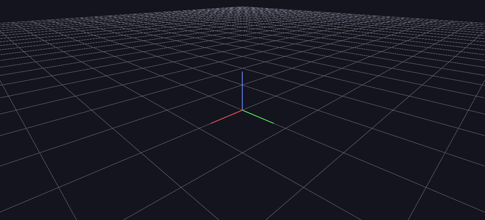

# Rotation Conventions

A side-by-side demonstration of the two `rotation_mode` values: ANTz's legacy Heading/Tilt/Roll (a Z-X-Z sequence) versus GlyphViz's per-axis Euler XYZ. Identical rotation inputs trace visibly different paths — a level circle under one convention, a wobbling one under the other.

**Try it:** [download the examples set](../getting-started/installation.md#example-scenes), then open `Rotation_Convention_Example/Rotation_Convention_Example_gv_node.csv` — or just drag its folder onto the GlyphViz window. Press **Space** to start the animation.

---

*A full write-up of this example is coming soon.*
