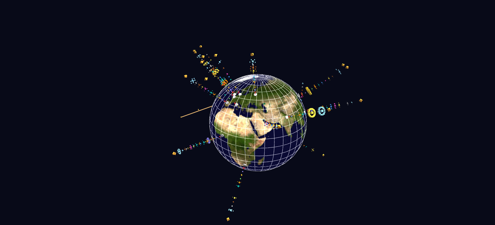

# RSS News Globe

A GlyphViz take on GaiaViz's RSS Viz concept: about twenty international news feeds in eight languages, concept mentions counted per outlet with a multilingual term dictionary and rendered as color-coded concept towers rising from a Blue Marble globe.

**Try it:** download this example below (or [the full examples set](../getting-started/installation.md#example-scenes)), then open `RSS_News_Example/rss_news_gv_node.csv` — or just drag its folder onto the GlyphViz window. Press **Space** to start the animation.

[:material-download: Download this example (3 MB)](https://iluvdata.org/glyphviz/zips/RSS_News_Example.zip){ .md-button }

---

*A full write-up of this example is coming soon.*
