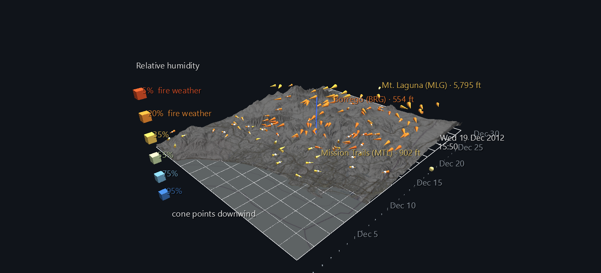

# Santa Ana Wind, December 2012

A Santa Ana is San Diego's fire wind. Air from the high desert pours west over the mountains, warming and drying as it descends, and in a few hours the whole county goes from ocean-damp to bone dry. This scene shows one happening: 130 weather stations across San Diego County, reporting every ten minutes for the whole of December 2012, each drawn as a cone pointing the way the wind is blowing, over the county's real terrain.

It belongs to the **San Diego River Watershed Atlas**, and it began as a restoration. The data comes from an HPWREN/SDG&E weather-station archive collected between 2012 and 2017, and a version of this animation was first built in ANTz. This scene is rebuilt from the raw archive, which put the stations at their true elevations over real terrain.



**Try it:** download this example below (or [the full examples set](../getting-started/installation.md#example-scenes)), then open `Santa_Ana_Wind_Example/santa_ana_wind_gv_node.csv`, or drag its folder onto the window. Press **Space** to play the month.

[:material-download: Download this example (9 MB)](https://iluvdata.org/glyphviz/zips/Santa_Ana_Wind_Example.zip){ .md-button }

## The month has two opposite weeks in it

That's why this month was chosen, and why it's worth pressing play rather than looking at the still.

| | Dec 13–18 | Dec 19–21 |
|---|---|---|
| Wind | onshore, off the Pacific | **offshore, out of the desert** |
| Stations pointing toward the sea | 9–34% | **64–67%** |
| Stations below 25% relative humidity | 0% | **30% → 61%** |
| Strongest gust | 65 mph | 50 mph |
| Colour of the scene | blue | **red** |

Over about twelve hours on 19 December, the entire wind field swings around and the colour collapses from blue to red. A single weather chart can't show 130 stations doing that at once across real terrain.

## How to read it

Each cone is one weather station.

| What you see | What it means |
|---|---|
| **The direction a cone points** | where the air is *going* (downwind) |
| **Cone size** | sustained wind speed, from calm up to 40 mph |
| **White bead at the cone's base** | gust factor (gust ÷ sustained speed): how rough the air is |
| **Colour** | relative humidity, from dry and hot (red) to moist and cool (blue) |
| **Height above the terrain** | the station's elevation, exaggerated 15× |

**Every cone has the same shape**, three times as long as it is wide, and only its size changes with wind speed. A 2 mph breeze points as clearly as a 40 mph gust, so the direction of the whole field stays readable.

**Colour shows humidity, not speed,** on purpose. Speed is already the cone's size. What makes a Santa Ana dangerous, and what links this scene to the fire scenes later in the Atlas, is how dry the air is. The terrain map is mostly greyed out so it doesn't compete with that colour.

**The bar south of the map is the month**, with a tick per day. The yellow bead moving along it is the current moment, and it carries a running clock: date above, time of day below.

**Before you press play, the scene shows the peak of the Santa Ana.** The generator scored every ten-minute frame in the month by how many stations were blowing offshore *and* how dry they were, and saved the top-scoring frame as the scene's starting state: **19 December 2012, 15:50**, when 74% of stations were blowing offshore and 79% were below 25% humidity. Press play to watch the month build up to that moment and then leave it.

Click any station for its name, abbreviation and elevation. Four stay labelled so you can orient yourself: Solana Beach on the coast, Mission Trails in the San Diego River watershed, Mt. Laguna in the mountains, and Borrego in the desert.

## Two vertical exaggerations

The terrain is real elevation data with the map draped over it, and it's drawn at **6× vertical exaggeration while the stations sit at 15×**. A single exaggeration doesn't work. At 15× the mountains turn into spikes that swallow the wind field, and the mountain stations, the most interesting ones in a Santa Ana, disappear into the peaks they sit on. At 6× the landscape still reads, and the wind stays above it.

That still isn't enough near the coast, where a station and the ground under it are both close to sea level, so every station is also lifted by the same fixed amount. It's one constant for all 130 stations, so their heights relative to each other are unchanged. The generator works out that lift from the actual terrain rather than guessing: **no station sits at or below the terrain.**

## Checked, not assumed

- **The cones point where the wind blows.** Checked across all 130 stations at three different moments against an independent re-read of the archive: the largest direction error is **0.0000°**.
- **Station heights are exact.** Mt. Laguna (5,795 ft) sits exactly 15× its true height difference above Rancho Santa Fe (263 ft).
- **The stations line up with the map.** A cone's position and the terrain beneath it agree to 0.000000 world units.
- **The clock is right.** At twelve sample moments across the month, exactly one date and one time label is showing, and both match the real timestamp.

## Structure

```text
World row                          background, tag style
World Grid                         the county's lon/lat frame
├─ station cone ×130               animated: direction, size, colour
└─ gust bead ×130                  animated: size
Terrain (Surface topology)         the county's relief, textured with the map
└─ vertex ×11,400
Timeline tick ×32                  one per day (the first scrape is stamped 30 Nov)
"Now" bead                         animated along the timeline
├─ date label ×32                  one shows per frame
└─ time label ×144                 one per ten-minute slot of the day
Legend                             the humidity ramp
```

The whole month is **4,428 frames and 1,087 animation tracks**. The running clock uses a trick worth borrowing: GlyphViz can animate whether a label is *showing* but not what it *says*. So the clock is a set of pre-written labels, one per date and one per ten-minute time slot, and exactly one of each is switched on at any moment. That takes 176 tracks instead of one label per frame (4,428).

## Data

The source is a personal archive of the **HPWREN / SDG&E weather-station network**, one file per ten-minute scrape, read at build time; only the derived scene files are distributed. Terrain imagery is © OpenStreetMap contributors, SRTM, © OpenTopoMap (CC-BY-SA); elevation is USGS 3DEP via AWS Terrain Tiles.

**Limits, stated plainly:** a dead sensor stuck on one reading looks like calm air, and December 2012 wasn't audited for that. A station missing from a scrape keeps its previous reading rather than disappearing, so a gap looks like steady conditions.
