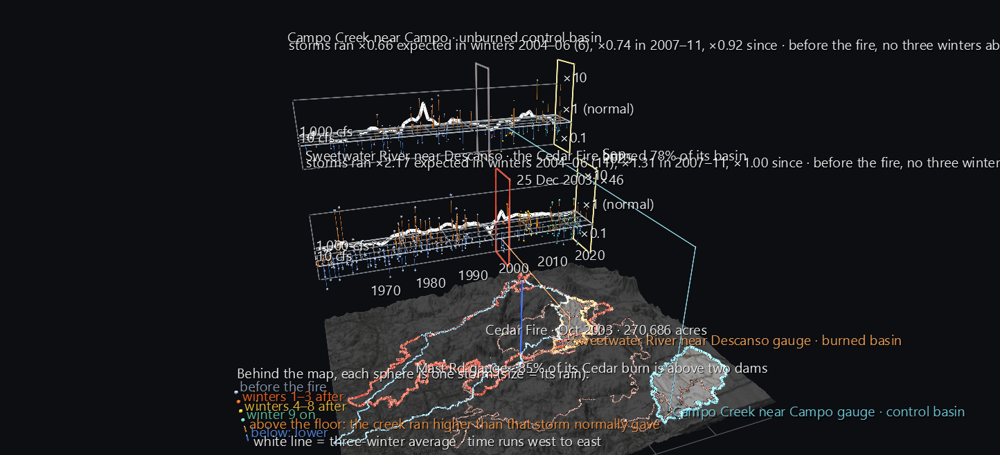

# After the Cedar Fire: Does the Same Rain Make a Bigger River?

When a wildfire strips a mountainside, what happens the next time it rains? Hydrologists expect burned slopes to shed water faster, because there's no vegetation or leaf litter left to slow it and the soil can turn water-repellent. This scene tests that expectation against the public record. Every storm since 1960 on two mountain creeks is measured against what that same storm would normally have produced before the October 2003 **Cedar Fire**. One creek's basin burned. The other's didn't.

It answers the headline question of the **San Diego River Watershed Atlas**, and it follows [The Storm Winter, 2004–05](sd-river-storm-2005.md), which showed the first big winter on the burn scar.



**Try it:** download this example below (or [the full examples set](../getting-started/installation.md#example-scenes)), then open `San_Diego_Cedar_Fire_Runoff_Example/sd_cedar_runoff_gv_node.csv`, or drag its folder onto the window. Press **Space** to play: the record runs month by month from October 1960, and storms appear in the month they fell. **Set the FPS slider to about 12**: the fire arrives about 43 seconds in.

[:material-download: Download this example (5 MB)](https://iluvdata.org/glyphviz/zips/San_Diego_Cedar_Fire_Runoff_Example.zip){ .md-button }

## Why not the Atlas's own river?

The obvious place to look is the San Diego River at Mast Road, the gauge at the heart of the Atlas, which has recorded the river every day since 1912. The Cedar Fire burned **80%** of the land that drains to it.

But **85% of that burned land lies above El Capitan and San Vicente dams**: 60% above El Capitan and 25% above San Vicente. Whatever the burn scar did to the runoff, those reservoirs caught it before it reached the gauge. And no stream gauge above either dam has a record that spans 2003. The map shows this: the Cedar perimeter covers the upper watershed, and the river's own gauge sits downstream of both reservoirs. The measurement comes from USGS basin boundaries and the fire perimeter. As a check, the two dam basins come out at 190 and 74 square miles, which match their published figures.

So the scene looks next door, at two mountain creeks with no dam above their gauges:

| | The burned basin | The control |
|---|---|---|
| **Stream gauge** | Sweetwater River near Descanso, in Cuyamaca Rancho State Park (45 sq mi; daily since 1905) | Campo Creek near Campo, 26 km to the south-east (85 sq mi; daily since 1936) |
| **Rain gauge** | Cuyamaca | Campo |
| **Cedar Fire** | burned **78%** of the basin | didn't reach it |
| **Other fires** | Conejos (1950) burned 45%, ten winters before this scene's record begins. Laguna (1970) burned 5%. | No fire since 1960 burned more than 16% (Donovan, 1968). |

## Reading the scene

**The map.** Both basins are lit on the terrain: Sweetwater's outline in orange, Campo's in cyan. The Cedar Fire's perimeter is bright red, and every other fire that burned at least a twentieth of either basin is drawn faintly. The pale blue line is the San Diego River watershed. The Mast Road gauge and the two dams are marked; click one to see its share of the burn.

**The storm slabs.** Behind the map stand two slabs, one for each creek: Sweetwater in front, and Campo behind and higher. A thin line runs up from each creek's gauge to its slab. On each slab:

- **West to east is time**, October 1960 to September 2025, across the width of the map.
- **Each sphere is one storm.** Its size is how much rain fell.
- **Front to back is how big a storm it was**, as the peak flow the creek would normally give for it, from about 1 cubic foot per second at the front edge to over 1,000 at the back.
- **Height is what actually happened.** The flat floor is "normal": the creek ran exactly as expected. A storm whose creek ran higher stands up out of the floor on an **orange** stem, and one that ran lower hangs below it on a **blue** stem. The scale is logarithmic, so ×10 stands as far above the floor as ×0.1 hangs below.
- **The white line** is the average over three winters at a time, so a run of high storms lifts it above the floor.
- **A wall** marks 25 October 2003, when the fire started: red on the burned slab, grey on the control.
- **Sphere colour** marks the period: grey before the fire, red-orange for the first three winters after, yellow for winters four to eight, and green from the ninth winter on.

**Click any storm** to see its date, its rain, how wet the ground already was, the flow in the creek beforehand, the peak it reached against the peak expected, and the ratio between the two.


## What "expected" means

To ask whether a storm ran high, you first need to know what it *would* have done. That depends on more than how much rain fell: rain on dry ground in October soaks in, while the same rain on soaked ground in February runs straight off. So the scene learns the creek's normal behaviour from its own history.

**Every storm is found in the daily records.** A storm starts on a day with at least half an inch of rain when three days together bring at least an inch and a half, and it lasts while the rain keeps up at a fifth of an inch a day or more. For each storm, the scene takes four measurements:

- **the rain**, the storm's total
- **how wet the ground already was**, from the rain in the 60 days before
- **how much water was already in the creek**, from the lowest flow in the three days before
- **the peak**, the highest daily flow during the storm and the day after

**The normal is learned from the storms before the fire**, October 1960 to 24 October 2003: 286 storms at Sweetwater and 90 at Campo. A regression finds how the peak depends on the other three measurements. A storm's **expected** peak is what that relationship predicts for it, and its **multiplier** is what it actually did divided by what was expected. Averages over a period are geometric means of those multipliers, the right kind of average for ratios. Before the fire, the multipliers average ×1 by construction; the question is what happens after.

## What the record shows

**At Sweetwater, the burned basin:**

| | Storms | On average, the creek ran |
|---|---|---|
| The first three winters after the fire, 2004–06 | 11 | **×2.17 expected** |
| Winters four to eight, 2007–11 | 28 | ×1.31 |
| From the ninth winter, 2012–25 | 86 | **×1.00**, back to normal |

- **Nothing like it had happened before.** Across 41 three-winter stretches from 1961 to 2003, the highest average was ×1.48.
- **The effect faded over about eight winters,** and by 2012 the creek was running exactly as it had before the fire.
- **At Campo, the control, the same periods ran ×0.66, ×0.74 and ×0.92.** Campo was at or below its own normal while Sweetwater ran high, so the jump isn't explained by a regional run of unusual storms.

**The first storm on the bare ground was the most extreme in 65 years.** On Christmas Day 2003, two months after the fire, 2.8 inches of rain fell at Cuyamaca. On ground that dry, the creek's history says that storm should have raised it to about 1 cubic foot per second. It reached **88**, about **46 times** what was expected. No storm before or since comes close. On the slab it's the tall red-orange stem standing just past the fire wall.


## How sure is this?

A result built on 11 storms needs checking from several directions:

- **It isn't just the Christmas storm.** Remove the single largest storm from every three-winter stretch, before and after the fire alike. The first post-fire winters still average ×1.60, and the highest pre-fire stretch is ×1.29.
- **The smaller storms were hit hardest.** After the fire, storms expected to raise the creek to under 20 cubic feet per second ran ×3.2 on average, and bigger storms ×1.6. Before the fire, both groups ran about ×1. The very large storms of January and February 2005 came in close to expected: 689 cfs against 611 expected on 7 January. That's the pattern you'd expect from burned slopes. A small storm that bare ground turns into a flash of runoff would otherwise have soaked in, while a very large storm floods the creek either way. The slab's front-to-back axis shows it: the tall post-fire stems stand toward the front, among the smaller storms.
- **The timing of the rain was set by the record, not by the result.** A volunteer rain gauge's "day" ends when the observer reads it. Cuyamaca's is read at 8 in the morning, so most of each day's total really fell the day before, and the scene shifts it back a day. Campo's is read at 5 in the afternoon, so its totals stay on their own day. Those reading times come from each station's records. If Cuyamaca's rain isn't shifted, the Christmas storm's rain lands after its own flood. Even so, the first post-fire winters still average ×1.66 against a pre-fire high of ×1.40.

**What it doesn't show.** It doesn't show how much sediment and debris came down, what happened below the dams, or that the fire caused any single storm's peak. Daily average flows also understate short, sharp floods, probably the post-fire ones most. It's a careful before-and-after with a control, on a small number of storms, and the page and the example's README say so.

## Structure

```text
World Grid                         the map's lon/lat frame (wire)
Terrain (Surface, 300 columns)     USGS elevation, 4× relief, basemap brightened inside the two basins
Basin outlines ×3                  (Plot) Sweetwater, Campo, the San Diego River watershed
Fire perimeters                    (Plot) Cedar, plus every fire that burned ≥5% of either basin since 1950
Gauges, rain stations, dams        pins and markers, on the grid
Storm slab ×2                      floor, flow gridlines, ×10 / ×0.1 references, the fire wall (Plot)
├ Storm ×565                       spheres; hide bound to the month the storm fell
├ Stem ×562                        cylinders from the floor to the storm; same channel
├ Three-winter average             (Plot)
└ Now frame                        translate bound along the time axis
Readout                            month and year labels riding a bead, one of each shown
```

The scene is 81,840 nodes, with 368 animated tracks over 780 monthly frames. Playback takes about 10 ms a frame.

## Data

| What | Source |
|---|---|
| Daily streamflow | USGS National Water Information System: Sweetwater River near Descanso (11015000), Campo Creek near Campo (11012500), San Diego River at Mast Road (11022480) |
| Basin boundaries | USGS Hydro Network-Linked Data Index: the three gauges, and El Capitan and San Vicente dams |
| Daily rain and each gauge's reading time | NOAA GHCN-Daily via the Applied Climate Information System: Cuyamaca and Campo |
| Fire perimeters | CAL FIRE FRAP historic fire perimeters |
| Watershed divide | USGS Watershed Boundary Dataset |
| Terrain | USGS 3DEP elevation, via AWS Terrain Tiles |
| Basemap | © OpenStreetMap contributors, SRTM, © OpenTopoMap (CC-BY-SA) |

The generator is `build_cedar_runoff_scene.py`. It solves both regressions a second way as a check, prints the result under the other rain-timing choice, and loads its own output back through GlyphViz's loaders and Channels engine to check:

- every storm's position and every stem's two ends
- the map markers' positions
- which storms are visible, the now frame and the readout, at frames across the record, including the months around the fire
