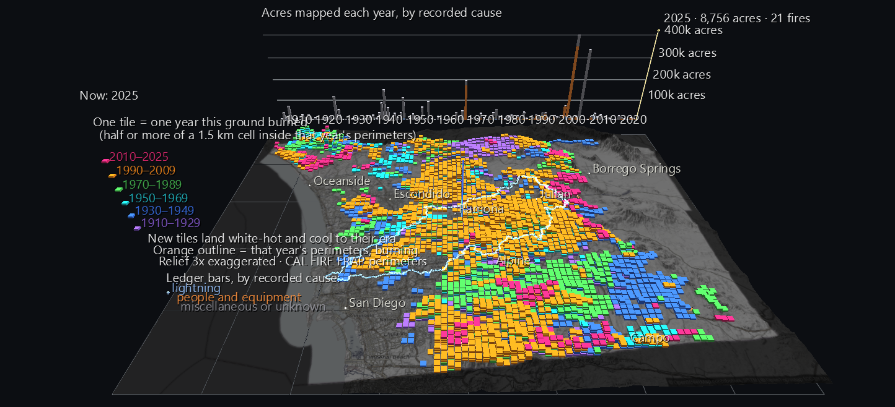
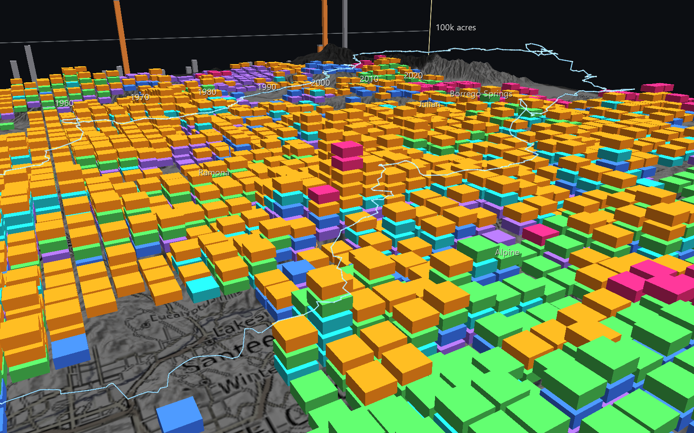
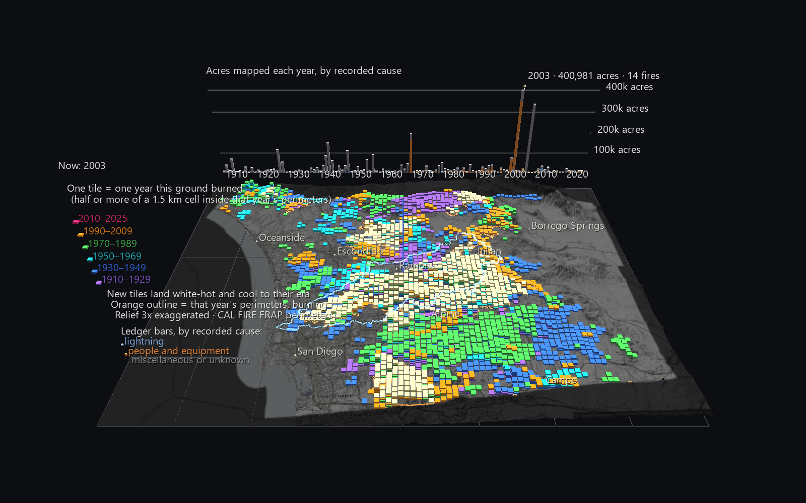

# The Burn Record: San Diego County Wildfires, 1910–2025

Every wildfire CAL FIRE has mapped in San Diego County since 1910 (1,640 fire perimeters) laid down on the county's terrain as **layers**. Each year a patch of ground burns, it gains a tile. Ground that burns again and again rises into a tall striped stack. Ground with no mapped fire stays bare. Nothing is ever taken away, so the finished scene is the county's whole fire history at once, readable without playing anything.

It's part of the **San Diego River Watershed Atlas**, widened from the river's own basin to the whole county, and it was made with the people who work on wildfire in mind: UCSD's [WIFIRE](https://wifire.ucsd.edu/) lab and the [HPWREN](https://hpwren.ucsd.edu/) network.



**Try it:** download this example below (or [the full examples set](../getting-started/installation.md#example-scenes)), then open `sd_fire_history_gv_node.csv`. In the full examples set, drag `San_Diego_Fire_History_Example/Burn_Record.zip` onto the GlyphViz window instead; it extracts beside itself and loads. It's a large scene (about 140,000 nodes) and takes a couple of seconds to load. Press **Space** to play the century, and **set the FPS slider to 8–12** to watch the years arrive one at a time.

[:material-download: Download this example (6 MB)](https://iluvdata.org/glyphviz/zips/San_Diego_Fire_History_Example_Burn_Record.zip){ .md-button }

## Why layers

Fire maps usually show one of two things. A map of perimeters shows *where* fires burned, but the outlines of a century pile on top of one another until nothing can be read. A map of "times burned" shows *how often*, but loses *when*. Neither shows what fire managers and ecologists care about most: how often the same ground comes back, how long it rests in between, and whether that's changing.

A stack of tiles holds all three. Its height is how many times the ground has burned. Its stripes, read from the bottom up, are when. The gaps between them are how long the ground rested. And because the stacks stand on the real terrain, you can see which ridges, valleys and communities keep burning.

## Reading the scene

**The squares.** The county is divided into 5,193 squares, each 1.5 km (just under a mile) on a side. A square counts as burned in a year when at least half of it lies inside that year's fire perimeters. Every burn adds one tile to that square's stack.

**The colours are eras.** Each tile is coloured by the twenty-year era of its fire:

| Era | Colour |
|---|---|
| 1910–1929 | violet |
| 1930–1949 | blue |
| 1950–1969 | teal |
| 1970–1989 | green |
| 1990–2009 | orange |
| 2010–2025 | magenta |

Looking down, you see each square's *most recent* fire, so the map reads as a picture of how long ago each part of the county last burned. Drop the camera low over the stacks to read the layers underneath.



**Playback.** The century plays at four frames a year:

- A year's new tiles land **white-hot**, cool through orange over the following year, and settle into their era colour.
- The year's fire perimeters **burn on the ground as orange outlines** for a year and a half, then go out.
- The year is shown at the head of the legend, over the Pacific.

**The ledger.** Behind the county's north edge stands a bar for every year, 1910 to 2025, showing the acres mapped that year. Each bar is split by the cause CAL FIRE recorded: blue for lightning, orange for people and equipment, grey for miscellaneous or unknown. A cursor rides along the bars with the playback, labelled with that year's acres and number of fires.

**The pale blue line** is the divide of the San Diego River watershed, the home basin of the rest of the Atlas. It floats above the tiles so it stays visible over the most-burned ground.

**Click anything.** A tile tells you its fire's name, year, mapped acres and cause, and every year that square has burned. An outline, while it burns, gives the fire's alarm date and the CAL FIRE unit that recorded it.

## What the record shows

- **Half the county has burned at least once since 1910.** Of the 5,193 squares inside the county line, 2,636 (51%) have at least one tile. 1,243 have burned once, 766 twice, 405 three times, 160 four times, 44 five times, 16 six times and 2 seven times.
- **The most-burned ground is in the Atlas's own watershed.** A square beside El Capitan Reservoir, above Lakeside, burned seven times: in 1929, 1956, 1995 (El Monte), 2003 (Cedar), 2007 (Witch), 2010 and 2025. Its neighbours are close behind. The other seven-time square is at the county's north-west corner, on the ground of the Roblar fires.
- **Two years dominate the century.** 2003 (the Cedar, Paradise and Otay fires, among others) mapped 401,000 acres, and 2007 (Witch, Harris, Poomacha and others) mapped 337,000. Together they account for 23% of every acre mapped since 1910. The next largest years are 1970 (196,000 acres, most of it the Laguna Fire), 1944 and 1928. The two tall bars at the right end of the ledger are those two siege years.
- **Fire comes back.** Of the 728 squares burned in 2003, 178 had burned again by 2025, 171 of them only four years later, in 2007.
- **The recorded cause is mostly unhelpful.** 71% of mapped acres are coded miscellaneous or unknown, 26% people and equipment, and 3% lightning. The ledger shows the coding as it stands. A cause code isn't always the whole story: the Cedar Fire is coded as equipment use, though it's widely reported to have started from a lost hunter's signal fire, and the Witch Fire is coded miscellaneous.



## What the tiles mean, exactly

- **A burn.** Sixteen sample points are spread evenly across each square. The square burns in year Y when at least 8 of them lie inside **all of year Y's perimeters combined**, with any unburned islands inside a perimeter excluded. Combining the year's perimeters means a fire recorded twice, or two fires meeting, can't count twice. It also means a square gains at most one tile per calendar year.
- **Which fire.** A tile is credited to whichever of that year's fires covered the most of its sample points.
- **Which fires.** Every perimeter with any part inside the county is kept, including fires that cross into Riverside, Orange or Imperial County. Their outlines are drawn whole, and the ledger counts their full mapped acres.
- **A bare square means "no mapped fire", not "never burned".** The perimeter record is incomplete before about 1950, and it leaves out most small fires throughout. A fire smaller than about 300 acres can't cover half a square, so it leaves an outline during playback but no tile.

## Structure

```text
World Grid                        the county's lon/lat frame (wire)
Terrain (Surface, 300×231)        USGS elevation, 3× relief, a dark basemap draped over it
Tile ×4,960                       cubes stacked on the terrain; hide + colour bound to their YEAR's channel
Perimeter ×1,675 outline parts    (Plot) draped on the terrain; hide bound to their year's channel
Watershed divide                  (Plot) floated above the tiles
Place ×8                          Oceanside, Escondido, Ramona, Julian, Borrego Springs, Alpine, San Diego, Campo
Ledger                            a bar per year × cause, gridlines at 100,000 acres
Cursor                            translate bound along the ledger
└ Year readout ×116               one label shown per frame
Legend                            eras, causes, and the rules
```

The scene is 140,670 nodes, with 782 animated tracks over 464 frames. **Every tile of the same year shares one channel**, so the whole century animates from one channel per year rather than one per tile.

## A faster renderer, found by this scene

Before this scene, GlyphViz redrew every animated node one at a time on every frame, even while playback was paused. With nearly 7,000 animated nodes, the Burn Record took 60–80 ms to draw a frame. The renderer now spots animated nodes whose channel changes only their colour or visibility, never their position, and keeps them in a cached draw list per channel. A list is redrawn only on the frames where that channel's values actually change. The pictures are identical, checked pixel for pixel. On this scene, a frame now takes about **11 ms** while you fly around and **22 ms** while playing, and every Channels scene of this kind benefits.

## Data

| What | Source |
|---|---|
| Fire perimeters | CAL FIRE FRAP, *California Fire Perimeters (all)*: final perimeter shapes, year, alarm date, mapped acres, cause |
| County boundary | US Census Bureau TIGERweb |
| Watershed divide | USGS Watershed Boundary Dataset |
| Terrain | USGS 3DEP elevation, via AWS Terrain Tiles |
| Place names | USGS Geographic Names Information System |
| Basemap | © OpenStreetMap contributors, SRTM, © OpenTopoMap (CC-BY-SA) |

The generator is `build_fire_history_scene.py`. It loads its own output back through GlyphViz's loaders and Channels engine, and checks:

- every tile's position and stacking height, and that no tile sits below the terrain
- the burn rule itself, recounted a second, independent way on the 25 tallest stacks and 25 random squares (no mismatches)
- tile visibility and colour, outline visibility, the cursor and the readout, at frames across the century
