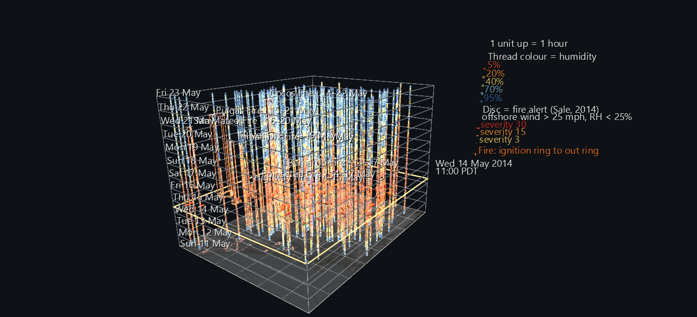
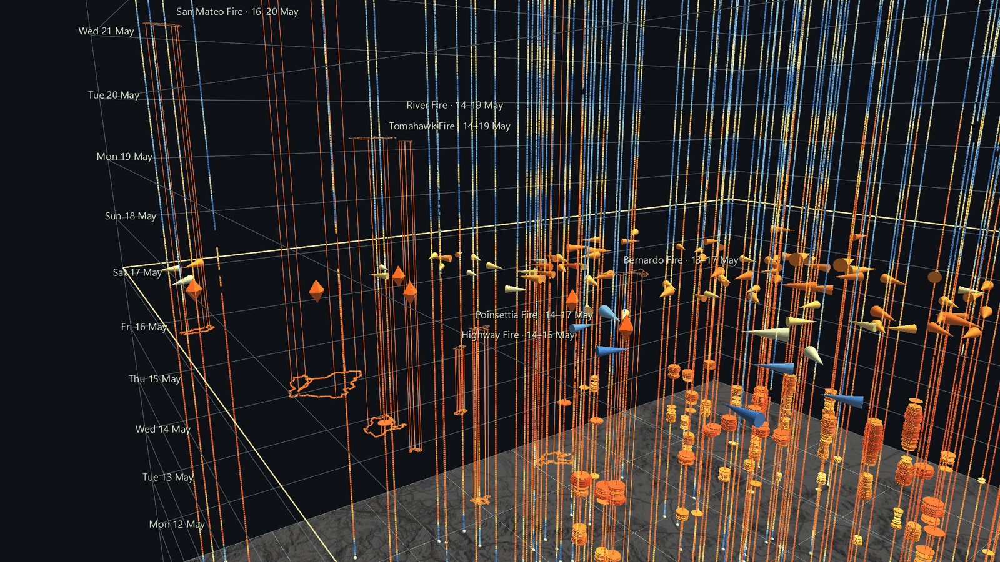

# The May 2014 Fire Siege

In May 2014, during a Santa Ana, eight fires broke out across northern San Diego County in the space of four days. This scene shows the twelve days around them as a **space-time cube**. The county map is the floor, and **time rises one unit per hour**, from midnight on 11 May at the floor to midnight on 23 May at the top. Every weather station, every fire alert, and every fire takes its real place and its real moment.

It's the third part of the **San Diego River Watershed Atlas**, and its first about fire. It's also a new take on Jeff Sale's own 2014 visualizations of this same weather-station network, using the fire-alert index he wrote for it then.



**Try it:** download this example below (or [the full examples set](../getting-started/installation.md#example-scenes)), then open `San_Diego_Fire_Siege_Example/sd_fire_siege_2014_gv_node.csv`, or drag its folder onto the window. Press **Space** to play: a plane sweeps up through the cube, carrying the wind.

[:material-download: Download this example (8 MB)](https://iluvdata.org/glyphviz/zips/San_Diego_Fire_Siege_Example.zip){ .md-button }

## Reading the cube

**Threads are weather stations.** Each of 128 stations is a vertical thread from the floor to the top of the cube. The thread is coloured hour by hour by relative humidity, from red (bone dry) to blue (humid). When the Santa Ana arrives, the whole county turns red at the same height, which is the same moment.

**Discs are fire alerts.** A station is in alert when three things are true at once:

- the sustained wind is over 25 mph
- the wind is blowing from between 10° and 110°, which is offshore
- humidity is under 25%

This is Jeff Sale's 2014 index, used unchanged. Each ten-minute alert is a disc on that station's thread, and its size is the severity: how far the wind is over 25 mph plus how far the humidity is under 25%. A run of alerts stacks into a spindle.

**Prisms are fires.** Each fire's mapped perimeter is drawn at the height where it ignited and again where it was declared out, with edges between. Its footprint is also traced on the floor map. The name and dates are at the top of each prism; click the lower ring for the full record.

**The plane is now.** During playback it rises through the cube. It carries every station's wind as a cone that points downwind, is sized by speed and coloured by humidity. A flame sits over each fire while it burns, and the date and time ride at the corner. The scene opens at 11:00 on 14 May, the ten minutes when the most stations were in alert.


## What the cube shows

These results come from the station records, taken at the three stations nearest each fire at the minute it ignited:

- **The Santa Ana is a single band.** The first alert came at 06:00 on Monday 12 May and the last at 10:20 on Thursday 15 May: 2,654 ten-minute alerts at 52 stations. At 11:00 on 14 May, 114 of the 126 stations reporting were below 10% humidity.
- **The alerts were in the mountains, but the fires were not.** The most alerts came from Crestwood, Volcan Mountain, Lucky Five Ranch and La Posta, in the eastern mountains, where offshore wind is strongest. Only 123 of the 2,654 alerts came from stations west of 117°W, the coastal third of the county, which is where every fire started.
- **At the fires, it was dry and hot, but the wind was mostly below the threshold.** Nearby humidity was 2–12% and temperatures were 82–101°F, but sustained winds were mostly under 25 mph. Of the 24 nearby readings, only two were in alert.
- **Two fires started after the alerts had stopped.** The Pulgas and San Mateo fires on Camp Pendleton ignited on Thursday afternoon and Friday morning. The wind nearby was light by then, but humidity was still 2–8%.

None of this explains why any fire started; the records give a cause for only one (equipment use, for the Bernardo Fire). What the cube does show is that a threshold based on wind drew the dangerous area in a different place, and over a different stretch of time, than the fires did.



## Getting the details right

- **The clock.** The weather archive stamps every reading in Pacific *Standard* Time all year round. This shows up at the March 2014 clock change, where the archive's file names skip an hour but the timestamps don't. So every reading is shifted one hour to match the local time of the fires.
- **Fire times come from two records.** The perimeter database has each fire's shape but only its date, and it dates the three Camp Pendleton fires wrongly. CAL FIRE's incident list has start and end times to the minute, so the scene takes the times from there. The two records also disagree on one name: the perimeter database's "COMBAT" is the fire the incident list calls San Mateo. Its location falls inside that perimeter, and both records say 1,457 acres.
- **Missing readings stay missing.** Alerts and humidity threads use only real observations. A wind cone holds its position through a single missed ten-minute reading rather than blinking off.
- **Perimeters are final.** A fire is drawn at its full final size from the moment it ignites, not as it spread.

## Structure

```text
World Grid                          the county map, the floor of the cube
Midnight ring ×13, corner edges ×4  (Plot) the cube's frame, one ring per day
Station ×128                        floor marker + humidity thread (Plot, one vertex per hour)
Fire-alert disc ×2,654              cylinders on the threads, radius = severity
Fire ×8                             perimeter at ignition, at out, and on the floor, + 6 edges (Plot)
Now plane (Plot)                    height bound to one track that every riding glyph shares
├ Wind cone ×128                    height, bearing, size, humidity colour, hide bound
├ Flame ×8                          height, hide bound (burning or not)
└ Readout                           12 day labels + 144 time labels, one of each shown
```

The scene is 42,070 nodes, with 1,063 animated tracks over 1,728 ten-minute frames. Playback takes about 15 ms a frame.

## Data

| What | Source |
|---|---|
| Weather | SDG&E weather-station network, recorded every ten minutes and archived by Jeff Sale. The example ships only the derived values for these twelve days, so it rebuilds without the archive. |
| Fire perimeters | CAL FIRE FRAP historic fire perimeters |
| Fire start and end times | CAL FIRE incident list |
| Basemap | © OpenStreetMap contributors, SRTM, © OpenTopoMap (CC-BY-SA) |

The generator is `build_fire_siege_scene.py`. It loads its own output back through GlyphViz's loaders and Channels engine, and checks it against the source data:

- station positions
- the time of every alert, against an independent recount
- fire ignition heights
- the plane's height, the cones' bearings and the readout, at frames across the twelve days
