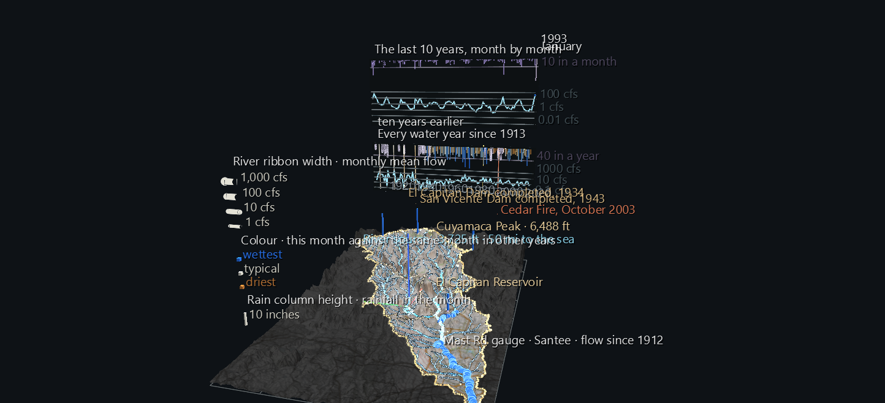

# The Pulse: A Century of the San Diego River

A river isn't a line on a map. It's a pulse: it swells every winter and shrinks every summer, and some years it barely runs at all. This scene plays that pulse **month by month since May 1912**, at the gauges that have been measuring it and the rain stations in the mountains above them.

It's the second scene of the **San Diego River Watershed Atlas**. It's built on [The Watershed, Source to Sea](sd-river-watershed.md), which it rebuilds unchanged underneath, and adds time.



**Try it:** download this example below (or [the full examples set](../getting-started/installation.md#example-scenes)), then open `San_Diego_River_Pulse_Example/sd_river_pulse_gv_node.csv`, or drag its folder onto the window. It's a large scene (about 70,000 nodes) and takes a few seconds to load. Press **Space** to play: at the default 30 frames a second the whole century takes 46 seconds. Slow the FPS slider down to watch individual winters.

[:material-download: Download this example (6 MB)](https://iluvdata.org/glyphviz/zips/San_Diego_River_Pulse_Example.zip){ .md-button }

## Watch it explained

A narrated tour of the century, under two minutes, rendered from GlyphViz itself: rain over the mountains, the river's ribbons swelling each winter, the record months of January 1916 and February 1927, the dams flattening the river's swings, and why even the running date is a Channels effect.

<video controls preload="metadata" width="100%" src="https://iluvdata.org/glyphviz/videos/channels_river_pulse.mp4"></video>

## What moves

**The river.** Each of the three USGS stream gauges drives a ribbon laid over the stretch of river it measures: Mast Road to Fashion Valley, Fashion Valley to the sea, and Los Coches Creek from its gauge down to the river.

- **Width is the month's flow**, on a log scale: a thread when the river is nearly dry, 14 pixels wide at 1,000 cubic feet per second. Every winter the ribbons swell.
- **Colour compares the month with the same month in other years**: ochre for the driest, pale for typical, blue for the wettest. So a wet August and a wet January are both blue, even though the January is much wider.
- **A month the gauge didn't record hides its ribbon.** Fashion Valley's and Los Coches Creek's ribbons first appear in 1982 and 1983, when those gauges began recording.

**The rain.** A column rises over each of the four long-record rain stations. Its height is the month's rainfall and its colour uses the same wetter/drier scale. When a station has too many unrecorded days in a month, its column disappears for that month.

**The panel** stands beyond the watershed's east edge, in two strips:

- **Every water year since 1913** (the lower strip). A water year runs October to September, so each one holds a whole winter. The line is Mast Road's average flow for the year. The bars hanging from the top are the year's rainfall at Cuyamaca, in the mountains, coloured by how the year ranks. A cursor sweeps across as the scene plays.
- **The last 10 years, month by month** (the upper strip). This window scrolls as the clock runs, and its right-hand end is always "now". The month and year are shown beside it.


## What the century shows

Everything here is measured from the monthly record the scene is built on:

- **February 1927 is still the record month.** Mast Road averaged 1,871 cubic feet per second for the whole month.
- **The wettest month has no flow record.** The gauge has no data for January to March 1916, and January 1916 is also Cuyamaca's wettest month on record, at 36.5 inches. There is a second gap, from October 1923 to September 1925.
- **The dams change the river.** El Capitan Dam was completed in 1934 and San Vicente Dam in 1943, and both are marked on the panel. Watch the flow line flatten after them:
    - Before 1935, 67 of 245 months had no flow at all, and months reached 1,871 cfs.
    - From 1944 to 1969, 76 months had no flow, and no month averaged more than 135 cfs.
- **The river hasn't run dry since September 1968.** Since 1970, the typical month has flowed at 6 to 8 cfs, and not one month has averaged zero. The flow record shows this but doesn't explain it. That's a question for a later part of the Atlas.

## Reading the gaps honestly

- **Missing data is drawn as missing, never bridged.** A plotted line normally joins its points straight across a missing one, which would draw a confident line over the gauge's two-year gap. The 10-year window is built from separate segments, so a gap stays a break.
- **Cuyamaca's early rain record is patchy.** Of 113 water years:
    - 67 are complete and drawn as solid bars.
    - 21 are missing one or two months. They're drawn as **wire bars labelled "at least"**, because the months that were recorded still add up to a true minimum.
    - Years missing more than that are left empty.

    Nothing is estimated.
- **Only Cuyamaca comes close to a full century of rainfall.** The other three stations have records for between 44% and 64% of the months, and their columns come and go with their records.

## Structure

```text
The Watershed, Source to Sea        rebuilt unchanged: terrain, divide, rivers, gauges, places
Flow ribbon ×3 (Plot)               width ← ratio, bound; hide ← gauge gaps
└─ vertex ×233                      scale 0; colour on one shared channel
Rain column ×4                      World Grid children; height, position, colour, hide bound
Century strip                       water-year flow line, rain bars, events, cursor (bound)
10-year window                      119 two-vertex Plot segments; each vertex's height bound
├─ rain bar ×120                    height bound
└─ "now" bead                       height and colour bound
Readout                             127 pre-labelled nodes, one year and one month shown per frame
```

Channels can't change a label's text, only whether it shows. So the running month and year is a bank of 115 year labels and 12 month labels, and each frame shows one of each.

The scene is 70,809 nodes, with 772 animated tracks across 1,372 frames. Playback takes about 12 ms a frame.

## Data

All of it is public and needs no API key. It is cached in the Watershed example's `data/` folder, which the Atlas scenes share.

| What | Source |
|---|---|
| Monthly flow | USGS National Water Information System daily discharge, averaged per month. Months missing more than 3 days count as gaps, and the most recent values are provisional. |
| Monthly rainfall | NOAA GHCN-Daily monthly totals, via the Regional Climate Centers' ACIS service. Months missing more than 3 days count as gaps. |
| Dam completion dates | City of San Diego |
| Cedar Fire date | CAL FIRE FRAP |
| Terrain, rivers, places | see [The Watershed, Source to Sea](sd-river-watershed.md#data) |

The generator is `build_pulse_scene.py`, which reuses the Watershed example's builder and data module. It loads its own output back through GlyphViz's loaders and Channels engine and checks the animation against the source data at frames spread across the century.
