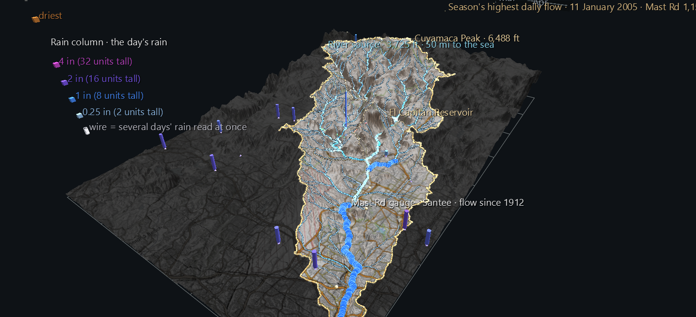
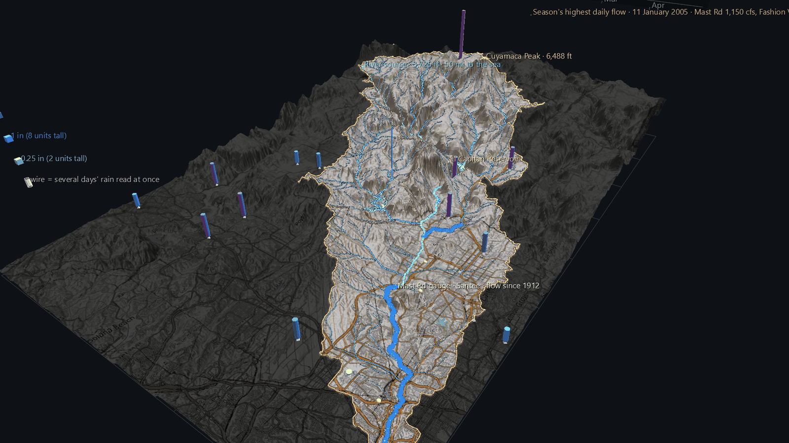

# The Storm Winter, 2004–05

[The Pulse](sd-river-pulse.md) shows the San Diego River a month at a time over a century. This scene zooms in on a single wet season and plays it **day by day**, from 1 October 2004 to 30 April 2005. Rain falls across the county on 18 rain gauges, and the river rises at its three stream gauges in answer.

It's part of the **San Diego River Watershed Atlas**, built on [The Watershed, Source to Sea](sd-river-watershed.md), which it rebuilds unchanged underneath.



**Try it:** download this example below (or [the full examples set](../getting-started/installation.md#example-scenes)), then open `San_Diego_River_Storm_Example/sd_river_storm_2005_gv_node.csv`, or drag its folder onto the window. It's a large scene (about 70,000 nodes) and takes a few seconds to load. Press **Space** to play, and **set the FPS slider to 4–8**: at the default 30 frames a second the whole season passes in 7 seconds.

[:material-download: Download this example (8 MB)](https://iluvdata.org/glyphviz/zips/San_Diego_River_Storm_Example.zip){ .md-button }

## Why this winter

- **It was one of the wettest winters on record.** Lakeside, in the middle of the watershed, recorded 29.3 inches in water year 2005. That's the second-highest of its 64 complete years; only 1978 had more, with 29.5. The river's mean flow at Mast Road that year ranks 11th of 110.
- **It was the burned hillsides' first real test.** The Cedar Fire burned across the upper watershed in October 2003, and the winter that followed was dry, with only 9.7 inches at Lakeside. So this was the first big rain to fall on the burn scar. Whether the river answered it differently is a question for a later part of the Atlas. This scene shows what happened.

## What moves

**The river.** The ribbons over the stretches of river each gauge measures work as they do in The Pulse, but for each day:

- **Width** is the day's average flow, on a log scale.
- **Colour** compares the day with every recorded day in the same month of that gauge's whole record: ochre for the driest, pale for typical, blue for the wettest.

**The rain.** A column stands over each daily rain gauge in the map: 18 of them, 7 inside the watershed. The ones outside stay in the scene, because a storm doesn't stop at a watershed line. **Height** is the day's rain, and **colour** is the amount, from pale for a trace, through blue at an inch, to magenta at four inches or more.

**The panel** beyond the east edge shows the whole season at once, and the pattern is plain: every burst of rain in the upper strip is followed by a spike in the river below.

- The **upper strip** is daily rain at Cuyamaca, in the mountains, and Lakeside, in the valley.
- The **lower strip** is daily flow at all three gauges.

A cursor marks the day, and the day and month are shown beside it.


## What the season shows

- **The river's biggest day was 11 January 2005.** Mast Road averaged 1,150 cubic feet per second over the day, and Fashion Valley 2,130.
- **The heaviest single reading was 5.63 inches at Cuyamaca on 29 December 2004.** That day, the gauges that reported averaged 1.71 inches.
- The scene opens on **21 February 2005**, the day that was both wet across the county and high on the river, so every layer has something to show. 11 January had the bigger river, but by then most of the rain had already fallen.



## Reading the rain honestly

- **Most of these gauges are read by hand, once a day.** A volunteer observer empties the gauge at their own chosen time, often in the morning. So a day's column can hold rain that fell the evening before, and two gauges a few miles apart can put the same storm on neighbouring days. The airport stations are automated.
- **Missing days are hidden, not filled in.**
- **Several days read at once are drawn as a wire column.** When an observer couldn't read the gauge for a few days, the record holds one total for all of them. The scene shows that total as a wire column on the day it was read, and hides the days it covers. Spreading it evenly would invent a daily pattern nobody measured.
- One gauge in the map, Santee Fire Department, reported on only 37 of the 212 days, so it's left out.

## Structure

```text
The Watershed, Source to Sea        rebuilt unchanged
Flow ribbon ×3 (Plot)               width, hide and colour bound, as in The Pulse
Rain column ×18                     World Grid children; height, position, colour,
                                    hide AND geometry bound (solid or wire)
Rain gauge marker ×15               octahedra for the gauges The Watershed didn't already mark
Panel                               daily flow lines, daily rain bars, peak days, cursor
Readout                             7 month labels and 31 day labels, one of each shown per frame
```

The scene is 70,799 nodes, with 180 animated tracks over 212 frames. Playback takes about 8 ms a frame.

## Data

All of it is public and needs no API key. It's cached in the Watershed example's shared `data/` folder.

| What | Source |
|---|---|
| Daily flow | USGS National Water Information System daily values, with each gauge's whole daily record cached for the colour ranking |
| Daily rainfall | NOAA GHCN-Daily, via the Regional Climate Centers' ACIS service, with its missing, trace and multi-day flags kept |
| Terrain, rivers, places | see [The Watershed, Source to Sea](sd-river-watershed.md#data) |

The generator is `build_storm_scene.py`. It reuses the Watershed and Pulse builders, then loads its own output back through GlyphViz's loaders and Channels engine and checks column heights, hidden days, solid versus wire, the cursor and the readout against the source data.
