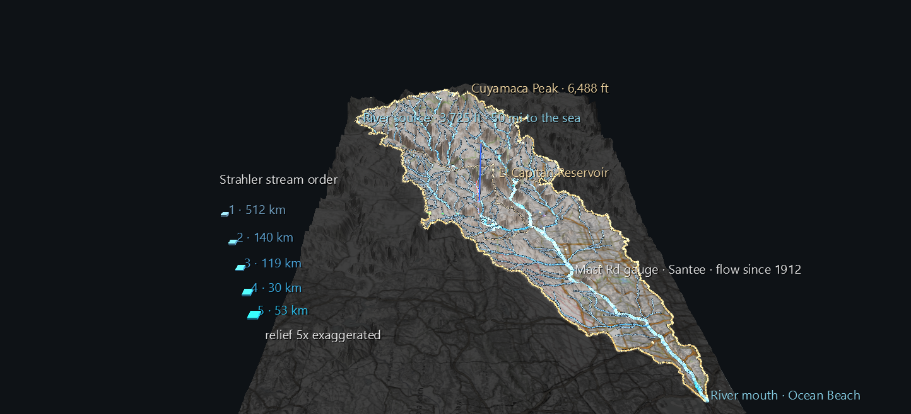

# The San Diego River Watershed, Source to Sea

A watershed is the land that drains to one river. You can live inside one for decades without knowing its shape, because nothing on the ground marks where it begins. This scene shows the San Diego River's whole watershed at once: 433 square miles of real terrain, every stream that feeds the river, and the gauges and rain stations that have been measuring it for more than a century.

It's the first scene of the **San Diego River Watershed Atlas**, a long-term project that builds this one place up in layers. This first scene has no time axis. It sets up the map every later scene is placed on: the century of rain and river flow, the fires that keep burning across it, and footage recorded along the river itself.



**Try it:** download this example below (or [the full examples set](../getting-started/installation.md#example-scenes)), then open `San_Diego_River_Watershed_Example/sd_river_watershed_gv_node.csv`, or drag its folder onto the window. It's a large scene (about 70,000 nodes) and takes a few seconds to load.

[:material-download: Download this example (6 MB)](https://iluvdata.org/glyphviz/zips/San_Diego_River_Watershed_Example.zip){ .md-button }

## What you see

**The land itself.** The terrain is real USGS elevation data at about 213 m between points, with the relief exaggerated five times so the valleys read. A topographic map is draped over it. Everything **outside** the watershed is dimmed and grey, so the basin stands out as a shape before you look at a single line. From the opening view you're over the Pacific, looking up the valley: the river mouth is in the foreground, and the Cuyamaca and Volcan mountains are on the horizon.

**The divide.** The gold line is the watershed boundary, the ridgeline where rain stops flowing toward this river and starts flowing toward another. The fainter lines inside it split the watershed into its three official sub-basins: the Upper San Diego River, San Vicente Creek and the Lower San Diego River.

**Every stream, sized by order.** The blue network is every stream the river collects, 267 reaches in all. Line width and brightness follow **Strahler stream order**, a count of how many branches have joined:

- A headwater creek is order 1.
- Where two order-1 creeks meet, the stream becomes order 2.
- Where two order-2 streams meet, it becomes order 3, and so on.

So the picture shows the river being built: faint threads in the mountains join into brighter channels, and those join into the main river, which reaches order 5 for its last 31 miles. The legend on the left gives the total length at each order. Most of the network is the smallest streams: 512 km of order 1, against 53 km of order 5.

**The reservoirs** are outlined in pale cyan: El Capitan, the large lake in the middle of the watershed, and San Vicente to its north.

**The measuring points.**

- **White pins** are USGS stream gauges. The pinned one is **Mast Road in Santee**, which has recorded the river's flow every day since May 1912.
- **Violet octahedra** are NOAA rain stations with records going back to the 1890s.
- **Pale spheres** are named places.

Click any of them for its label, or press **T** to see every label at once. Each stream also has an invisible, clickable point where it ends downstream. Its label gives the stream's name, stream order, length and the area it drains, and **U** opens its record in the national hydrography dataset.

## What the data says

**The watershed is smaller than its official code suggests.** The river is usually filed under hydrologic unit 18070304, but that unit is named "San Diego" and covers 1,553 square miles, including the Sweetwater River, Otay River and San Diego Bay basins. The San Diego River's own watershed is three smaller units inside it, **1,120.8 km² (432.8 sq mi)**, and that's what the scene draws.

**The river doesn't start where you might expect.** The Cuyamaca Mountains are the obvious high ground, but the mainstem's headwater is near the **Volcan Mountains**, northwest of Julian. Cuyamaca's water joins as tributaries instead. Lake Cuyamaca sits at the head of **Boulder Creek**, which runs 19 km west to meet the river, and the peak's western slopes feed King and Conejos creeks. From its source, the river runs **81 km (50.3 miles)** to the sea.

**Two famous rain gauges are just outside it.** Julian and Descanso both have records going back to the 1890s, and both sit just outside the divide. The rain that falls on them drains somewhere else. Cuyamaca and Lakeside are inside. The labels say which is which.

## How the lines stay on the ground

Draping a line over terrain sounds trivial, and it isn't. Each point in the terrain mesh stores the *average* height of the ground around it; averaging is what keeps the relief smooth instead of spiky. But averaging also fills the valleys in a little. Rivers run along valley floors, so a river placed at its true elevation ends up **underneath** the visible surface. Tested on this river, 94% of it was buried.

So the scene places every line against the surface as it is actually drawn. It adds a point wherever a line crosses a grid cell, then removes every point the line doesn't need. As a result, no part of any line can dip below the terrain. The build checks this on its own output: of 10,873 draped line points, none sit below the surface. Place labels report the true elevation at each point, because the averaged surface understates every summit.

## Structure

```text
World row                           background, tag style
World Grid (wire, dim)              the lon/lat frame — extents = the map window
├─ stream gauge ×3                  pins, standing on the surface
├─ rain station ×4                  octahedra
└─ place ×13                        spheres, incl. the river's source and mouth
Terrain (Surface topology)          textured with the toned basemap
└─ vertex ×58,500                   scale 0, so only the mesh draws
Watershed divide (Plot topology)    draped ring
Sub-basin divide ×3 (Plot)
Stream reach ×267 (Plot)            one per run of constant Strahler order
└─ vertex ×~7,400                   scale 0
Reservoir shoreline ×2 (Plot)
Legend                              Strahler order swatches, north of the map
```

The terrain and line vertices are authored at **scale 0**, which GlyphViz skips when drawing. See [Large terrain](../reference/topologies.md#large-terrain-give-the-vertices-scale-0) in the Topologies reference. The whole scene renders in a few milliseconds a frame.

## Data

All of it is public and needs no API key. The example ships a cached copy in its `data/` folder, so it rebuilds offline.

| What | Source |
|---|---|
| Watershed boundary | USGS Watershed Boundary Dataset |
| River network and reservoirs | NHDPlus V2, via the USGS Network-Linked Data Index |
| Stream gauges | USGS National Water Information System |
| Rain stations | NOAA GHCN-Daily, via the Regional Climate Centers' ACIS service |
| Place names | USGS National Map Gazetteer (GNIS) |
| Elevation | USGS 3DEP, via AWS Terrain Tiles |
| Basemap | © OpenStreetMap contributors, SRTM, © OpenTopoMap (CC-BY-SA) |

The generator is `build_watershed_scene.py`; `--exag` and `--cols` change the relief exaggeration and terrain resolution. The public-data fetching is in `watershed_data.py`, which later Atlas scenes reuse.

**Limits, stated plainly:** NHDPlus V2 is a 1:100,000-scale network, so small channels, and exact channel positions through urban Mission Valley, are approximate. Thin tributaries on steep slopes can look slightly beaded where a line needs closely spaced points.
