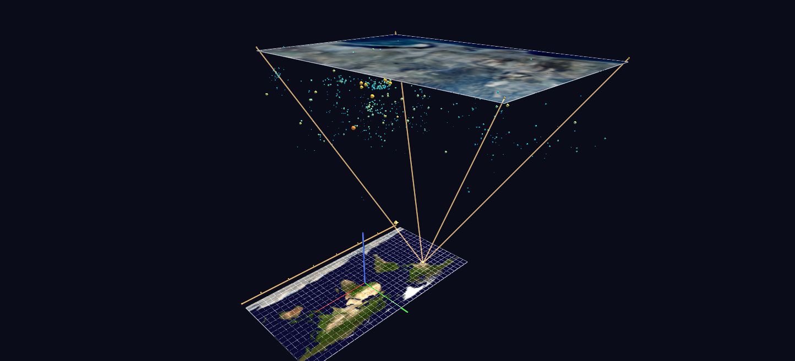

# San Diego Seismicity

A start-to-finish World Grids + Channels demonstration: a live USGS catalog pull becomes a georeferenced scene and a 66-year time replay of the San Diego region's earthquakes. Works flat or as a globe.

**Try it:** download this example below (or [the full examples set](../getting-started/installation.md#example-scenes)), then open `SD_Seismicity_Example/sd_quakes_gv_node.csv` — or just drag its folder onto the GlyphViz window. Press **Space** to start the animation.

[:material-download: Download this example (7 MB)](https://iluvdata.org/glyphviz/zips/SD_Seismicity_Example.zip){ .md-button }

---

*A full write-up of this example is coming soon.*
