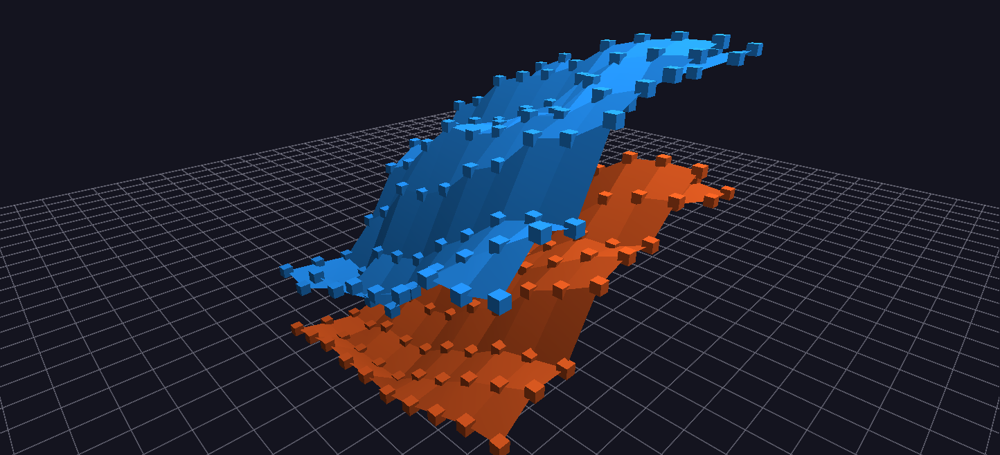

# SES Achievement Gap Terrain

Two stacked Surface-topology meshes over the same (grade, year) grid — average proficiency for economically disadvantaged and non-disadvantaged students — so the achievement gap is literally visible as the space between two terrains.

**Try it:** [download the examples set](../getting-started/installation.md#example-scenes), then open `SES_Achievement_Gap_Terrain_Example/SES_Achievement_Gap_Terrain_Example_gv_node.csv` — or just drag its folder onto the GlyphViz window.

---

*A full write-up of this example is coming soon.*
