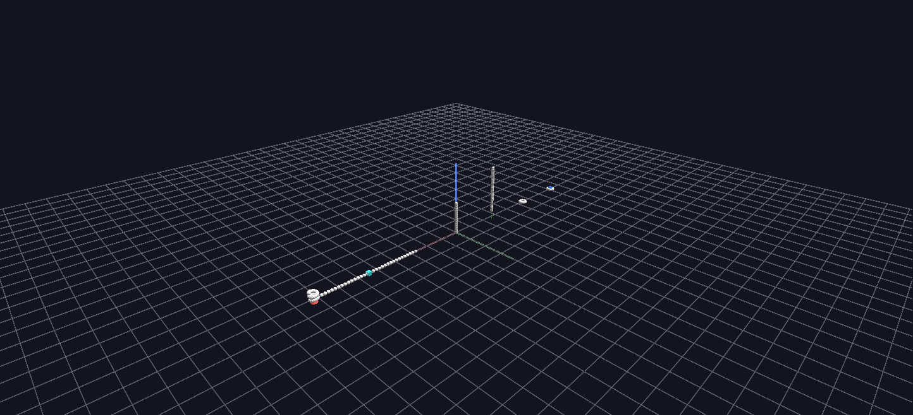

# Sine Wave Channels

The smallest end-to-end Channels demonstration: one root per topology, animated by sinusoidal time-series tracks.

**Try it:** download this example below (or [the full examples set](../getting-started/installation.md#example-scenes)), then open `SineWave_Example/SineWave_Example_gv_node.csv` — or just drag its folder onto the GlyphViz window. Press **Space** to start the animation.

[:material-download: Download this example (41 KB)](https://iluvdata.org/glyphviz/zips/SineWave_Example.zip){ .md-button }

## What it is

This is the smallest complete Channels scene, and the best one to open first. Seven shapes stand in a row, one for seven of GlyphViz's topologies (Sphere, Torus, Pin, Rod, Point, Plane and Spiral), and each is ringed by 32 small spheres. Press **Space** and the spheres rise and fall in sine waves of ever higher frequency, so each ring becomes a rippling wave that follows its shape.

Everything about it is small enough to read at a glance: 231 nodes, one mapping per child position, and a tracks file you could check by eye.

## How to read it

Each of the seven roots is labelled with its topology. Its 32 children are spread along that topology's natural axis, and the animated attribute is each child's `translate_z`, its offset off the parent:

| Root | The 32 children are spread along |
|---|---|
| Sphere | longitude |
| Torus | the ring's major angle, 0 to 360° |
| Pin | height above the pin's head |
| Rod | the rod's axis, bottom to top |
| Point | longitude |
| Plane | the X axis |
| Spiral | the helix angle, one turn per 360° |

**Child number 1 is the slowest and child number 32 is the fastest.** Track *n* completes *n* full sine cycles over the loop, so child 1 rises and falls once while child 32 does it 32 times, and in between the frequencies climb one by one. Because the children are laid out in order, the ring reads as a spectrum: a smooth gradient of wave speed running along each shape. Over the 512 frames of the loop the fastest wave still has 16 frames per cycle, enough to look like a wave and not like noise.

## The Channels idea, in one scene

The scene exists to show how a small amount of data drives a lot of motion:

- **One tracks file, 32 columns.** Each column is one sine wave. There are 512 rows, one per frame.
- **One map file, 32 rows.** Each row says "channel *n* drives track *n* and changes `translate_z`".
- **One column in the node file.** Each child carries a *Channel In* number from 1 to 32. All seven roots share the same 32 channels, so child *n* of every shape moves in step with child *n* of every other.

That last point is the whole join: the node file says *which* channel a node follows, the map says *what* the channel changes, and the tracks say *how it changes over time*. Change a child's Channel In in the Properties panel and it jumps to a different wave.

## Things to try

- **Compare the shapes.** The same 32 waves wrap differently on each topology: round a sphere, along a rod, around a ring, out along a spiral.
- **Rebind a node.** Select a child, change its Channel In to another number, and play. It joins that channel's wave immediately.
- **Edit the generator.** In `generate_sine_example.py`, `N_CHILDREN`, `AMPLITUDE` (3 units of peak height) and `MIN_SAMPLES_PER_CYCLE` are plain constants at the top.

For the same ideas in a narrower, more instructive form, see [Channel Parameters](channel-parameters.md), which has one station for every other attribute Channels can drive.

## Watch it explained

A narrated introduction to Channels, under two minutes, filmed on this scene: the tracks file and the map file, bringing a still node to life with **Channel In**, binding a parent so its whole ring follows, and giving twelve children staggered channels so a wave runs around the ring.

<video controls preload="metadata" width="100%" src="https://iluvdata.org/glyphviz/videos/channels_sine.mp4"></video>

The video works on a copy of this scene with a few channels added for the demonstration (a size pulse, a colour cycle and the twelve wave channels). The download has the original 32 height channels; to try the same steps, add columns of your own to the tracks file and rows to the map file, as described in [Channels Animation](../reference/channels-animation.md).
