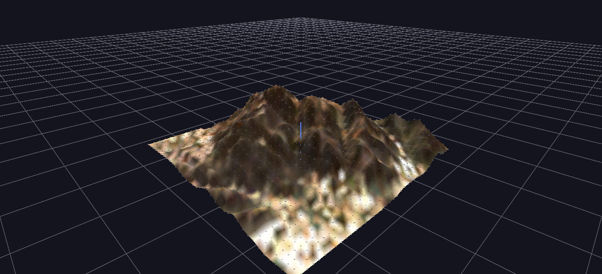

# Cowles Mountain Terrain

A real digital elevation model — Cowles Mountain, San Diego — as a Surface-topology mesh: a grayscale heightmap supplies elevation and the matching aerial photo supplies per-point color.

**Try it:** download this example below (or [the full examples set](../getting-started/installation.md#example-scenes)), then open `Surface_Example/Surface_Example_gv_node.csv` — or just drag its folder onto the GlyphViz window.

[:material-download: Download this example (111 KB)](https://iluvdata.org/glyphviz/zips/Surface_Example.zip){ .md-button }

---

*A full write-up of this example is coming soon.*
