# Tensors, from the Arrow Up

Most people who meet vectors in a physics course get comfortable with them: an arrow, a set of perpendicular unit vectors, three components. Then the word **tensor** arrives, usually as a grid of nine numbers with a transformation rule attached, and the picture goes missing. This example is seven animated scenes that rebuild the picture one step at a time.

The first three build the idea:

- **Scene 1** asks what a vector's components really are.
- **Scene 2** makes the step from a vector to a tensor.
- **Scene 3** puts a tensor to work in everyday mechanics: why a book thrown spinning about its middle axis flips over.

The next four put tensors to work, one physical job each:

- **Scene 4** shows a crystal's conductivity, where the current doesn't follow the field, in 2-D, 3-D and a 4-D "hypercrystal".
- **Scene 5** lets the basis stretch and slant, which splits components into upper and lower indices, and brings in the metric tensor that joins them.
- **Scene 6** cuts a loaded solid to find the stress tensor, where the word *tensor* comes from, and Mohr's circle.
- **Scene 7** places a diffusion tensor at every point of a slice of tissue, as in brain MRI, and follows the fibres through it.

The idea running through all seven is this: **a tensor is a geometric thing that doesn't care about your choice of axes. Its components are the answers it gives when you question it with basis vectors, and its rank is how many basis vectors each question takes.**

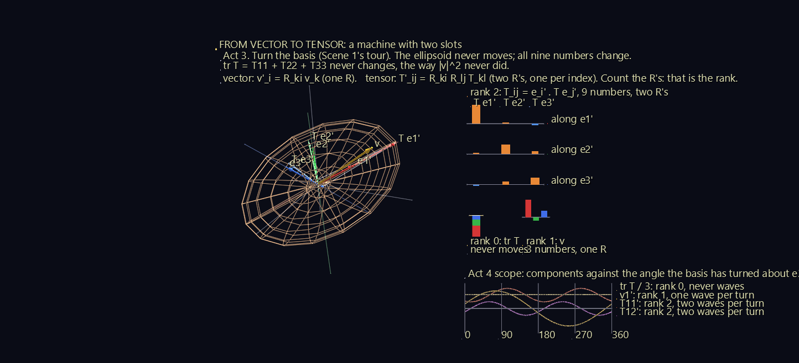

**Try it:** download the scenes below (or [the full examples set](../getting-started/installation.md#example-scenes)), then open the `*_gv_node.csv` inside, or drag the zip straight onto the GlyphViz window. All seven are animated: press **Space** to play, and each loops. Turn off **View > Show Grid** for the cleanest view. The captions sit on a board facing the camera the scene opens with, so they read best from that view.

[:material-download: Vectors_and_Bases (173 KB)](https://iluvdata.org/glyphviz/zips/Tensors_Vectors_and_Bases.zip){ .md-button }
[:material-download: Vector_to_Tensor (369 KB)](https://iluvdata.org/glyphviz/zips/Tensors_Vector_to_Tensor.zip){ .md-button }
[:material-download: Spinning_Book (699 KB)](https://iluvdata.org/glyphviz/zips/Tensors_Spinning_Book.zip){ .md-button }
[:material-download: Current_Across_the_Grain (963 KB)](https://iluvdata.org/glyphviz/zips/Tensors_Current_Across_the_Grain.zip){ .md-button }
[:material-download: Slanted_Rulers (340 KB)](https://iluvdata.org/glyphviz/zips/Tensors_Slanted_Rulers.zip){ .md-button }
[:material-download: The_Cut (220 KB)](https://iluvdata.org/glyphviz/zips/Tensors_The_Cut.zip){ .md-button }
[:material-download: A_Field_of_Machines (306 KB)](https://iluvdata.org/glyphviz/zips/Tensors_A_Field_of_Machines.zip){ .md-button }

The colours are the same in every scene. The basis vectors **e1, e2, e3** are **red, green and blue**, the vector **v** is **gold**, and on the boards **warm bars are positive, cool bars negative**.

## Scene 1: One Arrow, Many Shadows

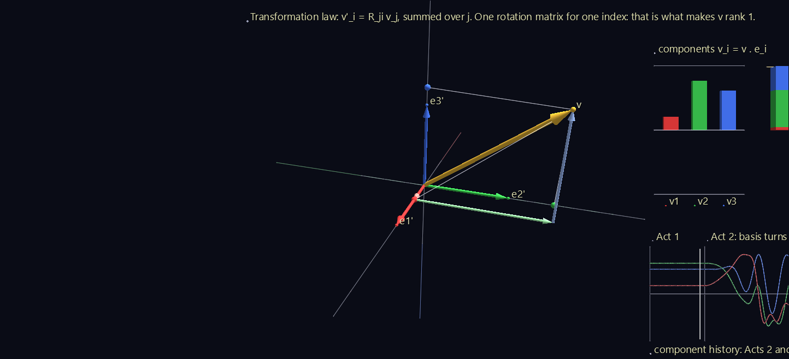

A fixed gold arrow, and a set of three perpendicular unit arrows (an orthonormal **basis**) that turns around it. The scene runs 66 seconds in three acts.

| Act | What happens | What to notice |
| --- | --- | --- |
| 1 | The basis lines up with the room's axes. The arrow is rebuilt one leg at a time. | **v = v1 e1 + v2 e2 + v3 e3.** The components are walking directions: go v1 along e1, then v2 along e2, then v3 along e3, and you arrive at the tip. |
| 2 | The basis turns through a closed loop of rotations. | The gold arrow never moves, but the legs, the drop lines and the bars all change. A component **v_i = v · e_i** is the arrow's shadow on one basis vector, and a shadow depends on where you shine the light from. |
| 3 | The basis holds still and the *arrow* turns the opposite way. | The bars and the history curve repeat Act 2 exactly. The components can't tell which one turned: they only know the arrow *relative to* the basis. |

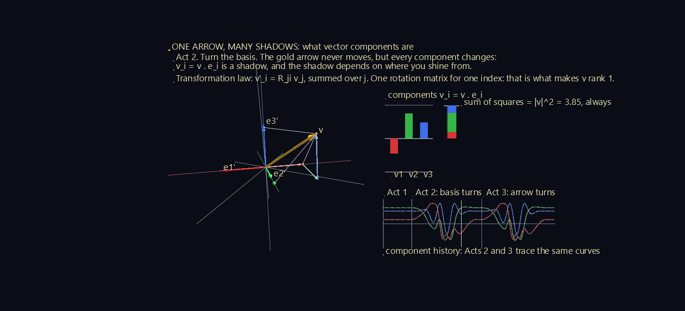

The board on the right shows three things:

- **The three component bars**, changing.
- **A stacked bar of v1², v2² and v3²**. Its colours trade places as the basis turns, but its height never changes: v1² + v2² + v3² = |v|² in every basis. A quantity that comes out the same in every basis is a **scalar**, or rank-0 tensor.
- **The component history** for the whole run, with a time cursor. Acts 2 and 3 trace the same curves.

The caption gives the rule that ties it together. When the basis turns by a rotation matrix R, the new components are v′_i = R_ji v_j, summed over j: **one rotation matrix for the one index.** That single R is what makes a vector a tensor of **rank 1**.

## Scene 2: From Vector to Tensor

The tensor in this scene is a symmetric one with principal values 2.0, 1.2 and 0.5, turned to an arbitrary orientation. The scene runs 105 seconds in five acts.

### Act 1: a tensor is a machine

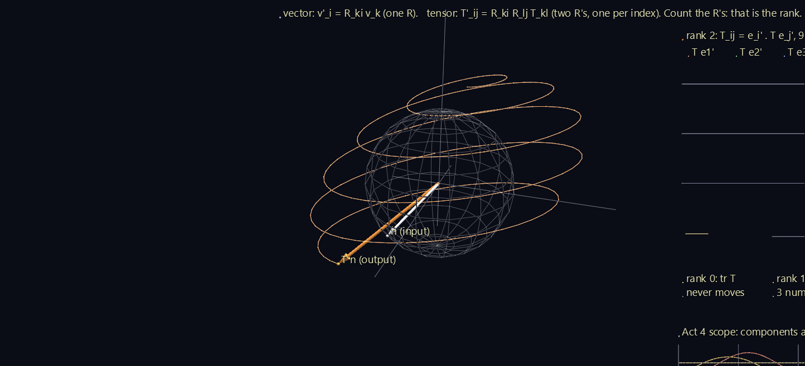

Forget components for a moment. A rank-2 tensor T is a **linear machine**: feed it a direction n, and it hands back a vector T n. A probe (white) sweeps over every direction, and the output (orange) paints a trail as it goes. The trail fills in an **ellipsoid**, and that ellipsoid *is* the tensor, drawn with no basis anywhere.

Notice that T n usually doesn't point along n. It does only along the ellipsoid's three axes, the tensor's **principal axes**.

### Act 2: its components need two basis vectors

To write the machine down as numbers, pick a basis and feed it each basis vector in turn. The three outputs T e1, T e2, T e3 appear in light red, green and blue. Read each output along e1, e2 and e3, and you have the grid:

**T_ij = e_i · (T e_j).** Column j of the grid is T e_j, read along each basis vector.

Drop lines show column 1 being read. Every component uses **two** basis vectors, one fed in and one read out. That's the whole step up from a vector.

### Act 3: turn the basis

The basis tours the same loop as in Scene 1. The ellipsoid never moves, but all nine numbers change. One combination never does: **tr T = T11 + T22 + T33**, the tensor's version of Scene 1's |v|². Scene 1's gold vector rides along so the two can be compared, and the **rank ladder** on the board sets them side by side:

| Rank | Object | Numbers | Rotation matrices in its rule |
| --- | --- | --- | --- |
| 0 | tr T | 1 (never moves) | none |
| 1 | v | 3 | one: v′_i = R_ki v_k |
| 2 | T | 9 | two: T′_ij = R_ki R_lj T_kl |

Count the R's in the rule, and that's the rank.

### Act 4: twice per turn

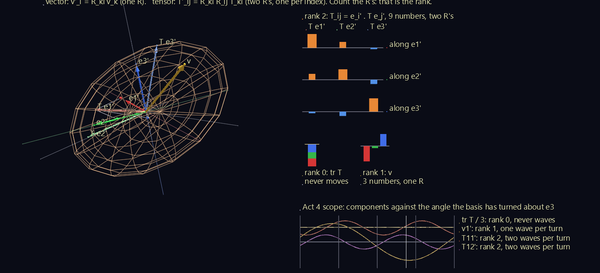

The basis makes one steady turn about e3, and the **scope** plots components against the angle turned:

- a scalar never waves;
- a vector component waves **once** per turn;
- a tensor component waves **twice** per turn.

Rank shows up as frequency. The reason is visible in the ellipsoid: an arrow has a head, so it takes a full turn to come back to itself, but an ellipsoid has no head and looks the same after half a turn.

### Act 5: the principal axes

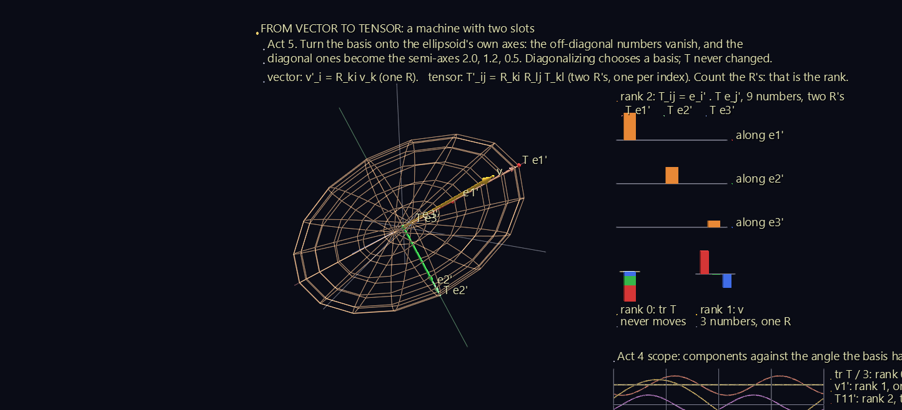

The basis turns onto the ellipsoid's own axes. The off-diagonal bars shrink to zero, and the diagonal ones become **2.0, 1.2 and 0.5**: the ellipsoid's semi-axes. Each output arrow now lies along its own basis vector, T e_i = λ_i e_i.

This is **diagonalization**, and the scene shows what it really is: choosing the basis the tensor agrees with. The tensor itself never changed.

## Scene 3: The Spinning Book

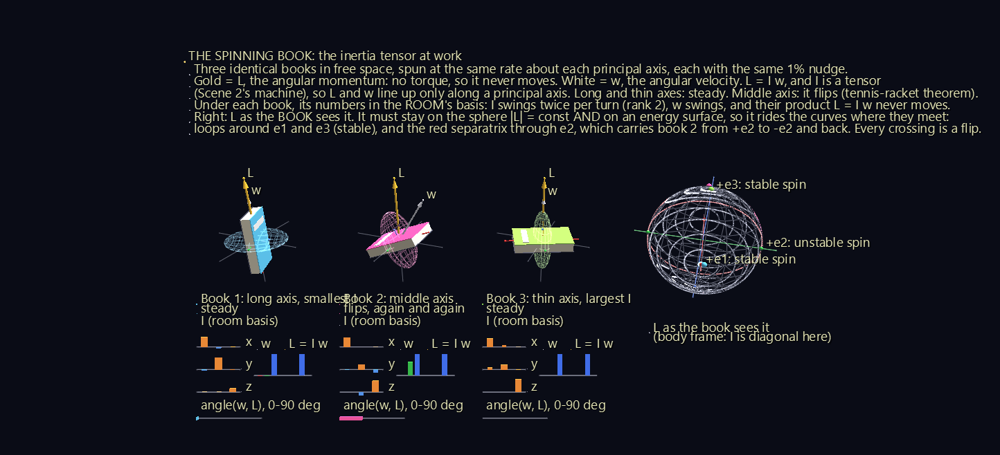

Throw a book in the air spinning about its long axis, or about the axis through its cover, and it spins steadily. Spin it about the remaining middle axis, and it flips over as it goes. This is the **tennis-racket theorem**, or the **Dzhanibekov effect** after the cosmonaut who filmed a wing nut doing it on a space station. It comes from the inertia tensor.

Three identical books (2.4 × 1.5 × 0.36 m, mass 1 kg) float in free space. Each is spun once every 3 seconds about one of its principal axes, with the same 1% nudge off that axis:

| Book | Spin axis | Moment of inertia | Result |
| --- | --- | --- | --- |
| 1 | long axis | smallest, 0.198 kg m² | steady: tilts at most 2.5° |
| 2 | middle axis | middle, 0.491 kg m² | flips, 7 times in 60 seconds |
| 3 | through the cover | largest, 0.668 kg m² | steady: tilts at most 0.6° |

### L = I ω, and I is a tensor

In an introductory course, angular momentum is L = I ω with I a single number, so L and ω always point the same way. For a real body, **I is a rank-2 tensor**: Scene 2's machine again, with angular velocity going in and angular momentum coming out. So L and ω line up only along a principal axis.

With no torque acting, L can't change, and the **gold** arrow holds still in the room. The **white** ω arrow is free to wander. Mid-flip it swings about 30° away from L, and the gauge under each book shows the angle.

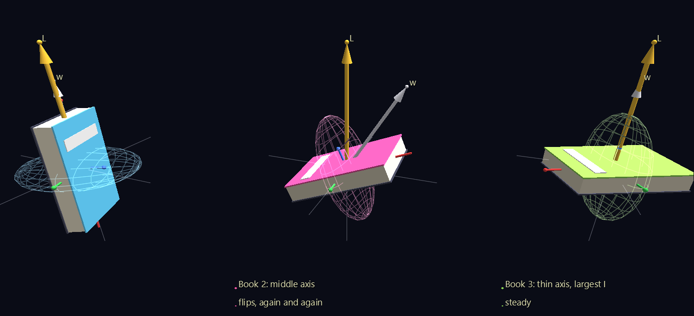

### Same tensor, two bases

- **In the book's own basis**, I is diagonal and constant: (I1, I2, I3).
- **In the room's basis**, the grid under each book shows its nine components swinging, twice per turn. That's Scene 2's rank-2 signature again.

Beside the grid, ω's three room components swing too. Yet **L = I ω, their product, never moves.** Two changing things combine into one fixed one.

The wire ellipsoid around each book is its inertia tensor drawn as in Scene 2. It's fattest about the axis through the cover, the axis the mass is spread farthest from.

### Why the middle axis is unstable

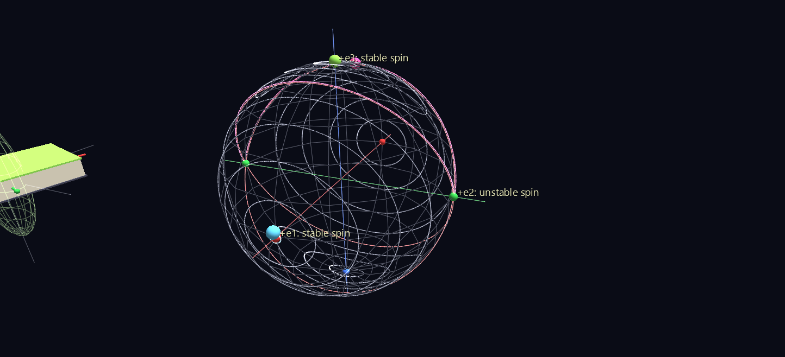

The sphere on the right shows L **as the book sees it**, in the book's own frame. Two things are conserved, and each confines L:

- **Its size, |L|.** L stays on a sphere.
- **The kinetic energy**, L1²/2I1 + L2²/2I2 + L3²/2I3. L stays on an ellipsoid.

So L can only ride the curves where the two surfaces meet. Around ±e1 and ±e3, those curves are small closed loops, which is why spin about those axes is stable. Through ±e2 runs the red **separatrix**, a pair of great circles at exactly the energy of a pure middle-axis spin. Book 2 rides near it from +e2 to −e2 and back, and **every crossing is a flip**. Stability is a property of the tensor's geometry.

A real book also loses energy as it flexes. That makes even the long-axis spin unstable in the end, and only the axis with the largest moment survives. That was the lesson of the Explorer 1 satellite in 1958. The scene shows the ideal rigid body.

## Scene 4: Current Across the Grain

Ohm's law for a wire is J = σE: the current runs along the field, and σ is a single number. A crystal isn't a wire. Its atoms sit in chains and layers, and charge moves easily along a chain, less easily across one, and hardly at all between layers. So the current leans toward the easy directions, and σ has to become a machine:

**J_i = σ_ij E_j**, summed over j.

That's Scene 2's machine with a physical job: a field in, a current out. Small beads, the charge carriers, drift through the lattice along J, not E, for the whole scene. The conductivities (2.0, 0.6 and 0.25 along the chains, across them and between layers) are illustrative. A real layered conductor such as graphite has a contrast of thousands to one.

The scene runs 92 seconds and climbs through the dimensions in three acts.

| Act | What happens | What to notice |
| --- | --- | --- |
| 1: 2-D | A single sheet faces you, its chains 30° above the x axis. E points along x, then turns all the way round. | J leans 20° toward the chains. As E turns, J's tip draws an ellipse, and J lines up with E only along the chains or straight across them. J's x part needs E's y part too, so the machine takes **2 × 2 = 4 numbers**. |
| 2: 3-D | The sheet lies down, more sheets stack into layers, and the crystal tilts. E points along x, then y, then z. Then it points along the crystal's own three axes. | **Each experiment fills one column of the 3 × 3 grid**; the board boxes the column being measured. Along the crystal's own axes, J finally points along E, 2.0, 0.6 and 0.25 times as strong. |
| 3: 4-D | A "hypercrystal": 3-D crystals stacked along a fourth direction, shown as its rotating 3-D shadow, coloured by the fourth coordinate. | Arrows can't be drawn in four dimensions, but the bars still can, and J_i = σ_i1 E_1 + … + σ_i4 E_4 works unchanged. σ is now 4 × 4. |

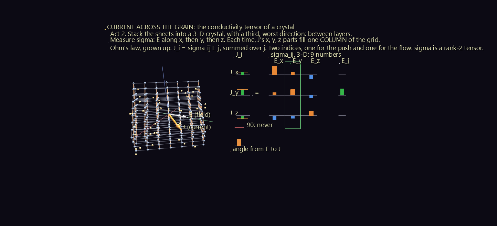

The board writes J = σE as a matrix equation: J's column, then σ's grid, then E's column. Each J_i is drawn as a **waterfall**: its row's pieces σ_i1 E_1, σ_i2 E_2, … stacked one after another, with a tick at the total, so you can watch the sum being made. A gauge shows the angle from E to J. It never reaches 90°: the current never runs against the push.

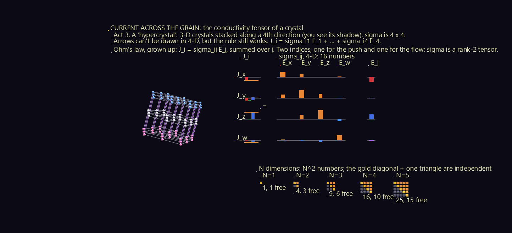

### How many numbers?

In N dimensions σ has N² components. They aren't all free: σ_ij = σ_ji, so only the diagonal and one triangle are independent, **N(N+1)/2** of them. The ladder at the bottom of the board counts them for N = 1 to 5: 1, 3, 6, 10 and 15 free numbers.

In 3-D the six free numbers have a physical reading: three conductivities, one along each of the crystal's own axes, plus three angles that say how the crystal is turned. The rule J_i = σ_ij E_j never cared how many dimensions it worked in, and that is the point of Act 3.

## Scene 5: Slanted Rulers

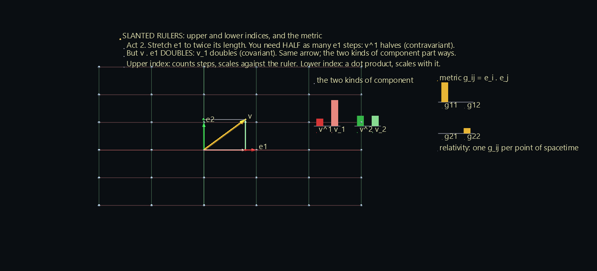

Scene 1 gave two pictures of a vector's components: walking along the axes (the legs) and dropping perpendiculars (the shadows). With perpendicular unit basis vectors, the two give the same numbers. Here the basis vectors are a crystal's lattice vectors, which can be any length and lean toward each other, and the two pictures come apart:

- **Upper index, v^i: count the steps.** v = v^1 e1 + v^2 e2. A longer ruler needs fewer steps, so v^i shrinks as the basis grows. These are the **contravariant** components.
- **Lower index, v_i: take the dot product.** v_i = v · e_i. A longer ruler gives a bigger dot product, so v_i grows with the basis. These are the **covariant** components.

The scene runs 102 seconds in five acts.

| Act | What happens | What to notice |
| --- | --- | --- |
| 1 | A square lattice with rulers of length 1. | The legs and the shadows give the same numbers. |
| 2 | e1 stretches to twice its length, then back. | **v^1 halves, and v_1 doubles.** Same arrow, opposite responses. |
| 3 | e2 leans 40° toward e1, both rulers length 1 again. | The legs walk the slanted grid; the shadows still drop at right angles. v^i and v_i now differ even with unit rulers. |
| 4 | The basis wanders, stretching and slanting at once. | **The metric g_ij = e_i · e_j converts between them:** v_i = g_i1 v^1 + g_i2 v^2, drawn as a waterfall that lands exactly on v_i. |
| 5 | The dual basis e^1, e^2 appears. | Walking v_1 steps of e^1 and v_2 steps of e^2 also reaches v. |

### What never changes

In Scene 1, v1² + v2² + v3² = |v|² in every basis. With a skewed basis that rule breaks: in Act 4, (v^1)² + (v^2)² swings by about 1.4 as the basis wanders. The board shows the rule that replaces it, **v^1 v_1 + v^2 v_2 = |v|²**, one upper index paired with one lower. It never moves.

### The dual basis is the reciprocal lattice

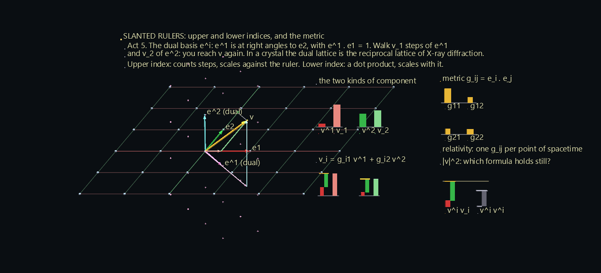

Each dual vector e^i stands at right angles to the other basis vector, scaled so that e^1 · e1 = 1. In a crystal, the lattice built from the dual basis is the **reciprocal lattice**, and the spots in an X-ray diffraction pattern sit on its points. The scene marks them with small crosses.

General relativity is this picture with a different g_ij at every point of spacetime. Gravity is the way the metric changes from place to place.

## Scene 6: The Cut

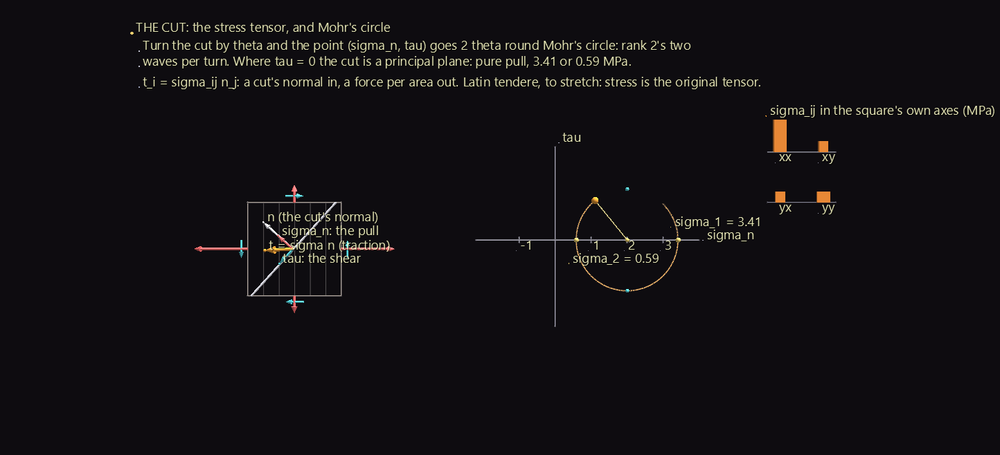

Stress is where the word *tensor* comes from, from the Latin *tendere*, to stretch. Woldemar Voigt gave the word its modern meaning in 1898, writing about the physics of crystals.

Cut a loaded solid along a plane with normal n. The material on the far side pulls on the cut with a force per area, the **traction t = σ n**. It is generally not along n, so it splits in two:

- a **pull** σ_n = t · n, straight out of the cut (red);
- a **shear** τ, along the cut (cyan).

That's Scene 2's machine again: a cut's direction in, a force per area out. The stresses are illustrative, in megapascals.

| Act | What happens | What to notice |
| --- | --- | --- |
| 1 | A square under stress in its own plane (σ_xx = 3, σ_yy = 1, σ_xy = 1), its four faces showing their tractions. A cut line turns half a circle, pausing at 22.5°, 67.5° and 112.5°. | The point (σ_n, τ) runs once around **Mohr's circle**. Turn the cut by θ and the point turns 2θ: rank 2's two waves per turn, from Scene 2's scope. At 22.5° and 112.5° the shear vanishes, and the cut is a **principal plane**, pure pull at 3.41 or 0.59 MPa. The shear peaks halfway between them, at 67.5°. |
| 2 | A cube under stress in all three directions (principal stresses 3, 1 and −1.5). The cut plane, a white ring, sweeps every direction. | Each cut lands at a point (σ_n, \|τ\|), and every point falls **between three circles**: inside the big one and outside the two small ones. That region is Mohr's arbelos. |
| 3 | The cube turns onto the principal directions. | The shear arrows on its faces vanish, and the grid of components goes diagonal, just as in Scene 2's Act 5. |

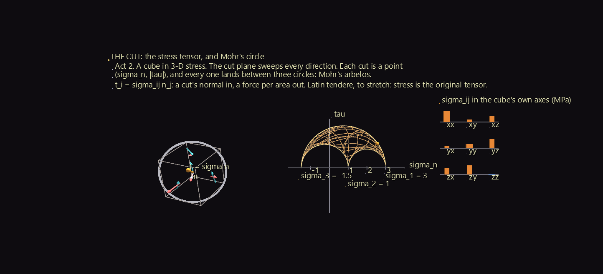

The principal directions matter in practice. Metals usually fail by slipping, where the shear is largest, 45° between the principal planes. Brittle materials snap where the pull is largest. Twist a stick of chalk and it breaks along a 45° spiral, because twisting makes the largest pull lie at 45° to the stick.

## Scene 7: A Field of Machines

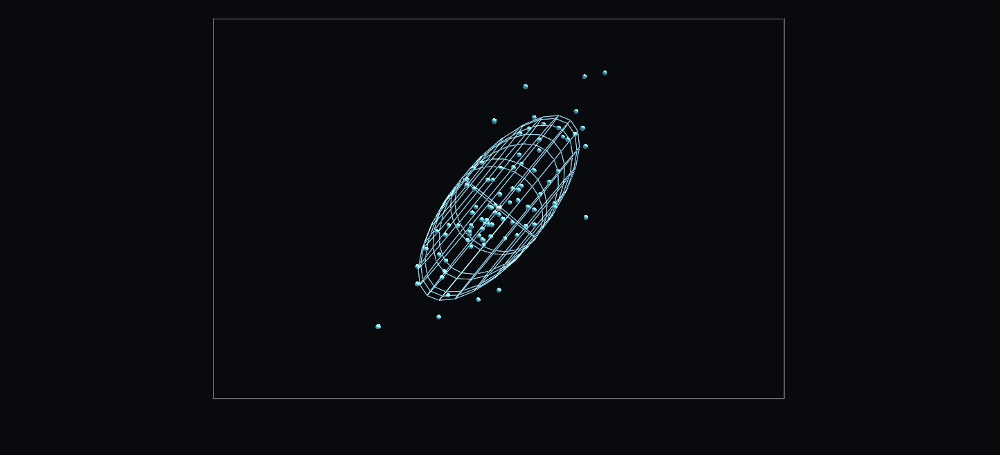

Diffusion is conductivity for molecules. Fick's law, **J_i = −D_ij ∂c/∂x_j**, is Scene 4's machine with the diffusion tensor D in place of σ and a concentration gradient in place of the field. In fibrous tissue, water moves easily along the fibres and poorly across them, so D is an ellipsoid. It also changes from place to place, which makes it a **tensor field**: one machine at every point.

Diffusion MRI (diffusion tensor imaging, DTI) measures one D in every voxel of a brain scan. This scene uses a **synthetic phantom, not a scan**: an arching bundle of fibres, a vertical bundle crossing its top, a bundle running straight through the slice, a pocket of fluid, and grey matter around them. The diffusivities are typical brain values, in units of 10⁻³ mm²/s.

The scene runs 95 seconds in four acts.

| Act | What happens | What to notice |
| --- | --- | --- |
| 1 | One point's machine: a drop of dye (90 random walkers) spreads. | The cloud fills the ellipsoid D predicts, drawn at two standard deviations along each axis. About three quarters of the dye ends up inside, as it should. |
| 2 | The ellipsoid flies to its voxel, and the whole field scans in. | One D per voxel, coloured by the standard DTI code for the long axis's direction: **red left-right, green up-down, blue through the slice**. The colour greys out as the ellipsoid rounds off. |
| 3 | Two maps appear on the board. | **Scalars from a tensor**, like tr T in Scene 2. The **mean diffusivity**, tr D / 3, is nearly blind to the fibres: the bundles score about the same as grey matter, and only the fluid stands out. The **fractional anisotropy**, FA, measures how lopsided D is, from 0 for a sphere to 1 for a needle, and it shows every bundle. |
| 4 | Tractography from six seeds: keep stepping along the local long axis. | The tracks trace the bundles. |

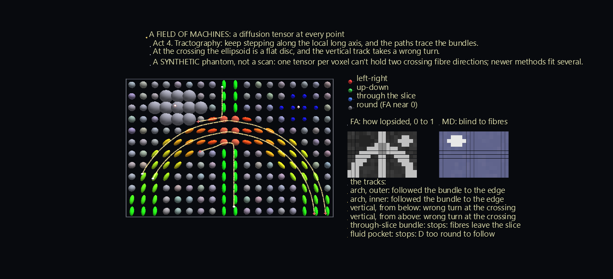

### Where tractography goes wrong

Tracking along the long axis is how brain wiring diagrams are drawn, and the scene shows both its success and its best-known failure:

- **The two arch tracks** follow their bundle from one end to the other.
- **The two vertical tracks** take a wrong turn. Where the bundles cross, a voxel holds fibres running two ways, and a single ellipsoid can't hold two directions. It becomes a flattened disc whose long axis belongs to the arch, so both vertical tracks swerve onto the arch.
- **The through-slice seed** stops at once: its fibres leave the slice.
- **The fluid seed** stops too: D is nearly round there, with no direction to follow.

Newer diffusion methods fit several fibre directions per voxel for exactly this reason.

## How it's built and checked

| Scene | Nodes | Animation |
| --- | --- | --- |
| Vectors and Bases | 1,106 | 88 tracks, 1,980 frames |
| Vector to Tensor | 1,294 | 237 tracks, 3,150 frames |
| Spinning Book | 10,481 | 648 tracks, 1,800 frames |
| Current Across the Grain | 1,660 | 551 tracks, 2,760 frames |
| Slanted Rulers | 204 | 167 tracks, 3,060 frames |
| The Cut | 1,113 | 255 tracks, 2,760 frames |
| A Field of Machines | 1,696 | 430 tracks, 2,850 frames |

- **Every arrow is two Link glyphs**: a cylinder for the shaft and a cone for the head, stretched between nodes whose positions are channels.
- **Each basis, book and crystal is a frame node** whose rotation is a channel. Everything inside it rides along.
- **The ellipsoids are wire spheres** scaled along their principal axes. A translucent solid would hide the arrows inside it.
- **The books' motion** solves Euler's equations for a rigid body with a fourth-order Runge–Kutta method, ten steps per frame.
- **The waterfall bars** in Scenes 4 and 5 are boxes whose bottoms and tops are both channels, so each piece of a sum starts where the last one ended.
- **The tracks in Scene 7** step through the field with the tensor interpolated between voxels, and stop when the field gets too round, turns too sharply, or leaves the slice.

Everything is checked through GlyphViz's own objects: the app's loaders, its playback engine, and its transform code, which says where each thing is drawn.

- **Scene 1:**
    - the drawn basis is the intended rotation;
    - the legs end exactly on the arrow's tip, and every drop line meets its axis at a right angle;
    - the bars are the dot products, and the |v|² stack never changes height;
    - Act 3 replays Act 2's bars exactly.
- **Scene 2:**
    - the ellipsoid is exactly T applied to the unit sphere;
    - every output arrow tip lies on it;
    - the nine bars are Rᵀ T R, and tr T never changes;
    - Act 5 ends exactly diagonal;
    - the scope's dominant frequency is 0, 1 and 2 waves per turn for ranks 0, 1 and 2.
- **Scene 3:**
    - angular momentum and energy are conserved to 10⁻⁹ over the full minute;
    - the drawn books are the computed orientations;
    - the drawn I bars times the drawn ω bars equal the drawn L bars;
    - book 2 flips, and books 1 and 3 don't;
    - every curve on the sphere keeps its energy to 10⁻¹².
- **Scene 4:**
    - the drawn E and J tips are E and σE, and every waterfall's total equals its row of σ times E;
    - the charge carriers move along J;
    - the angle from E to J never passes 51°, and on the crystal's own axes J lies exactly along E;
    - the 4-D shadow is the intended projection.
- **Scene 5:**
    - the drawn bars are v^i and v_i, and a stretch by 2 halves v^1 and doubles v_1 exactly;
    - the metric waterfalls land on v_i, and v^i v_i = |v|² holds while the naive sum of squares swings;
    - the dual basis satisfies e^i · e_j = 1 when i = j and 0 otherwise, and its legs reach v.
- **Scene 6:**
    - the traction, pull and shear tips are σn and its two parts;
    - the Mohr point sits on the drawn circle and turns exactly 2θ;
    - the shear vanishes on the principal cuts, and every 3-D cut falls between the three circles.
- **Scene 7:**
    - every voxel's ellipsoid is its D, coloured by the DTI direction code;
    - 77% of the dye ends inside the drawn ellipsoid, against 74% for an ideal Gaussian spread, and the cloud's long axis is within 3° of D's;
    - every track step follows the local long axis.

The generators and the checks are in the [`tensor_lab`](https://github.com/jsale/glyphviz/tree/master/tensor_lab) folder of the GlyphViz repository.

## Where it could go next

Every tensor in these scenes has rank 2. Three natural next steps:

- **Rank 3 and rank 4.** The piezoelectric tensor has rank 3: squeeze a quartz crystal and it makes a voltage. The elasticity tensor has rank 4: 81 numbers, of which at most 21 are free. A crystal's symmetry forces most of them to zero, which ties back to Scene 4's counting.
- **Curvature.** Scene 5's metric, varying over a curved surface such as a sphere or a saddle. Carry an arrow around a loop there, keeping it as straight as the surface allows, and it comes back turned. That turning is what the Riemann curvature tensor measures.
- **A real diffusion scan** in place of Scene 7's phantom.

## Credits

This example teaches standard physics rather than one paper.

- **Scene 3:** the rigid-body equations are Euler's. The polhode picture of torque-free motion is Poinsot's, as presented in Landau and Lifshitz, *Mechanics*, §37. The tennis-racket theorem is discussed by Ashbaugh, Chicone and Cushman, "The Twisting Tennis Racket," *Journal of Dynamics and Differential Equations* 3 (1991).
- **Scene 4** follows a route used in video explanations of tensors: a crystal's conductivity, current against field, first in 2-D crystals, then 3-D, then N-D "hypercrystals".
- **Scene 6:** the modern sense of *tensor* is Woldemar Voigt's (1898). The circle is Otto Mohr's (1882).
- **Scene 7:** diffusion tensor imaging was introduced by Basser, Mattiello and Le Bihan, "MR diffusion tensor spectroscopy and imaging," *Biophysical Journal* 66 (1994).

The scenes, simulations and checks are this example's own, and so are any errors.
