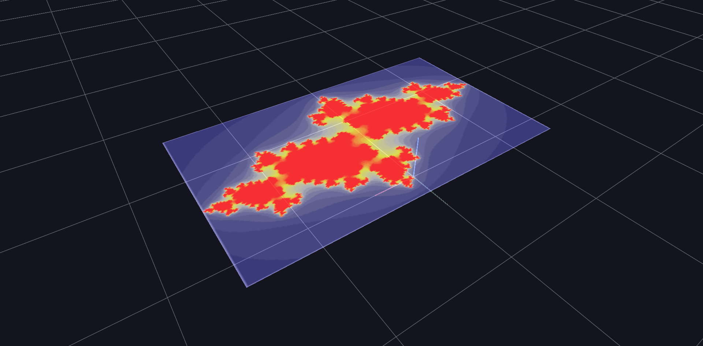

# Texture Animation

A Channels track steps a glyph's `texture_id` through a numbered image sequence — flipbook animation played on the surface of a 3D object, alongside a video texture.

**Try it:** download this example below (or [the full examples set](../getting-started/installation.md#example-scenes)), then open `Texture_Animation_Example/texture_animation_gv_node.csv` — or just drag its folder onto the GlyphViz window. Press **Space** to start the animation.

[:material-download: Download this example (6 MB)](https://iluvdata.org/glyphviz/zips/Texture_Animation_Example.zip){ .md-button }

## What it is

A single flat panel hangs in space, and a Channels track changes which image is painted on it, one image per frame. That is a flipbook. The twenty images are a numbered sequence of Julia-set renderings, so when you press **Space** the fractal appears to change shape, even though nothing in the scene is changing except one number: the panel's `texture_id`.

It is the smallest possible use of texture animation, and a good model for any image sequence you want to play on a surface: slides, rendered frames, satellite passes, microscope stacks.

## How it works

- **Textures are numbered by folder position.** Every image in the scene's `media/` folder gets a `texture_id` equal to its position in the sorted folder, starting at 1. Here, `map00001.jpg` is texture 1, `map00002.jpg` is texture 2, and so on up to `map00020.jpg`.
- **A node shows the texture its `texture_id` names.** The panel is saved with no texture assigned, and the channel supplies one from the first frame.
- **A channel steps that number.** The map file has one mapping, channel 1 to the attribute `texture_id`, and the tracks file has one column that simply counts 1, 2, 3 up to 20. Each frame, the panel's texture jumps to the next image.

The scene is **one node**, the Julia-set panel, plus a one-line tag file and the two Channels files. The panel uses the Grid geometry, a flat rectangle that takes an image across its whole face.

## Things to try

- **Scrub the animation.** Stop playback and drag the Channels slider: the panel steps through the images exactly as you move.
- **Show a single image.** Select the panel and change its Texture ID in the Properties panel to any number from 1 to 20.
- **Play a video on the same panel.** The `media/` folder also holds a short video. Images are numbered first and videos after them, so the video is texture 21. Set the panel's Texture ID to 21 and it plays there instead.
- **Use your own images.** Replace the files in `media/` with your own numbered frames, keep the names in the order you want them played, and make the track count up to the number of images.

## Things to know

- **Sort order is the animation order.** Zero-padded names such as `map00001.jpg` sort correctly. Without the padding, `map10.jpg` would sort before `map2.jpg`.
- **Texture changes are steps, not blends.** The engine does not interpolate between images. If you want a smooth transition, supply the in-between frames.
- **`texture_id` re-places nothing.** Unlike `topo` or `ratio`, switching textures changes only what is drawn on the node. The [Channel Parameters](channel-parameters.md) example shows the attributes that rearrange a node's children.

For the full list of what Channels can animate, see the [Channels Animation](../reference/channels-animation.md) reference.
