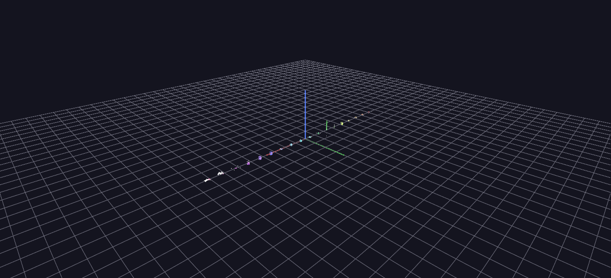

# Topology Tour

One labeled station per topology — the first 18 types; Point Cloud, added later, is shown in [LIDAR Import](lidar-import.md) — each showing how that topology arranges the same children in space. The scene the [Guided Tour](../getting-started/guided-tour.md) ends on, and the companion to the [Topologies reference](../reference/topologies.md).

**Try it:** download this example below (or [the full examples set](../getting-started/installation.md#example-scenes)), then open `Topology_Example/topology_example_gv_node.csv` — or just drag its folder onto the GlyphViz window.

[:material-download: Download this example (10 KB)](https://iluvdata.org/glyphviz/zips/Topology_Example.zip){ .md-button }

## What it is

Topology is how a node arranges its children. Put five children under a Sphere and they sit on its surface by longitude and latitude. Put the same five under a Cube and they go on its faces. This scene lays all of GlyphViz's topologies out in a single row so you can see them side by side: **18 stations, one per topology**, each a labelled parent with a handful of small children placed to make that topology's coordinate system obvious.

There are 109 nodes: 18 parents and 91 children. Nothing is animated. It is a scene to fly along slowly, left to right, reading each label.

## How to read it

The stations run in the canonical order, and every parent carries its topology name as a label. Each parent's children are given `translate_x`, `translate_y` and `translate_z` values chosen to show what those three numbers *mean* under that topology:

| Station | The three translate values mean | The five children |
|---|---|---|
| **None** | plain Cartesian x, y, z | scattered with no pattern: the baseline for comparison |
| **Cube** | position on a face, with the facet choosing the face | one child per face |
| **Sphere** | longitude, latitude, altitude | five around the equator, just above the surface |
| **Torus** | angle around the ring, angle around the tube, offset | five around the ring, on the tube |
| **Cylinder** | angle, height, radial offset | five around the axis, on the surface |
| **Pin** | height, and lateral x and y | five stacked along the pin's length |
| **Rod** | position along the axis, angle, radius | five along the rod |
| **Point** | longitude, latitude, altitude | five around a ring, floating with no surface |
| **Plane** | plain Cartesian on the grid | a flat pentagon |
| **Zcube**, **Zsphere**, **Ztorus**, **Zcylinder**, **Zrod** | as their plain versions, measured from the *centre* or axis instead of the surface | children pushed out from the middle rather than sitting on the skin |
| **Spiral** | angle (it climbs each turn), radius | five children climbing a rising helix |
| **Video** | plain Cartesian on the screen | the screen's four corners and its centre |
| **Plot** | plain Cartesian | a simple rising and falling data series |
| **Surface** | grid x, grid y, height | a 2 × 3 height-field of six points |

Compare a topology with its Z-variant to see the difference. A Sphere puts children on its surface; a Zsphere puts them around the same centre without regard to that surface. Likewise a Cylinder against a Zcylinder. Zrod is the one exception to the pattern: its placement maths is identical to Zcylinder's.

## Things to try

- **Change a station's topology.** Select any parent and change its Topology in the Properties panel. The same five children re-lay-out under the new rule, which is the quickest way to feel what each does. If the children fly far away after you switch to Cube, Pin, Plane or None, read about [Topology Scale](../reference/topologies.md#topology-scale-when-children-fly-off-after-a-topology-change).
- **Select by topology.** Edit > Select By > Topology picks every parent of a kind in a scene.
- **Move a child.** Use the Move handles on a child: the red, green and blue arrows follow the topology's own directions, so on a Sphere parent the red arrow runs along longitude rather than along the world X axis.
- **Open the table.** The node table lists each child's three values, so you can match the numbers to the picture.

## Where it fits

This is the scene the [Guided Tour](../getting-started/guided-tour.md) ends on, and the companion to the [Topologies reference](../reference/topologies.md), which describes every topology and the maths behind it. For topologies in motion, see the downloadable [Topology Animations](../reference/topologies.md#topology-animations-a-downloadable-instructional-series), twelve scenes that sweep each placement axis in turn.

The generator, `generate_topology_example.py`, ships with the scene, with the table above as its docstring, so it is also the shortest recipe there is for what each topology expects in its translate columns.
