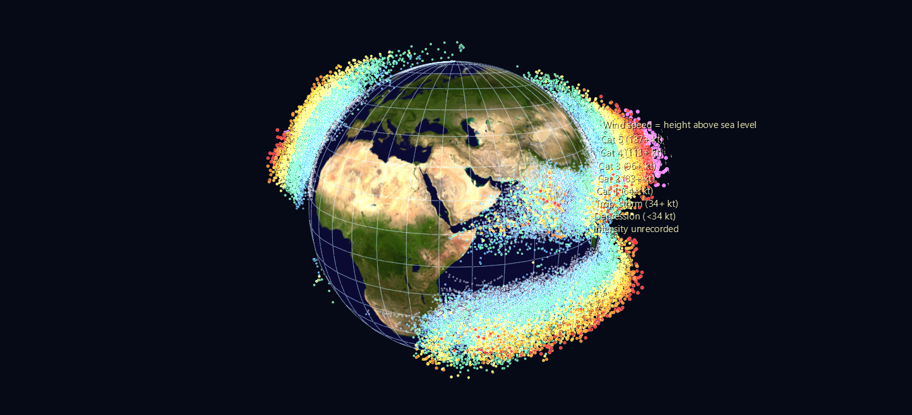

# Tropical Cyclones

Every tropical cyclone humanity has tracked, 1842–2025, placed on a Blue Marble globe by longitude and latitude — with **height above the ocean standing in for wind speed**, so the tracks stop being lines on a map and become a relief you can fly through.

**Try it:** [download the examples set](../getting-started/installation.md#example-scenes), then drag `Tropical_Cyclone_Example/Global_Tracks.zip` onto the GlyphViz window — it extracts beside itself and loads.

## The three scenes

**`Global_Tracks/`** — 174,545 point glyphs, one per storm per 12 hours, as children of a globe World Grid. Wind speed drives elevation, color (the Saffir–Simpson ladder) and glyph size at once. The 24 most intense storms carry labels at their moment of peak intensity; press **T** to read them.

**`Seasonal_Pulse/`** — the same globe animated over one composite calendar year, all 184 years of storms collapsed onto day-of-year. 366 frames; each track point lights on its own day and decays over the following fortnight, circularly, so the loop has no seam at New Year. A subsolar-latitude marker rides the same clock. Press **Space**.

**`Poleward_Drift/`** — one glyph per storm at its point of lifetime maximum intensity, animated by season, with rings marking the running mean latitude in each hemisphere.

## What to look for

- **Two ridges and a hollow equator.** Just 0.43% of the 341,735 observations fall within 5° of the equator, and 0.02% within 2° — the Coriolis force vanishes there and a storm has nothing to spin it up. The gap isn't an artifact; it's a law of physics drawn in negative space.
- **The empty South Atlantic.** 61 South Atlantic observations against 115,437 in the West Pacific. Wind shear and cool water suppress them.
- **Storms rise and fall along their own tracks**, climbing as they intensify over warm water and sinking as they recurve poleward into cooler seas.
- **The grey mat underneath** is storms whose intensity was never recorded — almost entirely 19th and early 20th century. The shape of the archive itself, where and when humanity was watching, is part of the picture.
- In `Seasonal_Pulse`, the two hemispheres breathe in antiphase and the basins switch on in sequence — West Pacific first and longest, North Atlantic sharply peaked in September.

## About the poleward-drift number

`Poleward_Drift` measures the latitude of peak intensity moving away from the equator at **+0.21°/decade** (northern hemisphere, 2.1σ) and **+0.22°/decade** (southern, 2.2σ) over 1980–2024 — the direction reported by Kossin, Emanuel & Vecchi (2014). The example's README is deliberately blunt about the caveats: run the identical regression back to 1950 and the northern trend flips sign, because before geostationary satellites the archive missed storms unevenly by latitude. Read that section before quoting the figure.

## Data

NOAA NCEI **IBTrACS v04r01** — the WMO's official consolidation of every regional forecast centre's storm records, public domain. 341,735 synoptic observations across 13,102 storms after tidying. The full archive is ~330 MB and isn't committed; the builder downloads it once and writes a 3.9 MB snapshot that every later rebuild reads offline.

`Global_Tracks` and `Seasonal_Pulse` ship zipped (42 MB of CSV compresses to 5.6 MB). `Poleward_Drift/` is small enough to sit unzipped.
