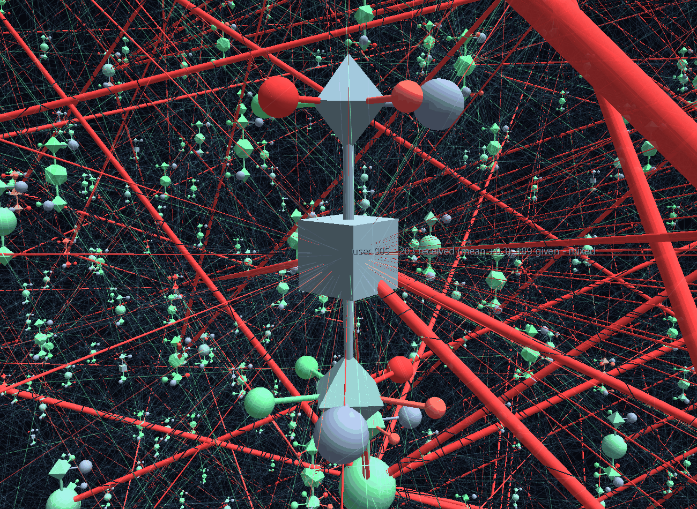
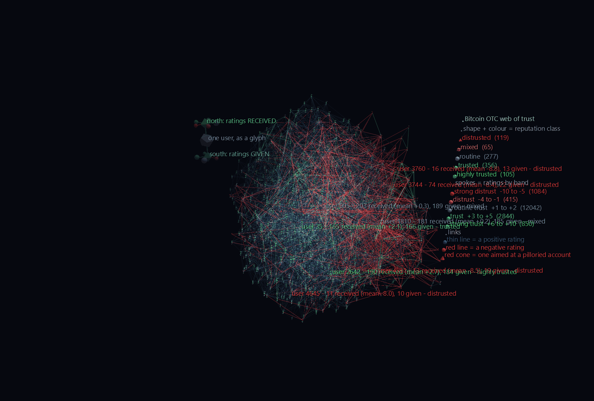
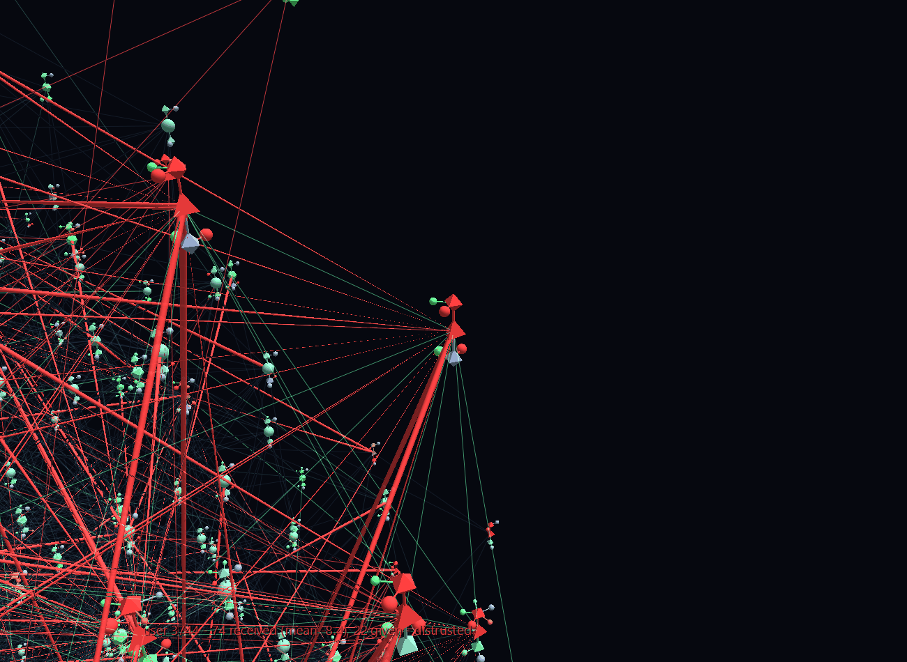

# Trust and Betrayal

Bitcoin OTC was an over-the-counter trading channel where people sent real money to strangers on the strength of a handle in a chat room. So they rated each other afterwards: a signed score from −10 to +10, stamped with a time. 35,592 of those ratings survive, spanning November 2010 to January 2016, and one in ten is negative — which in a marketplace is not a bad review, it is an accusation of theft.

This scene exists to show what a GlyphViz graph node can be that a conventional one cannot. In a standard graph tool a node is a circle with a size and a colour. Here **every user is a three-level hyperglyph whose children are their own reputation.**



**Try it:** download this example below (or [the full examples set](../getting-started/installation.md#example-scenes)), then open `Trust_Network_Example/Bitcoin_Trust/Bitcoin_Trust_gv_node.csv` — or drag its folder onto the window.

[:material-download: Bitcoin_Trust (2 MB)](https://iluvdata.org/glyphviz/zips/Trust_Network_Example_Bitcoin_Trust.zip){ .md-button }

## The glyph

```text
branch_level 0    the user.  Shape = reputation class, colour = mean rating
                  received, size = how many ratings they carry.  Topology
                  Sphere, so its children place by lon/lat.

branch_level 1    two hubs, at the user's north and south poles: ratings
                  RECEIVED (north) and ratings GIVEN (south).  Sphere
                  topology too, so their own children ring them.

branch_level 2    five spokes per hub, at 72° intervals, one per band of the
                  trust scale.  Size = how many ratings fell in that band.
                  Empty bands are omitted, so the spoke count is itself
                  information.
```

Every child is joined to its parent by a **limb** — a type-7 [Link drawn as a stretched cylinder](../reference/geometries.md#geometry-on-a-link-node). That is the [Glyph Composer](../reference/glyph-composer.md)'s own idiom for a hyperglyph, and it is not optional. The first cut of this scene had no limbs, and at any distance where two users were both in frame their children blended into one uniform field of dots. With limbs each user reads as a single object.

Roots are world-aligned and carry no rotation, so **every glyph in the scene shares one frame**: north is always *received*, south is always *given*, and a given trust band always sits at the same bearing. That is what makes the shapes comparable at a glance rather than merely decorative. A trader with a fat green spoke to the north has been vouched for many times; a red spoke to the north means they have been accused; a red spoke to the **south** means they are the one doing the accusing.



The whole assembly is exactly proportional to the root's scale, because children inherit it — measured at 2.83× root scale. The root scale is capped at 2.30 for that reason: the layout's median nearest-neighbour spacing is 21 world units, so the widest glyph spans 6.5 and no two ever touch (verified: 4.8 units of clear space at the closest approach in the scene).

**Every node in the scene carries a text label** — all 31,213 of them: each trader, each hub, each spoke, each limb, and each of the 17,235 rating links (*"−10 from user 1810 to user 3744, 2013-07-19"*). The labels restate in words exactly what the shape, size and colour already encode, and that redundancy is deliberate. Reading a glyph is an acquired skill, and the fastest way to acquire it is to have the reading spelled out beside the thing being read. Only eight are *pinned* on permanently; select any node, or press **T**, to see the rest.

## Which users are here

922 of the 5,881, being everyone with **at least 8 ratings received**. This filter is what makes the hyperglyph honest rather than decorative: a user rated twice has no distribution to show, and a scene full of one-spoke glyphs would imply a structure that is not in the data.

| reputation class | mean rating received | users |
|---|---|---|
| distrusted | below −0.5 | 119 |
| mixed | −0.5 to 0.75 | 65 |
| routine | 0.75 to 1.5 | 277 |
| trusted | 1.5 to 2.5 | 356 |
| highly trusted | above 2.5 | 105 |

Shape as well as colour, so **Select By → Geometry** pulls out every distrusted account in one action.

## The links, and a lesson about solid ones



17,235 rating events are drawn, and they carry the rating twice over — by geometry, and by how loudly they are drawn.

A positive rating is mostly ambient. **+1 alone accounts for 12,042 of them** and means little more than "the trade completed", so it is drawn as a faint line and lets the eye through, while a genuine +8 is bright and green. Fading by strength keeps every rating in the scene without letting the routine ones bury the meaningful ones.

A negative rating draws as a red line — except when it is aimed at one of the **20 accounts with 14 or more negative ratings**, where it becomes a stretched **cone** with its apex landing on the accused. An accusation is directed, and a cone is the shape that says so.

That rationing is the interesting part, and it was arrived at the hard way. The first version drew all 1,499 negative ratings as cones, and the result was unflyable: **a cone is solid along its whole length, so one passing near the camera is a red girder no matter how thin it is in world units.** Sizing it as a fraction of the link's 75-unit span gives a needle seen end-on and a wall seen from the side. There is no radius that is simultaneously visible from outside the scene and unobtrusive from within it — so the shape is spent where it earns its keep, on the handful of accounts the marketplace really turned on, each of which ends up inside a visible starburst of arrows. The rest of the volume stays flyable and the glyphs stay readable.

If you take one thing from this example for your own scenes: **stretched-glyph links are for edges that carry meaning, not for bulk.** Use geometry `27` (Line) for the rest.

## Watching it happen

The dataset is timestamped, so the Channels track is **the marketplace actually growing**, 120 frames from November 2010 to January 2016. Press play and 13 traders become 922; links go from 79 to 23,754; and the number of glyphs gone red climbs from 0 to 88 as reputations sour in front of you. Each user's glyph swells as it accumulates ratings and shifts colour as its running mean moves.

**The layout evolves too.** The source data carries no coordinates at all — just who rated whom, and when — so every position here is something the solver invents, which means there is a real spatial history worth showing. Rather than replaying ForceAtlas2 against the finished edge list, the solver is **re-run at every frame on only the graph that existed then**: it is chasing the data, re-arranging because new ratings have arrived. That is how a force layout actually behaves when you stream a network into it. The cloud grows outward from a 24-unit huddle to its full 135-unit spread, and traders drift into position as their trading circles form around them. A newcomer is seeded at the centroid of whoever has already rated them, so they emerge beside their first counterparties instead of flying in across the scene.

Everything appears when the data says it did: a hub when its owner first receives (or gives) a rating, a **spoke when they first earn a rating in that band**, and an accusation cone at the moment the accusation was made. So a trader's glyph visibly sprouts its reputation over the five years rather than arriving fully formed.

That richness is affordable because of how the channels are split:

- **120 bucket channels**, one per frame, each owning a single `hide` track that is 1 before that frame and 0 from it onward. Every node that comes into existence at that moment binds to the same channel — a channel drives *all* the nodes bound to it, so all 25 pieces of a user's glyph and all 17,235 rating links cost **120 tracks between them** rather than one each. Appearance is a shared event, so it deserves a shared channel.
- **922 user channels**, one per trader, carrying the seven things that are genuinely per-user and continuous: position (x, y, z), size, and red/green/blue. Their `hide` binding points back at the user's own bucket track, so a root appears in step with the rest of its glyph without needing a track of its own. Only the *root* needs position tracks — its hubs and spokes are placed by topology and follow for free, and every link redraws between its endpoints' current positions.

6,574 tracks in total for a 31,214-row scene. Note also that `scale_x`, `scale_y` and `scale_z` are three bindings onto **one** track — a ch-map row is a (track, attribute) pair, so a track may be read by as many attributes as want it.

## Data

`data/soc-sign-bitcoinotc.csv.gz`, unmodified, from [SNAP](https://snap.stanford.edu/data/):

- S. Kumar, F. Spezzano, V. S. Subrahmanian and C. Faloutsos, *Edge Weight Prediction in Weighted Signed Networks*, ICDM 2016.
- S. Kumar, B. Hooi, D. Makhija, M. Kumar, V. S. Subrahmanian and C. Faloutsos, *REV2: Fraudulent User Prediction in Rating Platforms*, WSDM 2018.

User ids are the dataset's own anonymised integers; no handles or personal information are present in the source or in the scene. The layout is [`forceatlas2_3d`](../reference/graph-layout.md) with `repulsion_falloff=2.0`.
