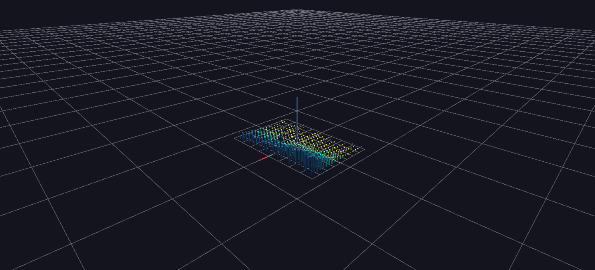

# Vehicle Sales — Depreciation Grid

A make × model-year bar field: bar height is median selling price, so every make's depreciation curve stands in relief; bar radius is sales volume.

*Data: Kaggle used-vehicle auction dataset (~559,000 sale records).*

**Try it:** [download the examples set](../getting-started/installation.md#example-scenes), then open `Vehicle_Sales_Example/Depreciation_Grid/DepreciationGrid_gv_node.csv` — or just drag its folder onto the GlyphViz window.

---

*A full write-up of this example is coming soon.*
