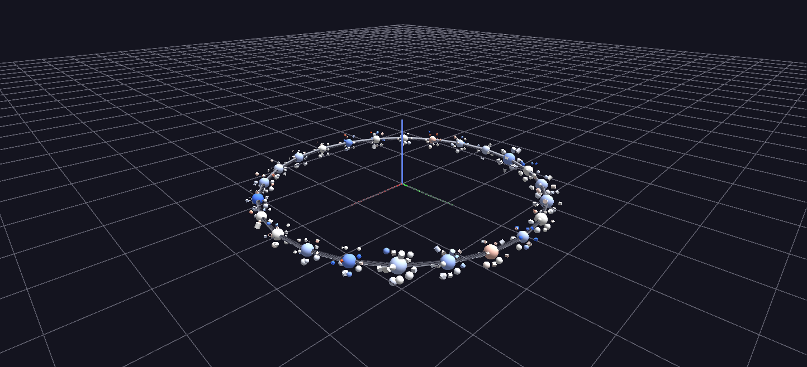

# Vehicle Sales — Market Galaxy

The top vehicle makes on a slowly rotating torus ring, each make a sphere with its top models orbiting it: ring position runs cheap to luxury, size is sales volume, color is selling price versus wholesale book value, and each model's geometry encodes its dominant body style.

*Data: Kaggle used-vehicle auction dataset (~559,000 sale records).*

**Try it:** [download the examples set](../getting-started/installation.md#example-scenes), then open `Vehicle_Sales_Example/Market_Galaxy/VehicleGalaxy_gv_node.csv` — or just drag its folder onto the GlyphViz window. Press **Space** to start the animation.

---

*A full write-up of this example is coming soon.*
