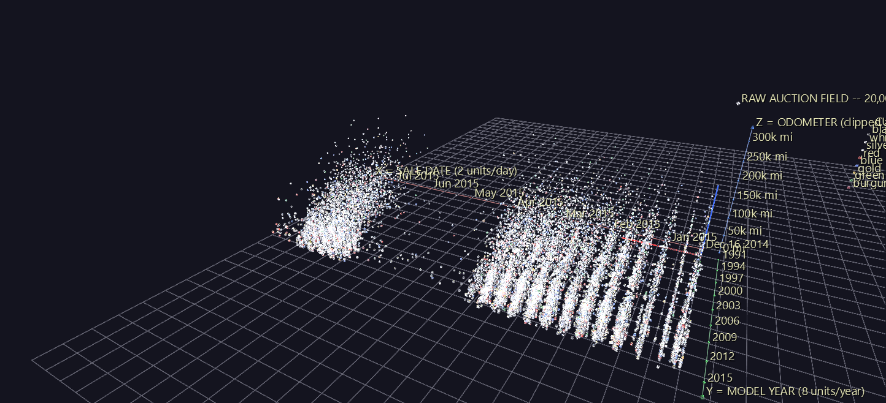
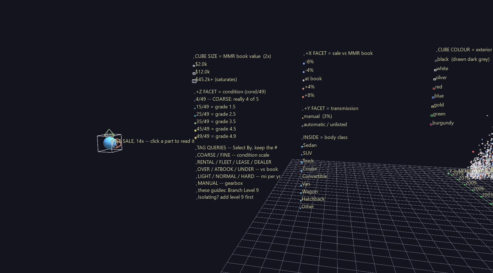
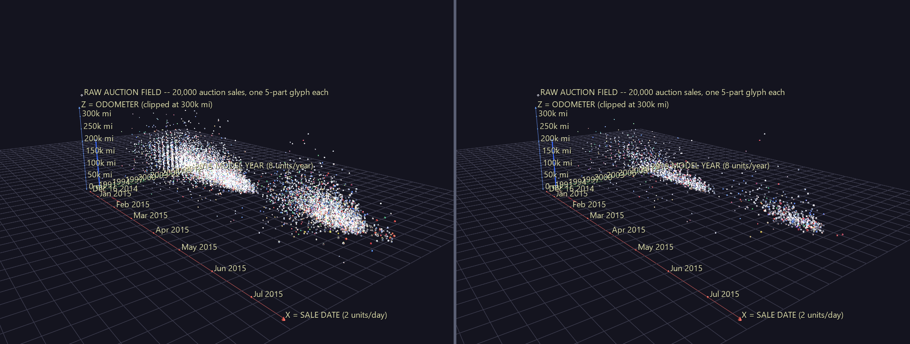
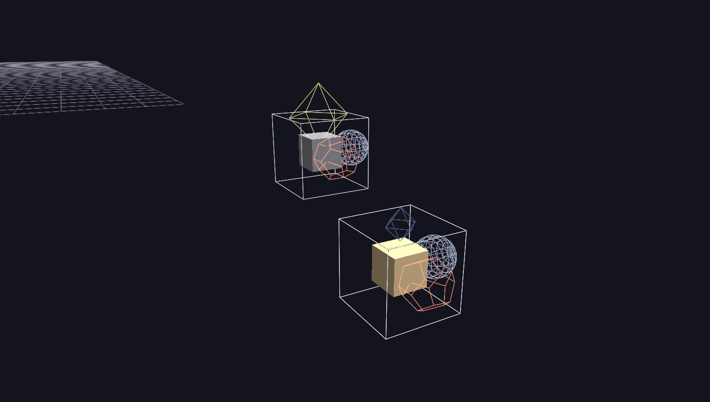
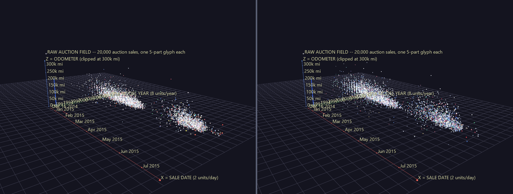

# Vehicle Sales — Raw Auction Field

No aggregation. A seeded sample of 20,000 used-vehicle auction sales, one five-part glyph each — about 100,000 nodes, and a deliberate stress test at GlyphViz's practical node budget.



*Two cities of glyphs: the December–March selling season and the May–June one, with April nearly empty between them. The vertical combs inside each are model years.*

**Try it:** download this example below (or [the full examples set](../getting-started/installation.md#example-scenes)), then open `Vehicle_Sales_Example/Raw_Auction_Field/RawAuctionField_gv_node.csv` — or just drag its folder onto the GlyphViz window.

[:material-download: Download this example (2 MB)](https://iluvdata.org/glyphviz/zips/Vehicle_Sales_Example_Raw_Auction_Field.zip){ .md-button }

## Watch it explained

A narrated tour, about three and a half minutes, rendered from GlyphViz itself: the axes, the scene's own legend read part by part, and the tag queries run through **Select By** and **Show Only Selected**, with the two results the field shows and the one it can't.

<video controls preload="metadata" width="100%" src="https://iluvdata.org/glyphviz/videos/vehicle_auction_field.mp4"></video>

---

## Reading one glyph

Every sale is one wire cube with four things mounted on it. The scene carries its own legend: an upright panel parked out at `x = -395`, clear of the data, so 100,000 glyphs don't render through its captions. Orbit left past the start of the time axis to find it.



| Part | Geometry | Encodes |
|---|---|---|
| the cube | wire cube, Cube topology | **one auction sale.** Colour is the exterior paint; size is the MMR wholesale book value (√-scaled, saturating at the 99th percentile ≈ $45k) |
| inside it | solid glyph at the cube's centre | **body class** by geometry — sedan = sphere, SUV = cube, truck = cylinder, coupe = cone, convertible = torus, van = dodecahedron, wagon = icosahedron, hatchback = octahedron. Coloured by the interior trim |
| +Z facet | wire octahedron | **condition grade, exactly as the column publishes it**: size and colour both run `condition / 49`, deep blue → teal → yellow |
| +X facet | wire dodecahedron | **this sale against book** — blue under MMR, near-white at it, red over |
| +Y facet | wire tetrahedron / sphere | **transmission** — gold tetrahedron for manual (about 3% of the lane), dim grey sphere for automatic |

Paint names are mapped to RGB tuned for the black viewport, so a black car renders dark grey rather than invisible.

## The axes

Three labelled rails stand outside the data box, coloured the way GlyphViz's own transform handles are — X red, Y green, Z blue.

| Axis | Meaning | Scale |
|---|---|---|
| **X** | sale date | 2 units/day, Dec 2014 → Jul 2015. Cars sharing a timestamp fan out +0.03 each, so a same-second auction batch of several hundred spreads instead of stacking |
| **Y** | model year | 8 units/year, 1991 → 2015 |
| **Z** | odometer | 120 units at 300,000 miles, clipped |

Tick labels are pinned with `show_text`, so they read without turning scene-wide tags on. The whole scaffolding — rails, ticks, legend — sits at **branch level 9**, which makes **Select By → Branch Level → 9** pick it up in one click. That matters when you isolate a cohort: tick *Add to current selection*, then run your query, then **Show Only Selected** `[I]`, and the axes stay under the glyphs you kept.

## Querying the field

The Properties panel's **Select By → Tag contains** box is a case-insensitive substring match over tag text. Every one of a record's five nodes carries the same token string, so a query selects whole glyphs, not bare parent cubes.

| Token | Selects | Share of the sample |
|---|---|---|
| `#COARSE` / `#FINE` | which of the two scales this row's `condition` column is on | 12.0% / 88.0% |
| `#RENTAL` `#FLEET` `#LEASE` `#DEALER` | consignor class, read off the `seller` column | 14.3% / 4.0% / 43.1% / 38.5% |
| `#OVER` `#ATBOOK` `#UNDER` | this sale vs MMR book, ±5% band | 26.4% / 43.0% / 30.7% |
| `#LIGHT` `#NORMAL` `#HARD` | odometer per year of age: under 9k, 9–18k, over 18k | 17.4% / 51.3% / 31.4% |
| `#MANUAL` | manual gearbox | 3.0% |

Keep the leading `#`. A bare `OVER` also matches every Land Rover.

---

## Reverse-engineering a visualization

This scene was built first, straight off the raw columns, with no finding in mind. The analysis below came afterwards, run over all 558,837 rows of the source dataset. The tokens exist so that each result has a click path — so a claim you can only reach with pandas can be *seen*.

Two of the three results survive that test. The third is included because it doesn't, and knowing which is which is the point.

### 1. The `condition` column is two scales in one

The column's 41 distinct values are **1–5, 11–19, 21–29, 31–39, 41–49**. There is no 6, no 7, no 8, no 9, no 10, and no multiple of ten anywhere. That is a fingerprint, not a distribution: the high values are a 1.1–4.9 grade stored ×10, and **64,853 rows store the same 1–5 grade rounded to an integer** instead — 12.2% of the 531,258 sales that carry both a grade and an odometer reading.

Pooling the two scales does real damage to any analysis that touches condition:

| | published column, pooled | rescaled to a common 1–5 grade |
|---|---|---|
| corr(condition, odometer) | −0.296 | **−0.528** |
| R² of odometer ~ condition | 0.088 | **0.279** |
| corr(condition, price vs book) | 0.218 | 0.278 |
| β on condition in `log(price) ~ log(mmr) + condition` | +0.0049 | **+0.1099** |
| R² of that model | 0.9357 | 0.9409 |

`log(mmr)` alone gives R² = 0.9303, so reconciling the scales **doubles** what condition adds on top of the book value — and multiplies its coefficient by twenty-two. A notebook that regresses on `condition` as published is measuring a blend of two rulers.

**And the scene was already drawing it.** Because the +Z facet renders `condition / 49` exactly as published, every coarse-scale row gets an octahedron about a tenth of the size and colour it has earned. In the sample, `#COARSE` rows draw at a median `condition/49` of **0.061** when their true grade fraction is **0.600**. Across the whole dataset 30,729 of them are graded 4 or 5 out of 5 — clean, low-mileage cars (median 22,585 miles, $17,950 book, one year old) wearing a wreck's badge.



*Select By → Tag contains → `#COARSE` → Show Only Selected. The full field (left) is a tall cloud reaching past 200,000 miles. The coarse-scale cohort (right) is a flat sheet along the floor: median model year 2012, median odometer 37,937 miles, median MMR $13,300. Genuinely low-graded cars — the 1,581 `#FINE` rows at grade ≤ 1.9 — sit where you'd expect instead: median 2006, 117,255 miles, $4,475.*

Click any two of them and the point lands in one line:



*The same car, twice. **Upper:** 2013 Lexus RX 350 Base, 36k miles, cond **44/49**, sold $31.5k against a $30.2k book — a big yellow condition octahedron. **Lower:** 2013 Lexus RX 350 Base, 34k miles, cond **4/49**, sold $32.3k against $31.1k — a speck of navy. Same model year, same mileage, same money, and the badge differs tenfold. The lower one was consigned by Lexus Financial Services, whose feed reports on the 1–5 scale.*

**Where it comes from.** The artifact is per-consignor, not random. Seven sellers with 500+ sales report ≥90% of their cars on the coarse scale — GM Remarketing (98.5%), Enterprise Holdings/GDP (99.2%), Hertz/TRA (99.5%), Hertz Corporation/GDP (98.0%), PV Holding Inc/GDP (98.7%), Enterprise Vehicle Exchange/Tulsa (98.4%) and Ally (98.9%) — five of the seven being rental fleets, and 13,041 coarse rows between them. Across the whole dataset, `#RENTAL` consignors are 19.6% coarse against a 12.2% base rate, a 1.6× lift; the rest is spread thinly across mixed sellers. Query `#COARSE`, tick *Add to current selection*, query `#RENTAL`, and watch the overlap.

### 2. The book value is a precise number for new cars and a rough guess for old ones

MMR is a wholesale book estimate, and the residual `(price − mmr) / mmr` is nearly unbiased across most of the range. Its **spread** is not:

| odometer | n | median residual | std dev | 10th–90th percentile |
|---|---|---|---|---|
| < 25k | 116,596 | −0.3% | 12.6 | −10.8% … +7.6% |
| 25–50k | 150,061 | 0.0% | 11.8 | −10.6% … +9.1% |
| 50–75k | 83,362 | 0.0% | 15.5 | −14.0% … +13.4% |
| 75–100k | 61,760 | 0.0% | 22.3 | −23.8% … +22.0% |
| 100–125k | 49,188 | −3.0% | 25.9 | −33.7% … +24.9% |
| 125–150k | 32,612 | −5.1% | 29.4 | −40.1% … +27.9% |
| 150–200k | 29,052 | −4.1% | 36.5 | −42.2% … +40.0% |
| > 200k | 8,627 | +4.0% | 57.3 | −41.4% … +75.0% |

The residual's standard deviation grows **4.5×** across the odometer range, and the 10–90 band widens from 18 points to 116. That is textbook heteroscedasticity, and it matters: an ordinary least-squares fit of price on MMR reports R² ≈ 0.98 and hides the fact that the book value is nearly uninformative at the top of the mileage axis.

Since the odometer *is* the Z axis here, that shows up as height.



*Left, `#ATBOOK` — sales within ±5% of book — is a low dense slab, median odometer 36,533 miles. Right, `#UNDER` climbs: median 73,114 miles. `#OVER` behaves the same way (median 68,069). Both tails live up high; the agreement lives down low.*

### 3. The one the picture will not show you

The market has a real seasonal lift. Comparing each sale only against its own make × model × year × grade cell (cells of 20+ sales, so the mix can't move the answer), the median residual climbs steadily through tax-refund season and resets:

| | Dec 2014 | Jan | Feb | Mar | May | Jun | Jul 2015 |
|---|---|---|---|---|---|---|---|
| median like-for-like residual | −0.31% | −0.24% | +0.23% | +0.62% | −0.69% | +0.17% | +0.48% |

In the sample that means the `#UNDER` share falls monotonically from **35.9%** of December's sales to **27.5%** of March's. It is a genuine, robust result — and isolating `#UNDER` shows you essentially nothing, because an eight-point change in the density of a scattered cohort along a 420-unit axis is not something eyes read.

That is worth stating plainly. Selection filtering turns a scene into an instrument for *categorical structure and spatial arrangement* — where a cohort sits, how tall it stands, what shape it takes. It is not an instrument for **conditional rates**. GlyphViz will select the cohort and tell you how many nodes are in it; it will not tell you what fraction of a slab that is. When the answer is a ratio that changes slowly along an axis, go back to pandas.

---

## Structure

```text
branch level 9   83 nodes: 3 axis rails (Link nodes), 28 pinned axis
                 labels, 3 legend columns, and an assembled 14x glyph
branch level 0   the car          wire cube, Cube topology, paint colour,
                                  sized by MMR
branch level 1   ├─ interior      solid body-class glyph, translate_z = -1
                 │                (zeroes the Cube placement distance)
                 ├─ +Z facet      condition octahedron
                 ├─ +X facet      deal dodecahedron
                 └─ +Y facet      transmission tetra / sphere
```

Facet children mount with `translate_z = −(1 − 1/√3)`, because Cube topology places a child at `base_radius + tz` along the face normal while the cube's rendered half-extent is `1/√3` — that pulls each child's centre back onto the face plane. Verified against `compute_world_positions` on sampled glyphs.

Regenerate with `examples/Vehicle_Sales_Example/generate_vehicle_sales_example.py`; `--raw-rows` and `--seed` control the sample.

## Honest caveats

**The scene renders the column as published, artifact and all.** That is the point — it is the *raw* auction field — but it does mean the +Z facet is wrong for 12% of the glyphs, in a specific and now-documented way. Each of those cars' condition facet says so in its own tag text.

**The consignor classes are a keyword heuristic** over a free-text `seller` column with thousands of spellings. `#RENTAL`, `#FLEET`, `#LEASE` and `#DEALER` are good enough to make the mechanism selectable; they are not an audit of the auction industry. `#DEALER` in particular is a residual bucket.

**About 205 records are timestamped Jan–Feb 2014**, ten months before the real auction window, and are dropped — they stretched the time axis 2.5× for nothing. The April 2015 gap you can see in the field is *not* that: it is real, and the handful of April sales that do exist behave strangely (median 16% under book across the full dataset).

**Miles per year uses age clipped at one year**, so `#HARD` is a floor on use intensity rather than an exact rate for current-model-year cars.

**Performance is the honest cost of the design.** 100,000 nodes at 1280×720 clocks around 300 ms/frame headless. Interactive is better, but this scene is meant to push the renderer. With 20,000 tags, turning *all* labels on is brutal — the default (labels on selection only) is the way to inspect individual cars.

## Data

Kaggle, [`syedanwarafridi/vehicle-sales-data`](https://www.kaggle.com/datasets/syedanwarafridi/vehicle-sales-data) — 558,837 US wholesale auction records (Dec 2014 – Jul 2015) with make, model, trim, body, transmission, VIN, state, condition, odometer, colour, interior, seller, MMR book value, selling price and sale date. The two aggregate scenes built from the same file are [Market Galaxy](vehicle-market-galaxy.md) and [Depreciation Grid](vehicle-depreciation-grid.md).
