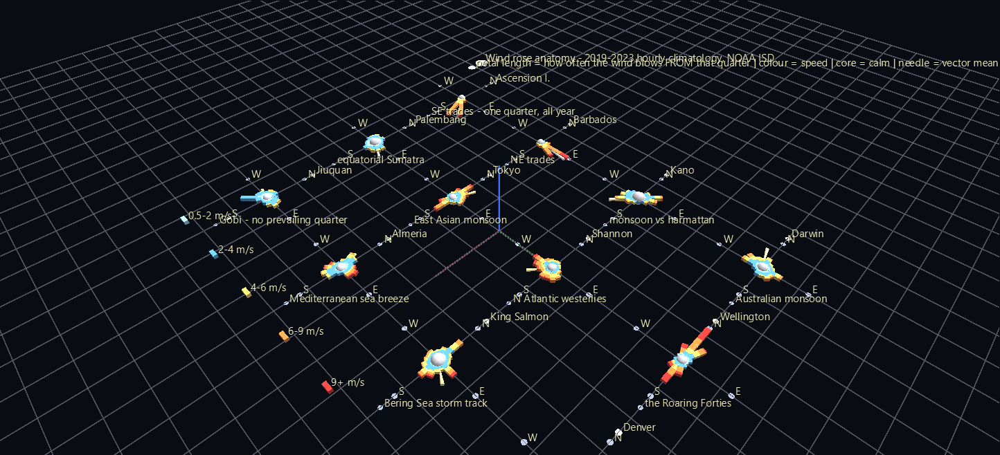

# The Wind Rose as a Hyperglyph

A wind rose is not an encoding invented to justify a nested glyph. It is the standard meteorological representation, and it already *has* an anatomy: a station hub carrying sixteen compass arms, each arm itself a stack of speed-bin segments. Three real levels of structure below the World Grid, and every level carries measured data.



**Try it:** download this example below (or [the full examples set](../getting-started/installation.md#example-scenes)), then open `Wind_Rose_Example/Rose_Anatomy/rose_anatomy_gv_node.csv` — or drag its folder onto the window.

[:material-download: Rose_Anatomy (11 KB)](https://iluvdata.org/glyphviz/zips/Wind_Rose_Example_Rose_Anatomy.zip){ .md-button }
[:material-download: Monsoon_Year (2 MB)](https://iluvdata.org/glyphviz/zips/Wind_Rose_Example_Monsoon_Year.zip){ .md-button }

## The two scenes — learn, then read

**`Rose_Anatomy/`** — twelve archetype stations on a plane, drawn large and labelled so a single glyph can actually be read. The pale core is how often the air is still; the sixteen petals are how often the wind blows *from* that quarter; the colour bands within a petal are wind speed; the slim needle is the vector-mean wind, long where the wind is persistent and stubby where it isn't.

**`Monsoon_Year/`** — 102 stations on the globe, animated through the twelve months. Every rose reshapes itself on the same clock. Press **Space** and the Atlantic trades barely stir while the glyphs around the Indian Ocean, West Africa and northern Australia swing bodily through 180 degrees. A marker tracks the subsolar latitude, which is the reason it happens.

## The physics fell out of the climatology

Nothing here was hand-picked to look good. The stations with the highest **directional constancy** — vector-mean wind divided by mean speed — are Ascension Island (0.98), Cape Verde, St Helena, Barbados and Fernando de Noronha. That is the trade-wind belt, recovered without being asked for. The lowest are continental interiors: Jiuquan in the Gobi (0.12), Sortavala in Karelia, Fort Smith in the Northwest Territories.

The largest January-to-July reversals of resultant wind direction are Kano (178°) and Bissau (177°) — the West African monsoon against the harmattan — followed by Palembang, Darwin (176°), Tokyo and Nikolaevsk-on-Amur. The Asian, Australian and East Asian monsoons, ranked correctly by a calculation that knew nothing about monsoons.

## Structure

```text
World Grid (globe, scale 3)
└─ station hub          topo = Cylinder, invisible placement frame
   ├─ calm core         sphere sized by the calm fraction
   ├─ resultant needle  cone aimed along the vector-mean wind
   └─ compass arm ×16   translate_x = 180 - bearing
      └─ speed segment  cube per speed bin, stacked outward
```

Two things this example demonstrates that generalize to any scene you build:

**Grid scale buys glyph size for free.** A World Grid's scale re-spaces child *positions* without touching subtree size — measured here, at scale 3 the hub separation goes from 9.99 to 29.96 world units while the arm offset stays 4.000 and the segment's world scale stays 0.5000. That's what lets the roses be 13 world units across without colliding.

**The 0.2 render floor lands on each node's own scale**, so a node authored below it is drawn bigger than it encodes and the encoding quietly lies. Rather than silently inflate a rare speed bin, sub-floor segments are **merged into a neighbour** — which keeps the petal's total length exactly right and costs only colour resolution in the tail.

## Honest caveats

The example's README states these plainly and they're worth repeating: frequencies are conditional on a direction report; diurnal sampling is corrected by inverse-frequency weighting so daylight-only stations aren't biased; petal length is clipped at 28% frequency as a fixed cross-station reference rather than self-normalising; stations above 85° latitude are excluded, because a compass rose is meaningless where local north depends on which meridian you pick. Five years is a climatology, not a climate trend.

## Data

NOAA NCEI **Integrated Surface Database (ISD-Lite)**, 2019–2023 hourly observations, public domain. 232 stations × 12 months vendored as a 1.9 MB CSV, so everything but the initial fetch works offline.
