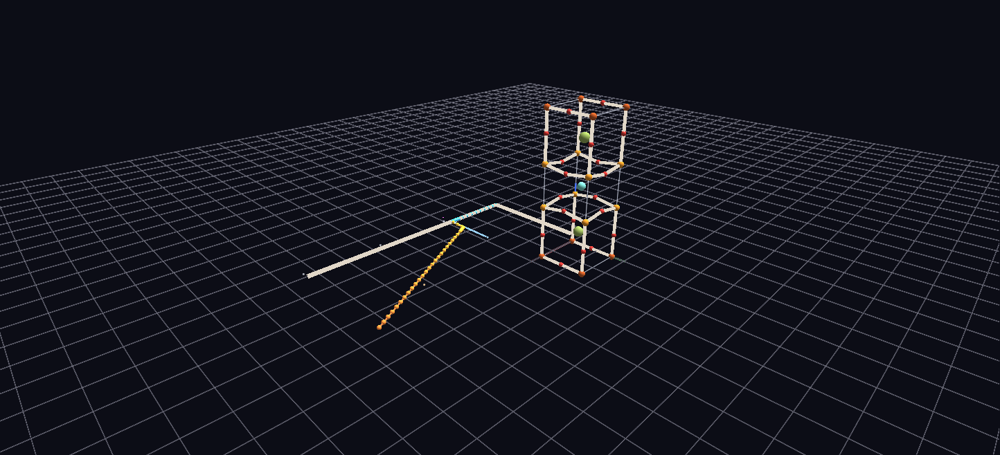

# YBCO Superconductor

The 1987 liquid-nitrogen superconductor YBa₂Cu₃O₇ as a materials-science story: the orthorhombic crystal structure, a resistivity-versus-temperature plot, literature links, and a Channels animation that ties the structure's symmetry directly to the physics.

**Try it:** [download the examples set](../getting-started/installation.md#example-scenes), then open `YBCO_Superconductor_Example/ybco_gv_node.csv` — or just drag its folder onto the GlyphViz window. Press **Space** to start the animation.

---

*A full write-up of this example is coming soon.*
