# A Guided Tour

This is the long-form walkthrough of GlyphViz's fundamentals — the window, the panels and menus, creating and shaping objects, building parent–child hierarchies, and finally topologies, the idea that makes GlyphViz a *hierarchical* visualizer rather than just a 3D scatter plotter. It assumes nothing beyond a working install ([Installation](installation.md)); if you only want the five-minute version, see the [Quickstart](quickstart.md).

Everything here is hands-on. Follow along in an empty scene — you don't need to load any data until the very last section.

!!! tip "Keyboard shortcuts in this tour"
    GlyphViz leans on single-key shortcuts the way ANTz does: **N**, **O**, **J**, **Tab**, and friends act on the 3D Viewer, so they need the Viewer to have keyboard focus. If a key seems dead, click once anywhere in the 3D view first.

## 1. Launch GlyphViz

Run `GlyphViz.exe` from the folder you extracted (Python users: `python main.py` from the repo). The window opens with an empty scene: a dark 3D **Viewer** in the center, panels docked around it, and two toolbars across the top.

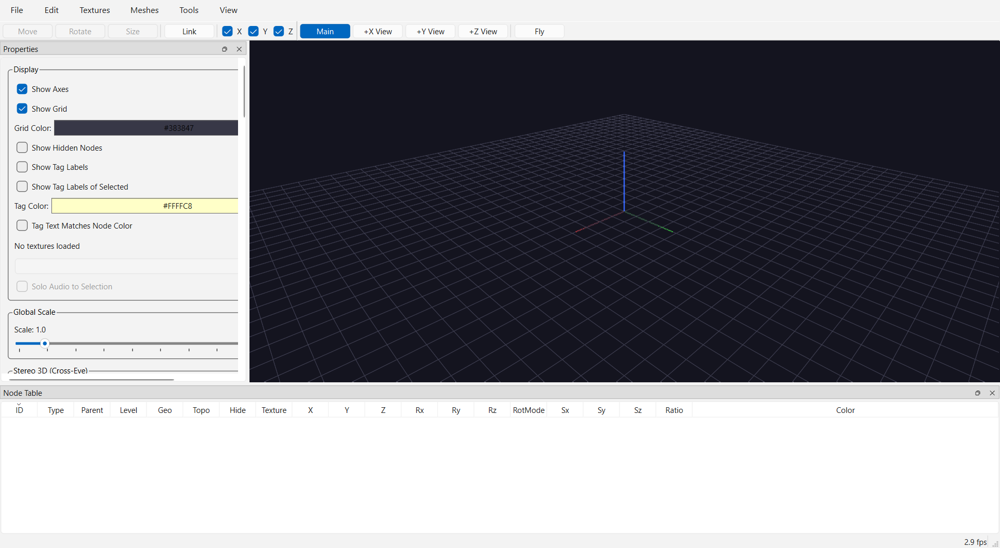

## 2. The window at a glance

Four regions, each of which we'll use in this tour:

| Region | What it is | Show/hide |
|---|---|---|
| **Viewer** | The 3D scene. Camera, selection, and all single-key shortcuts live here. | Always visible |
| **Properties panel** | Scene-wide display settings on top (background, grid color, tag settings); the selected node's editable fields below; New Object Defaults; the World Grid and Channels groups. | **Ctrl+P**, or View menu |
| **Node Table** | Every node as a sortable spreadsheet row — the same scene seen as data. Selecting a row selects it in the Viewer and vice versa. | **Ctrl+N**, or View menu |
| **Toolbars** | **Manipulate** (Move / Rotate / Size / Link buttons + X/Y/Z axis checkboxes) and **Camera** (Main / +X / +Y / +Z views + Fly). | View menu |

Both panels are standard dock widgets: drag their title bars to float or re-dock them, click their **×** to close, and reopen them from the **View** menu — every panel and toolbar has a checkable entry there, so nothing can get lost permanently.

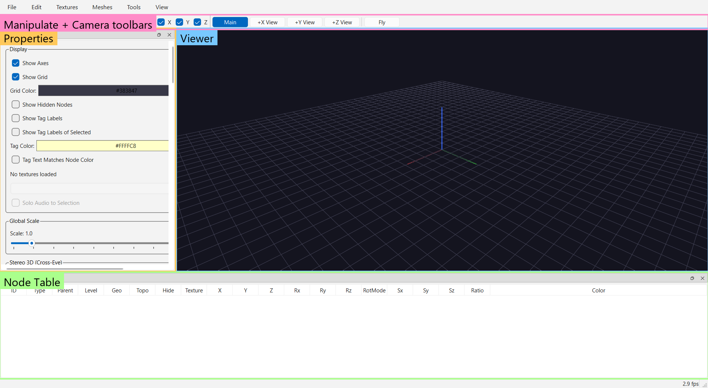

## 3. The menus

A quick orientation pass — details for each item live in the [Menus reference](../reference/menus.md):

- **File** — `Open Node CSV…` (**Ctrl+O**) loads a scene; `Merge Node CSV…` (**Ctrl+M**) loads a second file *into* the current scene; `Watch and Reload` (**Ctrl+R**) hot-reloads the open CSV whenever it changes on disk (great when a script is regenerating it); `Import PDB File…` brings in a protein structure; `Save` / `Save As…` write timestamped node+tag CSVs; `Save Scene as PNG…` (**F12**) captures the Viewer.
- **Edit** — `Copy` / `Paste` (**Ctrl+C/V**) duplicate a node *with its whole subtree*; `Invert Selection` (**Ctrl+I**). **Ctrl+A** selects all visible glyphs.
- **Textures** and **Meshes** — point GlyphViz at an image folder for textures; import OBJ/mesh files usable as node geometry.
- **Tools** — the `Glyph Composer…` (**Ctrl+G**) and `Hyperglyph Generator…` (**Ctrl+H**) builders; both are their own topic.
- **View** — display toggles (axes, grid, hidden nodes, tag labels, selection box, stereo 3D), `Camera Mode (Free Flight)` (**C**), `Follow Selected Node` (**F**), `Reset Camera`, and the panel/toolbar visibility entries from section 2.

You can drive this whole tour without the menus — but knowing `Reset Camera` exists will save you the first time you fly somewhere and lose the scene.

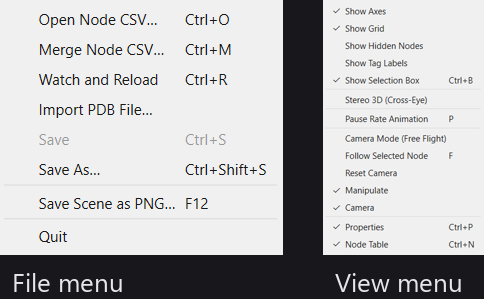

## 4. The Viewer: grid, axes, and colors

The empty Viewer isn't quite empty. Two pieces of furniture orient you:

- The **reference grid** — a flat lattice on the ground plane. Toggle: **View → Show Grid**.
- The **XYZ axes** — colored lines marking the world origin and directions. Toggle: **View → Show Axes**.

Neither is part of your data; they're never saved into your scene's nodes and never selectable.

Both the grid and the background are recolorable per scene, from the top of the **Properties panel**:

- **Background:** click the color button to pick any color. The **B** key toggles the background between black and white — the fastest way to check how a scene reads on a light background.
- **Grid Color:** click to recolor the reference grid to suit.

These choices are saved with the scene (they live on the scene's invisible World settings row), so a scene keeps its look when reopened.

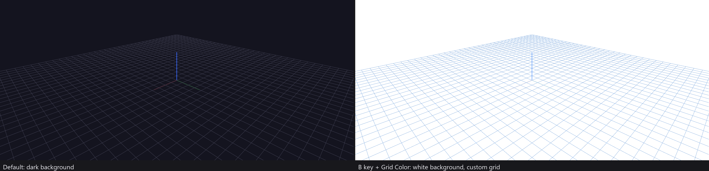

## 5. Create your first object — the N key

Click in the Viewer and press **N**. An octahedron appears at the origin.

That shape came from the **New Object Defaults** group in the Properties panel: every object you create with N gets the geometry, topology, scale, and color set there. The defaults start as a solid **Octahedron** — ANTz's traditional starter glyph — but change the dropdowns and subsequent N presses use your choices.

Make one change there now: set **Topology** to **None**. The panel's default, *Point*, is an ANTz convention that arranges a node's children *spherically around it* — translate values become angles. That's a powerful idea we'll meet properly in [section 12](#12-topologies-where-children-live), but for learning the hierarchy it's much clearer to work in plain Cartesian space, where translate values are ordinary X/Y/Z offsets.

Press **N** a few more times: each new object steps 10 units along the X axis from the last, so they line up in a row rather than stacking invisibly on top of each other. These are **root-level** objects — they have no parent and sit directly in world space.

!!! note "N is context-sensitive"
    With nothing selected (or a root-level object selected), N creates a new root object. If a *child* object is selected, N creates another child under the same parent — the same thing Shift+N does in section 8. When in doubt: click empty space to deselect, then N always makes a root.

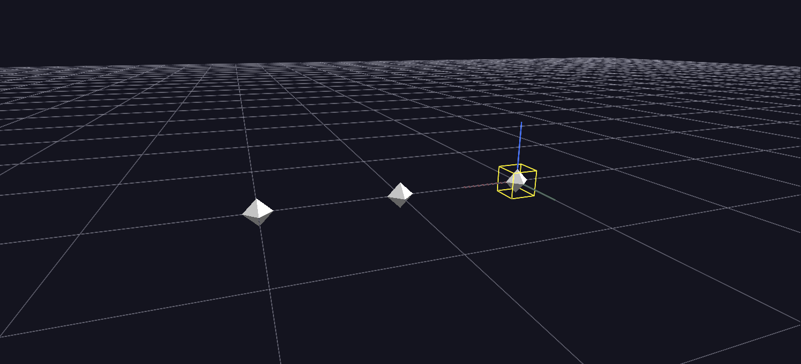

## 6. Fly to it and select it

Now get close to your first octahedron using the camera:

| Action | Binding |
|---|---|
| Orbit around the scene | **Left-drag** (right-drag also orbits) |
| Pan / slide | **Middle-drag** |
| Zoom | **Scroll wheel** |
| Frame a specific object | **Double-click** it |
| Recover from anywhere | **View → Reset Camera** |

Orbit and zoom until the octahedron fills a good part of the view, then **left-click** it. Two things happen:

1. A **yellow bounding box** appears around it. This is the selection halo: it tells you at a glance *what* is selected — invaluable once scenes have thousands of glyphs — and its extents show the object's actual bounds, which matters once scaling and children enter the picture. If it visually clutters a screenshot, **Ctrl+B** (View → Show Selection Box) hides it without deselecting.
2. The **Properties panel** fills its *Selected Node* fields with this object's id, position, rotation, scale, and color, and the **Node Table** highlights its row. Panel, table, and Viewer always agree about the selection.

**Ctrl+click** adds more objects to the selection; **Shift+drag** sweeps a rubber-band box around several at once; clicking empty space clears the selection.

There's also a real flight mode — **C** toggles **Camera Mode**, where holding the left button flies you continuously through the scene — but orbit/zoom is all this tour needs. Flight is covered in [Viewer Navigation](../reference/viewer-navigation.md).

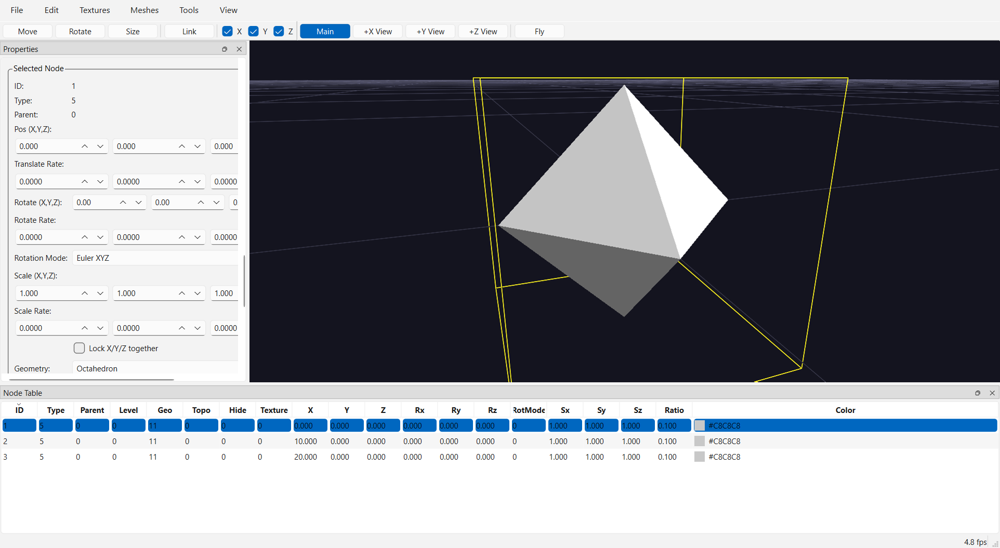

## 7. Cycle the geometries — the O key

With your octahedron still selected, press **O**. Its shape changes. Press it again. And again.

**O** cycles the selected object through every geometry GlyphViz can render — cube, sphere, cone, torus, dodecahedron, octahedron, tetrahedron, icosahedron, pin, cylinder, and more, each in solid and wireframe variants, plus the flat point/marker shapes. **Shift+O** cycles backward. This is the fastest way to audition shapes for a glyph design, and it works on a multi-selection too.

Cycle until you're back at the solid octahedron (or set Geometry back to *Octahedron* in the Properties panel dropdown — same field, two interfaces). Leave it selected; the next section builds on it.

The full catalog with pictures: [Geometries reference](../reference/geometries.md).

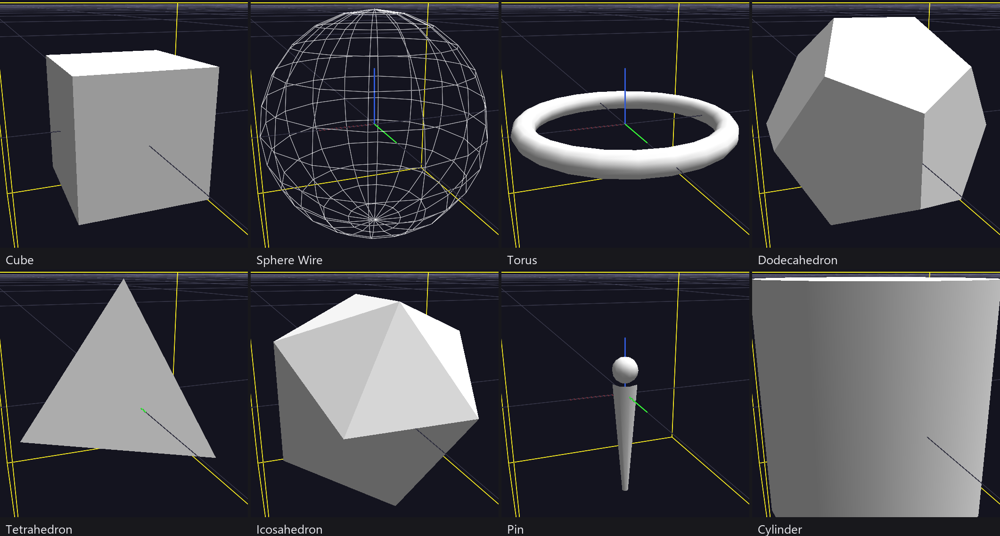

## 8. Give it children — Shift+N

With the octahedron selected, press **Shift+N**. A new object appears beside and slightly above it — a **child** of your octahedron. Press Shift+N several more times, and watch the children array themselves in a line: each new child places 5 units further along the parent's local **translate_x** axis, so siblings never stack.

Notice the parent *stayed selected* the whole time — Shift+N is built for exactly this "pump out a batch of children" gesture.

Two things make a child a child:

- Its **`parent_id`** field points at the parent (check the Node Table — you can watch the hierarchy exist as plain data).
- It lives in its parent's **local coordinate space**: its translate/rotate/scale are relative to the parent, not the world. Move the parent and every child comes along.

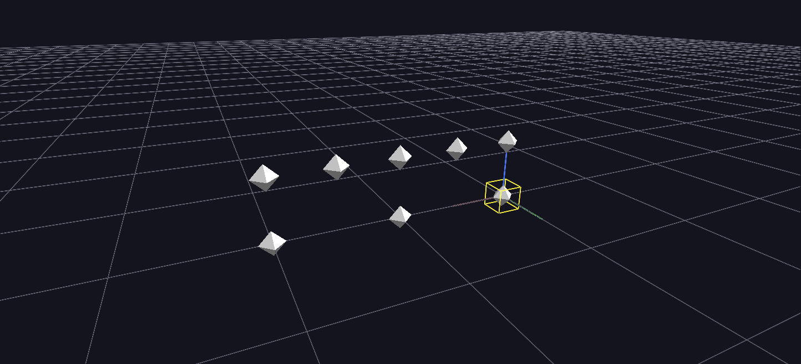

## 9. Go deeper — children of children

Click one of the children to select it, then press **Shift+N** a few times. Now *that* child has children. Select one of the grandchildren and do it again.

Do this repeatedly — seriously, it's the fastest way to internalize the model. There is no fixed depth limit worth worrying about: a scene is a **tree** (technically a forest — many roots), and everything in GlyphViz — placement, scale inheritance, animation, topologies — is defined in terms of parent→child relationships down this tree. A "glyph" in the ANTz sense is exactly one of these subtrees, designed so its shape encodes several data dimensions at once.

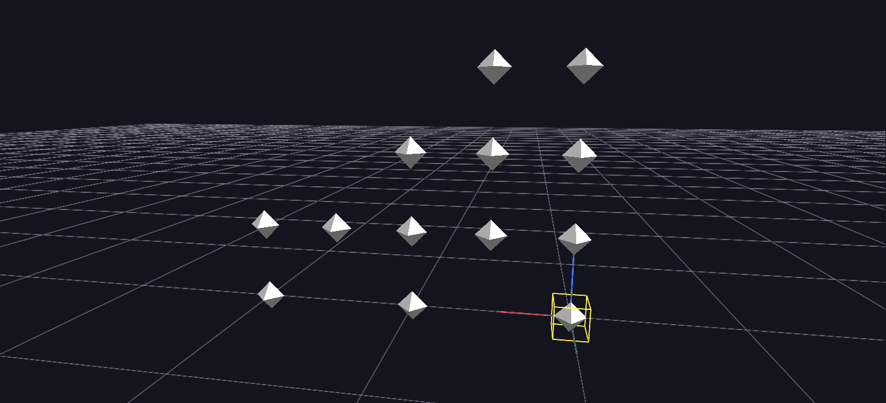

## 10. Walk the tree — and prune it

Building trees needs a way to move around them without hunting with the mouse. Four keys navigate the hierarchy from whatever is selected:

| Key | Moves selection to |
|---|---|
| **Tab** | Next sibling (same parent) |
| **Shift+Tab** | Previous sibling |
| **↓** (down arrow) | First child — one level deeper |
| **↑** (up arrow) | Parent — one level up |

Try it: select a grandchild, walk **↑** up to the root, **Tab** across the roots you made in section 5, **↓** back down a branch. The yellow box hops from node to node as you go.

Now prune. Navigate to a mid-level node that has children under it and press **Delete** (or Backspace). The node disappears **and so does its entire subtree** — every descendant goes with it. Its parent and the rest of the tree are untouched. That's the deletion contract everywhere in GlyphViz: a node always brings its descendants, whether you're deleting, copying (Ctrl+C), or pasting (Ctrl+V).

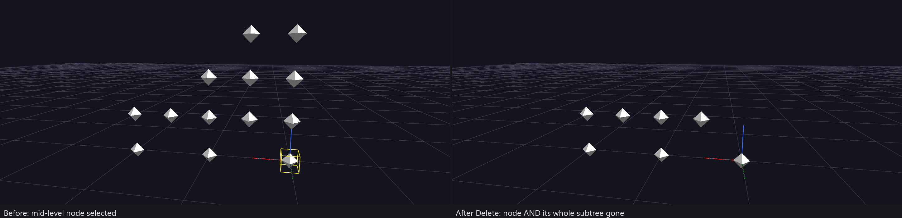

## 11. Shape an object — every way to modify it

Select any object (or press N for a fresh one) and work through its *Selected Node* fields in the Properties panel:

- **Position** — edit `translate_x/y/z` directly, or click the **Move** button on the Manipulate toolbar and drag the object in the Viewer. The X/Y/Z checkboxes beside the mode buttons confine the drag to specific axes; with all three checked, the left button drags the first two axes and the right button drags the third.
- **Rotation** — `rotate_x/y/z` in degrees, or **Rotate**-mode dragging. New objects use intuitive per-axis Euler rotation. (Loaded ANTz-era files use the legacy Heading/Tilt/Roll convention; the `rotation_mode` field switches between them.)
- **Scale** — `scale_x/y/z`, or **Size**-mode dragging. Non-uniform scale is fine: a stretched octahedron is a legitimate glyph element.
- **Color** — the color button opens a picker; alpha gives you translucency. The **=** and **−** keys step the selected object through its color palette, which is its own topic ([color palettes](../reference/properties-panel.md)).
- **Geometry / Topology** — the dropdowns behind the O and J keys.

Now the important experiment: give your object a child (Shift+N), then re-select the **parent** and change things.

- **Move the parent** → the child moves with it, keeping its relative offset.
- **Rotate the parent** → the child orbits around it, because the child's position is expressed in the parent's rotated frame.
- **Scale the parent** → the child's position *and* rendered size scale along, keeping the family proportional.

The child's own numbers never changed — check its row in the Node Table. Everything a parent does composes onto its descendants. This is what makes a multi-level glyph act like one object.

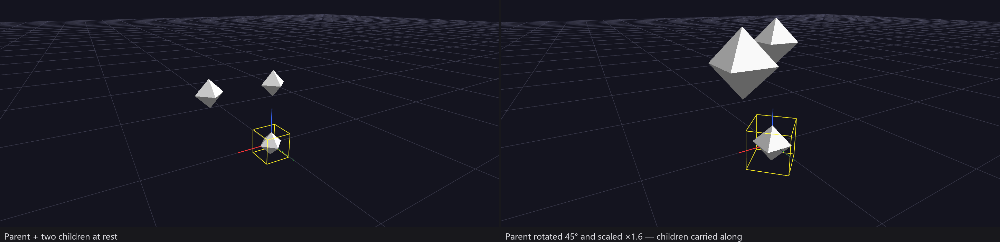

## 12. Topologies — where children live

So far every child has hung in Cartesian space beside its parent. **Topology** is the property that changes that: it declares what kind of *surface or space* a node offers its children, and reinterprets the children's `translate_x/y/z` accordingly.

Select a parent that has several children and press **J** (like O, but for topology — **Shift+J** cycles backward). Watch the children snap into completely different arrangements:

- On a **Sphere** parent, a child's translate_x/y become **longitude and latitude** — children sit *on the sphere's surface*, and translate_z lifts them off it like altitude.
- On a **Torus**, children ride the ring.
- On a **Cylinder**, they wrap the barrel.
- On a **Spiral**, they wind outward along a coil.
- **Cube** places children on its six faces (the `facet` field picks which).
- **Plot** and **Surface** are GlyphViz extensions for line plots and deformable grids.
- Back on **Cube-space/None**, translate is plain Cartesian again — what you've used all tour.

Same children, same stored numbers, radically different structure — topology is *the* mechanism behind glyph design, and it nests: a sphere parent can have torus children with their own children on each ring.

Two examples make this concrete; both ship in the examples set:

- **`Topology_Example`** — a labeled scene laying the topologies out side by side, each parent showing how its children place. Load its `topology_example_gv_node.csv` and orbit around.
- **`Channel_Parameters_Example`** — press **Space** after loading, and station 2 *animates* a parent's topology stepping through Sphere → Torus → Cylinder → Cube → Spiral while its 12 children continuously re-lay themselves out. Watching that loop for thirty seconds teaches more than any paragraph.

The full placement math, per topology: [Topologies reference](../reference/topologies.md).

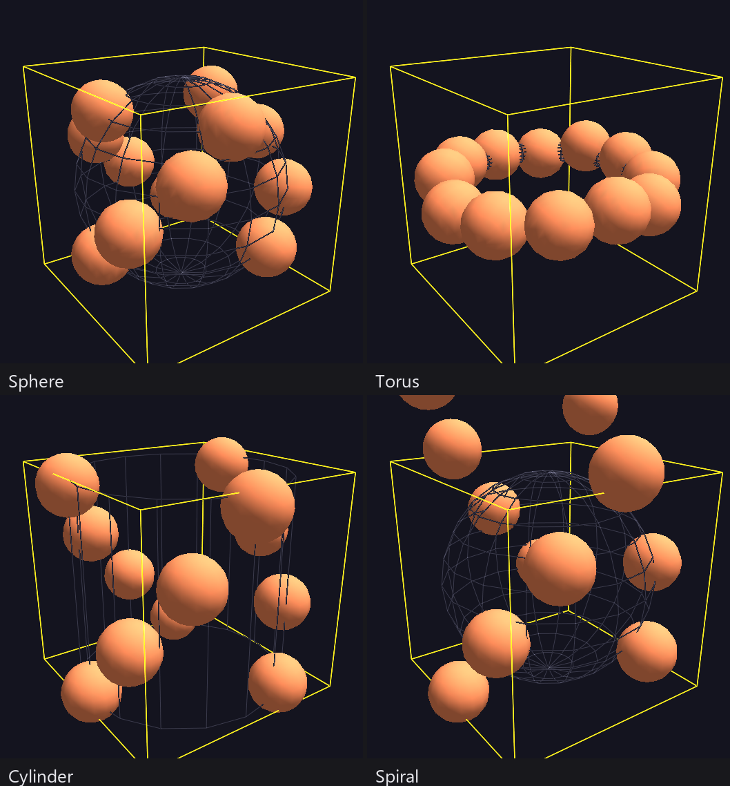

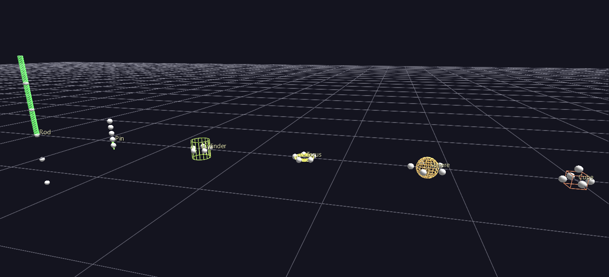

## 13. Where to go next

You now have the core loop: create (N / Shift+N), navigate (Tab / arrows), select, shape (O / J / Properties), and compose hierarchies whose parents carry their children. From here:

- **Load real scenes** — grab the examples zip (see [Installation](installation.md)), then just **drag any example folder or zip onto the window** ([Drag and Drop](../reference/drag-and-drop.md)).
- **Save your work** — **Ctrl+S** writes a timestamped node+tag CSV pair; everything you built this tour is plain CSV data you can open in a spreadsheet.
- **Let Claude build scenes for you** — the **GlyphViz Skill** teaches Claude to generate valid scene CSVs directly from your data and a description of what you want. For most real datasets this is the fastest path to a first visualization, with the skills from this tour used to refine the result by hand.
- **Go deeper in the reference** — [Viewer Navigation](../reference/viewer-navigation.md) (flight mode, follow, stereo 3D), [Properties Panel](../reference/properties-panel.md), [Topologies](../reference/topologies.md), and [Channels Animation](../reference/channels-animation.md) when you're ready for time-series playback.
