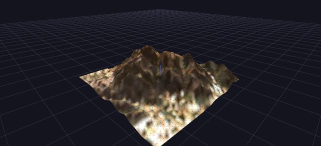
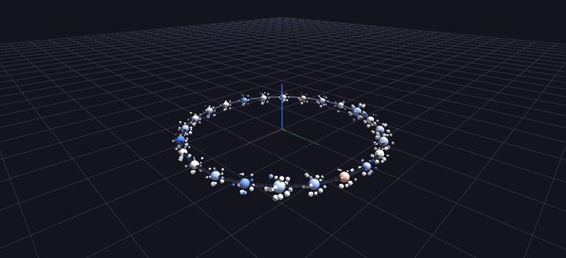
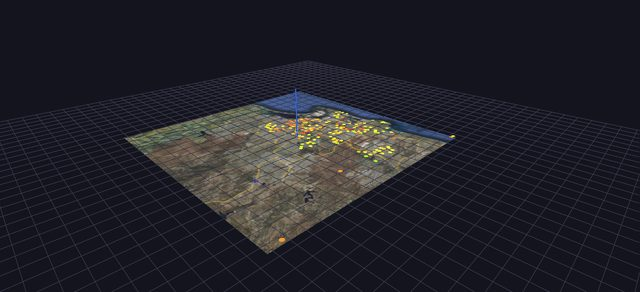
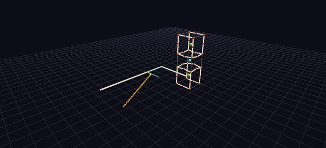

# GlyphViz

**A 3D hierarchical visualization toolkit for hyperdimensional data.**

GlyphViz renders structured data — node hierarchies, time series, gene networks, EEG signal fields, strange attractors — as navigable 3D scenes. It is built in the lineage of [ANTz](https://github.com/openantz/antz), extending its node/tag model into a modern Python toolkit while preserving exact rendering fidelity with the original.

GlyphViz is not a charting library. It treats *data structure as scene structure* — hierarchy becomes spatial nesting, relationships become topology, and dimensions beyond the third are recovered through projective geometry rather than discarded.

  An interactive 3D scene showing GlyphViz's own node hierarchy: an indigo torus parent orbited by a teal sphere, an indigo cylinder, and a coral cone, with a smaller sphere orbiting the teal sphere as its own child node. Drag to rotate the view.
  

  
Drag to orbit — this is a live render of GlyphViz's own node hierarchy: parent, children, and one grandchild.

*Every frame in the carousel above is an actual GlyphViz scene — no mockups. Full source and data for each ships in the [Examples Gallery](examples/index.md).*

---

## Try it right now — no install

**[GlyphViz Web](https://www.iluvdata.org/glyphvizweb/)** is a full browser implementation: open the link, drag in a node CSV, and you're in a live scene — nothing to download, nothing to install. It's a from-scratch WebGL rewrite (Three.js), not a stripped-down port, reading the same native `gv_` scene format as desktop, and it has closed most of the gap with the desktop app — node creation and editing, selection, tags, Channels animation, color palettes, even cross-eye stereo 3D all work in-browser today.

### …including in VR

Open that same link in a headset's browser and press **Enter VR**, and you are standing *inside* the scene — fly through it, grab and resize it with both hands, point at a glyph to select it, all from a wrist-mounted control panel. It's [WebXR](reference/immersive-vr.md): no app to sideload, no PC-VR link, no cable. Confirmed on a Meta Quest 3; any WebXR-capable headset browser, Apple Vision Pro included, should work the same way.

[:material-open-in-new: Launch GlyphViz Web](https://www.iluvdata.org/glyphvizweb/){ .md-button .md-button--primary target=_blank rel=noopener }
[:octicons-arrow-right-24: VR controls](reference/immersive-vr.md){ .md-button }
[:octicons-arrow-right-24: Prefer the desktop app?](getting-started/installation.md){ .md-button }

---

## Why GlyphViz

- **Hierarchical by design** — node and tag relationships map directly onto 3D spatial hierarchy, the way ANTz originally intended.
- **Validated, not just tested** — every release is checked against a golden-master oracle: the original ANTz C renderer, instrumented to dump its exact transformation matrices, compared frame-for-frame against GlyphViz's output.
- **Built for real scientific data** — spatiotemporal EEG, RNA-seq expression networks, longitudinal health records, and chaotic dynamical systems are first-class use cases, not afterthoughts.
- **Hyperdimensional-aware** — when your data has more than three dimensions, GlyphViz doesn't just drop the rest. Projective geometry and phase-space embedding techniques (Takens delay embedding, strange attractor reconstruction) bring higher-dimensional structure into a space you can actually navigate.
- **Everywhere you want it** — the desktop renderer (`glyphviz_gl`) and the OpenXR spike (`glyphviz_xr`) share one core engine (`glyphviz_core`); GlyphViz Web is a separate, browser-native implementation of that same scene format, with its own [WebXR immersive mode](reference/immersive-vr.md). So the same CSV opens in the full desktop app, in a browser tab with no install, or in a headset — from one link.

---

## Where to start

- 

    :material-rocket-launch:{ .lg .middle } **New to GlyphViz?**

    ---

    Get it installed and render your first scene in a few minutes.

    [:octicons-arrow-right-24: Quickstart](getting-started/quickstart.md)

- 

    :material-book-open-page-variant:{ .lg .middle } **Want to understand the model first?**

    ---

    Nodes, tags, hierarchy, and how the ANTz lineage shapes everything.

    [:octicons-arrow-right-24: Core Concepts](getting-started/core-concepts.md)

- 

    :material-image-multiple:{ .lg .middle } **Want to see what's possible?**

    ---

    Real visualizations — EEG fields, gene networks, strange attractors — with full source.

    [:octicons-arrow-right-24: Examples Gallery](examples/index.md)

- 

    :material-map:{ .lg .middle } **Curious where this is headed?**

    ---

    WebXR deployment, an AI-to-topology bridge, and the long-range plan.

    [:octicons-arrow-right-24: Roadmap](roadmap.md)

---

*GlyphViz is under active development. This documentation site is a working scaffold — most sections are placeholders being filled in incrementally.*
