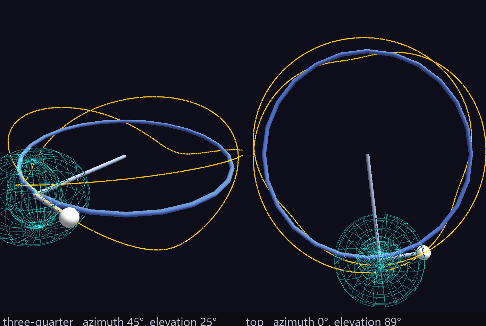
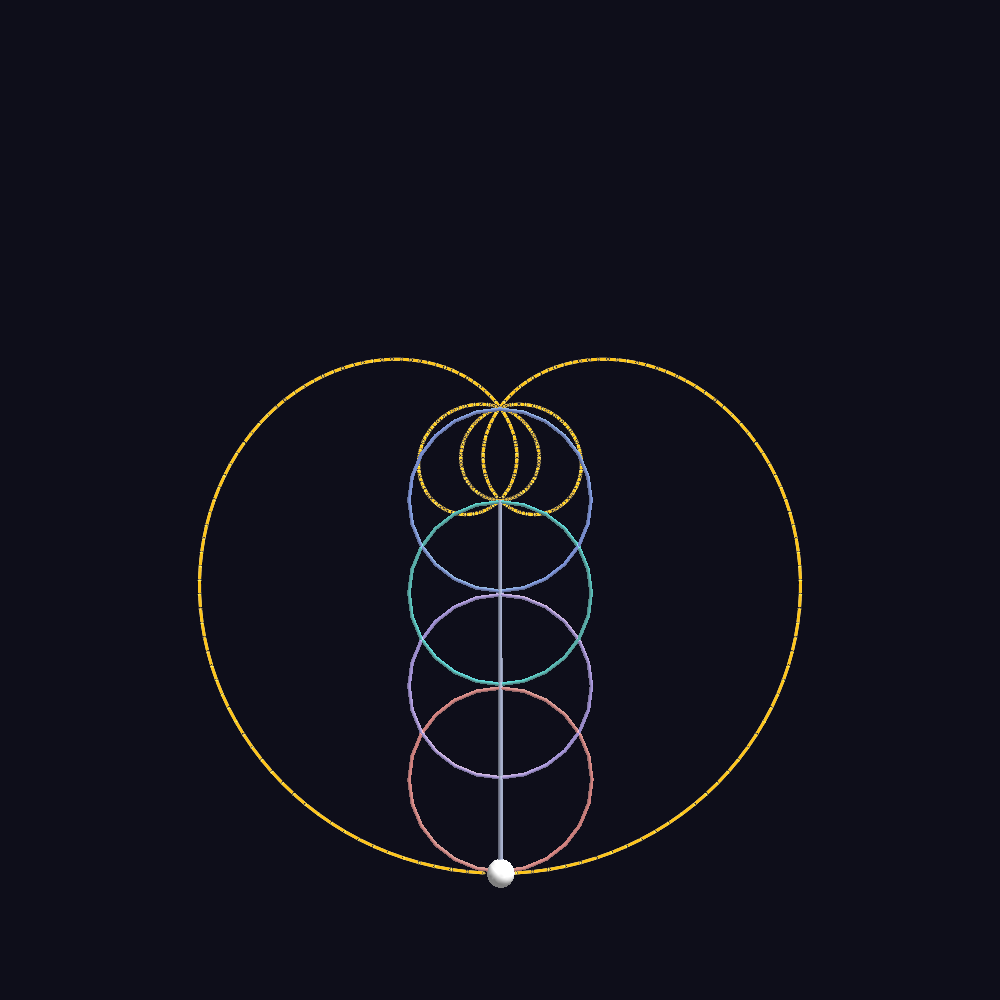

# Epitrochoid Generator

**Tools → Epitrochoid Generator… (Ctrl+E)**

Designs an **epicycle chain** — a Fourier series built out of nested
[Torus-topology](topologies.md) parents — and lets the pen at the end of the
chain draw its own path.

Unlike the [Tree Designer](tree-designer.md), which exports a
[Glyph Composer](glyph-composer.md) template, this one writes **node CSVs**
directly. It has to: a tree *is* a recipe, but an epicycle chain's whole point
is the traced curve, and that curve only exists once the chain has been walked.
Save Scene therefore writes a complete, loadable folder.

## The idea

Five nodes, each the child of the last, every one of them Torus topology, each
spinning its `translate_x` at a constant rate. Because each level's angle is
measured in its **parent's rotating frame**, the angles compose down the chain,
and the pen at the end traces the *sum* of the arms — which is exactly what a
Fourier series is.

Each arm contributes one term:

| control | what it sets | in the series |
|---|---|---|
| **Rate X** | orbit angle, degrees per frame | the **harmonic** |
| **Length** | the arm's radius, world units | the **amplitude** |
| **Phase X** | starting orbit angle | the **phase** |

and two more take the figure out of the plane:

| control | what it does |
|---|---|
| **Tilt** | leans this arm's orbit plane out of the previous arm's, in degrees |
| **Tube** / **Rate Y** / **Phase Y** | gives the arm a *second* circle riding the first, around the torus tube |

### The harmonic ladder

Rates do not map to harmonics one-for-one. Each level's `rotate = (90, 90, 0)`
cancels the base rotation Torus topology applies to its children, and that
cancellation leaves the frame's **handedness flipped**. So the magnitudes add,
with the sign alternating:

```
h₁ = r₁
hₖ = hₖ₋₁ + (−1)^(k−1) · rₖ
```

Rates `(+1, −1, +1, −1)` therefore climb to harmonics **1, 2, 3, 4** rather than
collapsing to 1, 0, 1, 0. The readout under the preview shows the ladder your
current rates produce, so you never have to work it out by hand.

That rotation is load-bearing, not decoration. Without it the rings tip 90° out
of plane at every level, the chain corkscrews off the *z* = 0 plane, and the
construction stops being a Fourier series at all.

### Amplitudes live one level up

A node's torus **is** the circle its child rides, and its radius is that node's
cumulative scale — so the arm lengths you type are produced by the scale of the
node one level *up*. The designer telescopes that for you; you author every
`Length` directly in world units at any depth.

### The tube is a sideband generator

An arm at harmonic *h* with tube rate *r* contributes **h**, **h − r** and
**h + r** in the plane, plus pure out-of-plane motion at *r*. That is what turns
a flat rosette into a genuine space curve, and with two arms it is a torus knot.

The tube is carved *out* of the arm rather than added to it, so `Length` stays
the true arm length, and the parent's drawn ring becomes the tube its child
actually travels. Rings thicker than a hairline are drawn as **wireframe** —
a solid one at that size is an opaque doughnut that hides the mechanism it
exists to show.



## The readout

Under the preview, all of it **measured** from the traced path rather than
predicted:

- **Harmonic ladder** — what your rates actually produce.
- **Closes in N frames** — the exact period after which every angle is back
  where it started, computed in rationals so ½ or ⅓ give the right answer. A
  curve that closes is a figure; one that does not is a smear, and the readout
  says which you have.
- **Spectrum** — the complex DFT of the traced curve, in the same units as
  Rate X. Sidebands from Tube and Tilt show up here even though you never typed
  them.
- **Figure** — planar or 3-D and how deep, plus half-span and node count.

## Output

**Save Scene (CSV)…** writes a folder containing:

- `<name>_gv_node.csv` — the chain, the linkage, and the trail
- `<name>_gv_tag.csv` — a label on every structural node
- `<name>_gv_ch-map.csv` + `<name>_gv_ch-tracks.csv` — only when **Self-drawing
  trail** is on

One folder per scene is required, not tidiness: GlyphViz auto-loads
[Channels](channels-animation.md) only when it finds exactly **one** ch-map and
**one** ch-tracks file beside the node CSV. Two candidates in one directory
disable Channels entirely, and silently.

**Insert into Scene** adds the design to the scene already open, as new roots.

**Save Design…** writes the parameters as `.json` so a hand-tuned design can be
reopened *here* later. It is never needed to view or share a result — that is
what the CSVs are for.

## The trail

The traced curve is a transparent **Plot-topology** parent holding one
**Point**-geometry bead per sampled frame, at the pen's world position. Plot
draws a polyline through its children in CSV row order, so that polyline *is*
the curve.

Three details that matter if you build one by hand:

- The Plot parent is `color_a = 0`, **not** `hide = 1`. A hidden plot parent
  suppresses the polyline entirely.
- The line takes its **colour from each bead** and its **width from the
  parent's** `ratio × 20` pixels.
- Bead positions are sampled from the live engine, not recomputed — which is why
  the trail sits on the curve to the CSV's own write precision.

With **Self-drawing trail** on, each bead's alpha steps from 0 as the pen
arrives, so the curve draws itself during playback (Space in the main window).
Beads share an alpha channel in small groups to keep the tracks file compact;
a group lights when its **last** bead is reached, so the line trails the pen by
a fraction of a second rather than ever running ahead of it.

## Preview

The preview always runs on `translate_rate` with the trail fully drawn, even
when Self-drawing is checked — so you can watch the pen ride a curve that was
computed independently of it, which is the correctness check, on screen.
Self-drawing changes only what Save Scene writes.

The camera stays where you put it across edits. **Reset View** re-frames.

## Worked examples

`examples/Fourier_Epicycles_Example/` ships six scenes built from this same
engine — the planar original, a self-drawing version, a square wave from odd
harmonics, and three that leave the plane. Its README explains each one.



## What the curve is called

Not a Lissajous figure — that is a *product* of two independent 1-D
oscillations. This is a *sum* of rotating vectors: the epitrochoid family. Two
terms give the textbook epitrochoid/hypotrochoid (the Spirograph curve); *n*
terms give an epicyclic curve, or a truncated Fourier series curve. It is the
same construction as the classical deferent-and-epicycle planetary models, which
is why the linkage on screen looks like an orrery.
