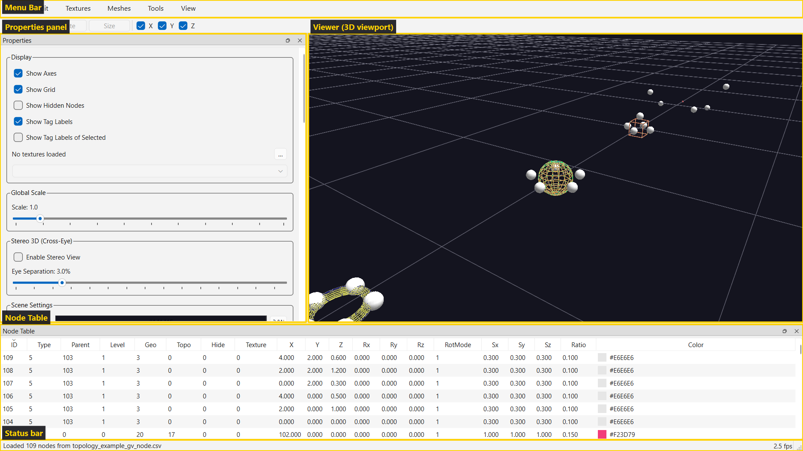
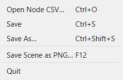
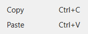
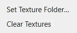
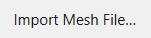
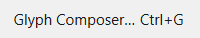
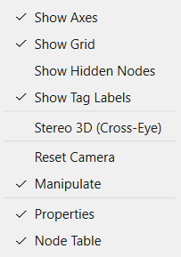

# Menus

The full menu tree, read directly from `MainWindow._build_menu()` in
`glyphviz_gl/main_window.py:138-239`. GlyphViz has **six** top-level menus —
File, Edit, Textures, Meshes, Tools, View. There is no Node or Help menu.

## File

| Item | Shortcut | Action |
|---|---|---|
| Open Node CSV… | Ctrl+O | Opens a node CSV via file dialog; auto-loads a matching tag file, a `media/` texture folder next to the CSV, and a Channels animation pair if present (`_open_csv` — `main_window.py:927-958`) |
| Merge Node CSV… | Ctrl+M | Loads a second node CSV (and its companion tag file) **into** the current scene instead of replacing it. The merged nodes get fresh ids above the existing ones and keep their own coordinates, so the two scenes overlay in the same world space; the camera, the loaded texture set, and any running Channels playback all survive (`_merge_csv`) |
| Watch and Reload | Ctrl+R | Checkable. Polls the open node CSV's modification time once a second and hot-reloads the scene whenever another program rewrites it, such as a generator script running in a loop; the camera, selection and Channels playback survive each reload. A merge turns it off, since the scene in memory no longer matches the file (`_toggle_watch_reload`) |
| Import PDB File… | — | Loads a `.pdb` protein structure: atoms become sphere nodes and distance-inferred bonds become links. Replaces the current scene. See [Protein Import](../examples/protein-import.md) (`_import_pdb_file`) |
| Save | Ctrl+S | Overwrites the currently-open file; if it was opened un-stamped, silently stamps it first rather than clobbering the original (`_save_csv` — `main_window.py:1055-1065`) |
| Save As… | Ctrl+Shift+S | Saves under a fresh `YYYYMMDDHHMMSS`-stamped name (`_save_csv_as` — `main_window.py:1067-1078`) |
| Save Selection As… | Ctrl+Alt+S | Writes just the selected nodes (and, by default, their descendants) to a node CSV of their own, with their tag, scene-settings and Channels companions. A node whose parent is left behind keeps its world placement, so the fragment reopens looking exactly as it does here. Greyed out with nothing selected. See [Save Selection](save-selection.md) (`_save_selection_as`) |
| *(separator)* | | |
| Save Scene as PNG… | F12 | Saves the current viewport exactly as displayed (`_save_scene_png` — `main_window.py:1108-1123`) |
| *(separator)* | | |
| Quit | — | Closes the window |

Open and Merge both have a drag-and-drop equivalent: dropping a node CSV, a
scene folder, or a zip onto the window opens it, and Shift+drop merges. See
[Drag and Drop](drag-and-drop.md).

## Edit

| Item | Shortcut | Action |
|---|---|---|
| Copy | Ctrl+C | Copies the selected node and its full descendant subtree (`_copy_selected` — `main_window.py:2021`) |
| Paste | Ctrl+V | Pastes the copied subtree as a new sibling with fresh ids (`_paste_clipboard` — `main_window.py:2039`) |

## Textures

| Item | Action |
|---|---|
| Set Texture Folder… | Loads images from a folder in alphanumeric order — texture ID 1 = first file, 2 = second, etc., matching the ANTz `usr/images/` convention (`_browse_texture_folder` — `main_window.py:960-970`) |
| Clear Textures | Unloads all textures, reverting to solid-color rendering (`_clear_textures` — `main_window.py:1032-1036`) |

## Meshes

| Item | Action |
|---|---|
| Import Mesh File… | Loads an OBJ/STL/PLY/glTF file as a `GEO_MESH` shape — applies to the selected node if exactly one is selected, otherwise creates a new root node (`_import_mesh_file` — `main_window.py:989-1030`) |
| Import Model with Materials… | Splits a multi-material model (OBJ + MTL) into one node per material under a hidden rig node, writing the parts into the scene's `meshes/` folder and each material's texture into `media/`. Use this for a downloaded model that came with textures; use Import Mesh File when you want the model as one shape. See [Imported Meshes](imported-meshes.md#importing-a-model-that-already-has-materials) (`_import_model_with_materials`) |
| Import Point Cloud… | Loads a LIDAR or scan file (LAS, LAZ, PLY, XYZ, PTS) as a [Point Cloud topology](topologies.md#point-clouds-topology-18) node — one real, clickable node per point. Opens an options dialog first that reports what is in the file, then merges the result into the current scene. See [Importing point clouds](point-cloud-import.md) |

## Tools

| Item | Shortcut | Action |
|---|---|---|
| Glyph Composer… | Ctrl+G | Opens the hierarchical glyph-template builder dialog — see [Glyph Composer](glyph-composer.md) (`_on_glyph_composer` — `main_window.py:984-987`) |
| Hyperglyph Generator… | Ctrl+H | Procedurally generates one randomized multi-level hyperglyph from a branch-level count and a node budget — see [Hyperglyph Generator](hyperglyph-generator.md) (`_on_hyperglyph_generator`) |

## View

All items below F12/Ctrl+G's row are checkable toggles. Most mirror an
identically-named control in the [Properties Panel](properties-panel.md) — the
Display group for the Show Axes/Grid/Hidden/Tag items, the Select By group for
Show Selection Box — and the two stay in sync, because a single setter updates
the menu action, the panel control and the viewport together (`_set_axes`,
`_set_grid`, `_set_selection_box`, etc.). Pause Rate Animation, Follow Selected
Node and Reset Camera have no panel counterpart.

| Item | Default | Notes |
|---|---|---|
| Show Axes | ✓ checked | `main_window.py:304-307` |
| Show Grid | ✓ checked | `main_window.py:309-312` |
| Show Hidden Nodes | ☐ unchecked | `main_window.py:314-317` |
| Show Tag Labels | ✓ checked | Tooltip notes the **T** key toggles the same state. On by default, paired with the Properties panel's *Show Tag Labels of Selected* (also on) — so labels appear when you select a glyph rather than all at once (`main_window.py:319-323`) |
| Show Selection Box | ✓ checked | **Ctrl+B** — hide the yellow bounding box around selected nodes without deselecting them, e.g. for a clean screengrab. Mirrored by *Show selection box* in the Properties panel's Select By group, not the Display group (`main_window.py:325-336`) |
| Show Transform Handles | ✓ checked | Draw the red/green/blue X/Y/Z handles on the selected node while Move/Rotate/Size is armed, and let them be dragged directly. Unchecking leaves the armed mode and its free-form axis drags exactly as they were — see [Transform handles](viewer-navigation.md#transform-handles) |
| Enforce Minimum Glyph Size (0.2) | ☐ unchecked | Clamp every glyph's rendered size (`scale_x/y/z` × Global Scale) to at least 0.2 per axis, so a very small or zero-scale node stays visible and clickable. Off by default: glyphs render at exactly their authored scale. World Grid footprints are never clamped. Mirrored in the Properties panel's Global Scale group |
| *(separator)* | | |
| Stereo 3D (Cross-Eye) | ☐ unchecked | Side-by-side cross-eye stereo pair; disables rubber-band select and the transform handles while active (`main_window.py:339-348`) |
| *(separator)* | | |
| Pause Rate Animation | ☐ unchecked | **P** — freeze all `translate_rate`/`rotate_rate`/`scale_rate` animation in place, then resume with the original rates (`main_window.py:351-360`) |
| *(separator)* | | |
| Follow Selected Node | ☐ unchecked | **F** — keep the camera centered on the selected node as it moves (`main_window.py:363-372`) |
| Reset Camera | — | See [Viewer Navigation](viewer-navigation.md#camera-controls) (`main_window.py:373`) |
| Manipulate | ✓ checked | Toggles visibility of the Manipulate (Move/Rotate/Size) toolbar (`main_window.py:279`) |
| *(separator)* | | |
| Properties | ✓ checked | Toggles visibility of the Properties dock (`main_window.py:899-900`) |
| Node Table | ✓ checked | Toggles visibility of the Node Table dock (`main_window.py:911`) |

The last four items (Manipulate/Properties/Node Table) are Qt's built-in
`toggleViewAction()` for each dock/toolbar, appended by the widget-building
methods that own them rather than by `_build_menu()` itself — that's why
they're interleaved with separators added later in `MainWindow.__init__`'s
build order (`_build_viewport` → `_build_menu` → `_build_manipulate_toolbar`
→ `_build_panel` → `_build_table`, `main_window.py:102-107`).

## Next step

See [Viewer Navigation](viewer-navigation.md) for mouse/keyboard equivalents
of common menu actions.
