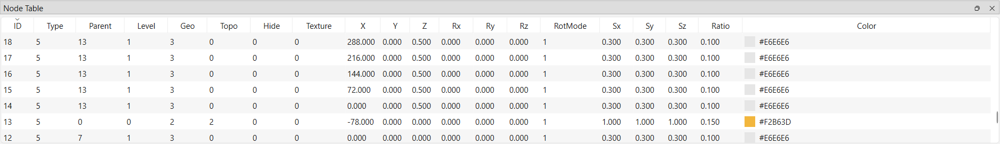

# Node Panel

!!! note "Naming correction"
    In the GUI itself this dock is titled **"Node Table"**
    (`QDockWidget("Node Table", ...)` — `glyphviz_gl/main_window.py:903`), and
    its widget class is `NodeTableView` (`glyphviz_gl/node_table.py`). It is
    **not a hierarchy tree** — see below. This page keeps the "Node Panel"
    filename/title for site navigation continuity, but the correct in-app
    name is Node Table.

## What the Node Panel (Node Table) actually is

It's a flat, sortable, filterable `QTableView` — one row per node, columns
for the node's raw attributes. There is **no tree structure, no expand/
collapse, no indentation by hierarchy depth, and no drag-and-drop
reparenting.** Parent/child relationships are visible only as a plain
`Parent` column holding the parent's node ID (`_COLUMNS` —
`glyphviz_gl/node_table.py:11-32`).

Columns, in order: **ID, Type, Parent, Level, Geo, Topo, Hide, Texture, X, Y,
Z, Rx, Ry, Rz, RotMode, Sx, Sy, Sz, Ratio, Color** (`node_table.py:11-32`).
Every column is sortable by clicking its header (`setSortingEnabled(True)` —
`node_table.py:106`); the `Color` column shows both a swatch and hex text.

## Confirmed capabilities

- **Multi-select**: `ExtendedSelection` mode — click, Ctrl+click, Shift+click,
  and drag all work as in any standard list/table (`node_table.py:105`).
- **Selection sync with the Viewer**: bidirectional. A Viewer click/rubber-band
  selection replaces the table's selection (`select_by_id`/`select_by_ids` —
  `node_table.py:147-189`, wired from `_on_viewport_pick*` —
  `main_window.py:1267-1277`), and a table selection change highlights the
  same nodes in the Viewer and repopulates the
  [Properties Panel](properties-panel.md) inspector
  (`_on_table_selection` — `main_window.py:1281-1307`).
- **Double-click a row**: frames/zooms the Viewer camera on that node
  (`_on_table_double_click` → `Viewport.focus_on_node` —
  `main_window.py:1796-1800`).
- **Live refresh**: editing a node via the Properties Panel or a Viewer drag
  updates that row in place (`refresh_node` — `node_table.py:191-198`).

## Confirmed absent

- **No expand/collapse or indentation** — it's a table, not a `QTreeView`.
- **No drag-and-drop reparenting** — `node_table.py` never calls
  `setDragEnabled`/`setAcceptDrops`, and there's no drop-handling code
  anywhere in `glyphviz_gl/`.
- **No right-click context menu** — no `customContextMenuRequested` connection
  or `contextMenuEvent` override exists on `NodeTableView` or its dock.

Node creation/deletion/reparenting-by-editing-the-Parent-column all happen
through the [Properties Panel](properties-panel.md)'s Create/Delete groups
and the **N**/**Shift+N**/**Delete** keys instead — see
[Viewer Navigation](viewer-navigation.md#keyboard-shortcuts).

If a real hierarchy-tree view (expand/collapse, drag-to-reparent) is wanted,
that would be new functionality, not a documentation gap — flagging per Jeff's
request rather than guessing at unbuilt behavior.

## Next step

See [Properties Panel](properties-panel.md) for what appears once a node is
selected, or [Viewer Navigation](viewer-navigation.md) for selecting nodes
directly in the 3D scene.
