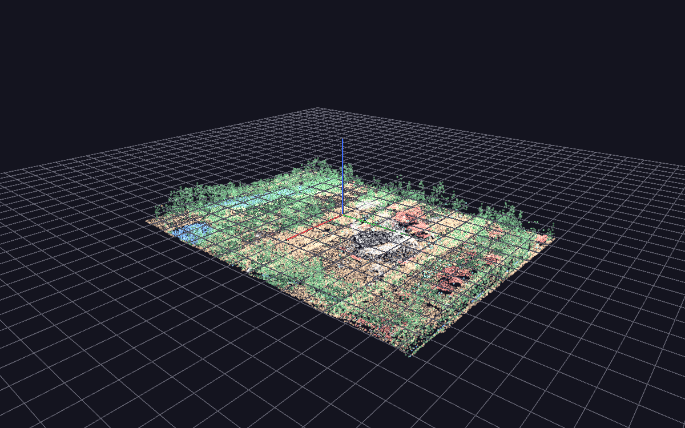

# Importing point clouds (LIDAR)

**Meshes ▸ Import Point Cloud…**, or drag a `.las`/`.laz`/`.xyz`/`.pts` file
onto the window.

GlyphViz reads LIDAR and scan data into a [Point Cloud
topology](topologies.md#point-clouds-topology-18) node: one parent glyph you
can move, rotate and scale, with one real node per point underneath. Those
points are not a special kind of object — they are ordinary nodes that happen
to draw as a batch, so every one of them is clickable, labellable,
Channels-bindable, and saves into the scene CSV like anything else.

## The formats, and why they are all open

LAS is binary, but it is not proprietary. It is a published ASPRS
specification — the spec itself lives at
[github.com/ASPRSorg/LAS](https://github.com/ASPRSorg/LAS) — and LAZ, its
lossless compressed form, became an
[OGC Community Standard](https://www.ogc.org/announcement/ogc-announces-publication-of-the-laz-1-4-community-standard/)
in September 2026.

| Extension | What it is | Read by |
|---|---|---|
| `.las` | ASPRS LAS 1.0–1.4, the LIDAR interchange format | `laspy` |
| `.laz` | LAZ — LAS losslessly compressed to 7–20% of its size | `laspy` + `lazrs` |
| `.ply` | Stanford PLY, point-only or a mesh's vertices | `trimesh` |
| `.xyz` `.pts` `.txt` `.csv` | ASCII `x y z [r g b]`, comma or whitespace | built in |

A dropped `.ply` still goes to the **mesh** importer, as it always has — a
dropped PLY is far more often a model than a scan. Use Import Point Cloud…
explicitly to bring one in as points. `.csv` and `.txt` are likewise only
offered through the file dialog, because a dropped CSV is a scene.

E57 is not supported. It is an open ASTM standard, but reading it needs a
native library GlyphViz does not bundle; convert to LAS or PLY first.

## What the dialog shows you before you commit

Opening a file reads its header first and reports what is actually in it —
point count, extent in source units, and which of RGB, classification and
intensity it carries. On a LAS or LAZ file that is nearly free however large
the file is, because those facts live in the header.

That report exists because every one of those facts changes what a sensible
import looks like. A 10-million-point tile in State Plane feet with no RGB
needs different answers than a 200,000-point coloured scan in metres.

### Keep at most

How many points to import. **100,000 is the comfortable default, and there
is no upper limit** — type a number at or above the file's own point count and
every point in it is imported. The field is a suggestion about what you want,
not a ceiling on what GlyphViz will accept.

The renderer is not what limits this — it draws a million points in 0.63 ms
per frame, and a 442,767-point import runs at about 400 fps. The *node model*
is: every point is a real node, costing about 2 KB of memory and about 90
bytes in the saved scene file.

| Points | Import from LAZ | Saved scene | Save | Reopen | Memory |
|---|---|---|---|---|---|
| 100,000 | 1.4 s | 9.1 MB | 1.0 s | 1.4 s | ~200 MB |
| 442,767 | 4.0 s | 40.7 MB | 4.2 s | 6.3 s | ~900 MB |

!!! note "Scenes saved before September 2026 are much larger"
    GlyphViz used to save every node as a full 94-column ANTz-compatible row,
    about 550 bytes a point — that made the 442,767-point scan a 243 MB file
    that took 15 s to save. It now writes only the columns a scene uses.
    Opening one of those older scenes and saving it shrinks it in place.

**Importing is much cheaper than saving.** Bringing a large cloud in and flying
around it is comfortable well past the default; it is keeping it as a scene
file that gets expensive.

### Method

How the points to keep are chosen.

- **Random sample** (default) — unbiased and reproducible. The same file and
  the same settings give the same cloud every time.
- **Voxel grid** — one point per occupied cell of a 3-D grid, so density is
  evened out instead of inheriting the scanner's. Measured on a real
  10.6-million-point tile decimated to 100,000: voxel reaches **85%** of the
  cells the full cloud occupies where random reaches **74%**, at half the
  density spread. Because the grid is volumetric it moves points off flat
  ground and onto structure — trees, buildings — which is usually what you
  want to look at. Takes about twice as long.
- **Every Nth point** — fastest, and exactly reproducible without a random
  seed. Be careful with it: a file written in acquisition order has its rows
  grouped by flight line, so a stride can beat against the scan pattern and
  sample stripes rather than the scene.

### Colour by

**Automatic** takes the file's own RGB when it has any, then classification
when the file is genuinely classified, then an elevation ramp. Most public
LIDAR has no RGB at all, so the other two are what usually make a scan
readable rather than being fallbacks.

- **File RGB** — 16-bit or 8-bit is detected from the data, not assumed.
- **Classification** — ASPRS codes in the colours every LIDAR tool draws:
  ground brown, vegetation green by height, buildings red, water blue. Codes
  past the standard 0–18 table (LAS 1.4 reserves 64+ for user definition) get
  distinct generated hues.
- **Elevation** — a blue→green→warm-white ramp over height.
- **Intensity** — return strength, dark to bright.

Both ramps normalise over the 2nd–98th percentile rather than min/max,
because a handful of noise returns at the top of the range would otherwise
squeeze every real value into the bottom of the ramp.

### Point size

The rendered size of every point, in pixels. Stored on the cloud's parent as
`ratio = size / 20`, so you can change it afterwards from the Properties
panel's Ratio field. One size per cloud — fixed-function OpenGL has no
per-point size. To encode a second variable, use colour, or split the scan
across several cloud parents.

### Fit to width

The world-space width the scan is scaled to, measured across its larger
horizontal axis. **360** is GlyphViz's own 1:1 frame — the width of a default
World Grid, and a full sweep of longitude — so an imported scan lands at the
same scale as everything else and can be dropped onto a grid without
retuning.

This matters more than it sounds. A georeferenced tile arrives in CRS units
with an enormous origin: the Autzen Stadium test file runs 635,577 to 639,003
easting in Oregon State Plane feet. Imported raw it would be a speck 800,000
units from the origin.

The scale is **uniform across all three axes** and derived from the
horizontal extent only, so the scan is never stretched. Centre and scale are
measured from the 0.1–99.9 percentile box rather than the raw bounding box:
airborne LIDAR reliably contains a few gross outliers (birds, cloud returns),
and one point a kilometre up would otherwise shrink the whole scan toward
invisibility.

### Vertical exaggeration

Multiplies Z alone. **1.0 is truthful and is the default.** Terrain work
routinely uses 2–3×, because 200 m of relief spread over 4 km reads as flat
otherwise — but it *is* a distortion, which is why it is opt-in.

### Keep classifications

Import only the ticked classes. Dropping **Ground** (class 2) is the usual
first move on an aerial tile: it is most of the points, and removing it
reveals the buildings and canopy underneath.

The filter runs **before** the decimation, so your point budget is spent on
the classes you asked for. Ask for 100,000 points and drop ground on a tile
that is 70% ground, and you get 100,000 non-ground points — not 30,000.

## After the import

The cloud is **merged** into the loaded scene rather than replacing it, with
ids rebased exactly as File ▸ Merge does. A scan is nearly always context for
something else — sensors placed inside a building, per-tree glyphs over a
canopy — so replacing your scene would be the wrong default.

The cloud's **parent node carries the provenance** in its label: how many
points, how they were coloured, what they were sampled from, which classes
were kept, and any exaggeration applied. That label is the only record of how
the cloud was made, since a saved scene has no other memory of it. The points
themselves carry no labels, deliberately — see
[the topology reference](topologies.md#interaction-rules).

From there it is an ordinary GlyphViz scene:

- **Move, rotate, scale the parent** and the whole cloud follows.
- **Click a point** to select it; it is a real node with an id, and the
  Properties panel edits it.
- **Label the handful that matter** with `show_text`, or by selecting them.
- **Save** with Ctrl+S — the cloud travels in the node CSV with no new
  column and no external file.
- **Parent other nodes to the cloud's parent** to place glyphs in the scan's
  own coordinate frame.
- **Retune the whole scan** with the parent's Topo Scale, which multiplies
  all three axes.
