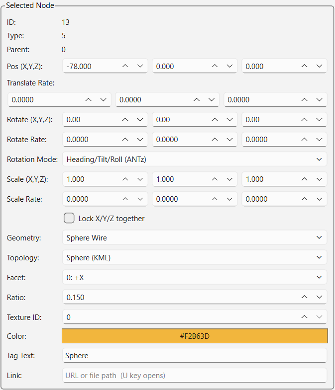

# Properties Panel

The Properties Panel is a single `QDockWidget` titled **"Properties"**
(`_build_panel` — `glyphviz_gl/main_window.py:306-900`). It's not just a
per-node field editor — it's the GUI's home for every setting that isn't the
Viewer or the Node Table: scene-wide display toggles, global scale, stereo
3D, world/background settings, node creation defaults, selection tools, *and*
the per-node inspector. All groups below appear in this one scrollable dock,
top to bottom, in this order.

## What the Properties Panel does

Everything in the **Selected Node** group (below) reflects and edits
whichever node(s) are currently selected — in the Viewer, in the
[Node Table](node-panel.md), or via **Select By**. Edits apply live: changing
a spin box or combo box updates the node object immediately and repaints the
Viewer (`_on_insp_*` handlers, e.g. `_on_insp_pos_changed` at
`main_window.py:1464`, `_on_insp_rotation_changed` at `main_window.py:1491`).

## Display

| Field | Type | Default | Maps to |
|---|---|---|---|
| Show Axes | checkbox | checked | `Viewport.show_axes` |
| Show Grid | checkbox | checked | `Viewport.show_grid` |
| Grid Color | color button | dark gray (56, 56, 71) | The reference grid's line color. Unlike the checkboxes around it this is **scene data**, stored on the World node (`ref_grid_color_r/g/b`) and saved with the file. A World Grid node (type 6) draws its own lattice in its own node color and ignores this setting. |
| Show Hidden Nodes | checkbox | unchecked | `Viewport.show_hidden` |
| Show Tag Labels | checkbox | unchecked | `Viewport.show_tags` (also toggled by the **T** key) |
| Show Tag Labels of Selected | checkbox | unchecked | `Viewport.show_tags_selected_only` — when checked, only selected nodes' tags draw |
| Tag Color | color button | pastel yellow (255, 255, 200) | The color of every tag label. **Scene data**, stored on the World node (`tag_color_r/g/b`) and saved with the file. Disabled while the checkbox below is on. |
| Tag Text Matches Node Color | checkbox | unchecked | Draws each label in its own node's color instead of the single Tag Color, so a label reads as belonging to the glyph it names (`tag_color_mode`). |
| Tag Text Size | slider, 6–36 pt | 11 pt | Point size of every tag label. Scene data too (`tag_font_size` on the World node). Labels are a fixed size on screen, so they do **not** shrink with distance — to declutter a dense scene, label fewer nodes rather than shrinking the type. |
| *(texture status label + "…" button)* | — | "No textures loaded" | Opens **Textures → Set Texture Folder…** |
| Audio track dropdown | combo | "All Audio Tracks" | Solos one video's audio track when multiple textured videos are loaded; disabled unless 2+ tracks exist |

Source: `main_window.py:321-376`.

## Global Scale

A slider, range 1–100 (displayed as 0.1–10.0), default value 10
(→ scale **1.0**). Sets `Viewport.base_scale`, the global geometry-to-world-units
conversion factor.

Below it, **Enforce Minimum Glyph Size (0.2)** (checkbox, **unchecked** by
default) clamps every glyph's *rendered* size — `scale_x/y/z` × Global Scale —
to at least 0.2 per axis, so a very small or zero-scale node stays visible and
clickable. Off by default, glyphs render at exactly the size their scale fields
ask for, and a sub-0.2 node can be too small to click. The clamp is per axis,
so it changes the proportions of anything thinner than 0.2 on one axis only.
World Grid (type 6) footprints are never clamped either way — a grid's
rectangle has to stay aligned with where its children land. Mirrors the
**View → Enforce Minimum Glyph Size** menu toggle; sets
`Viewport.enforce_scale_floor` → `Scene.scale_floor`.

## Stereo 3D (Cross-Eye)

| Field | Type | Range / Default |
|---|---|---|
| Enable Stereo View | checkbox | unchecked |
| Eye Separation | slider | 0.5%–15.0% of camera distance, default 3.0% |

Mirrors the **View → Stereo 3D (Cross-Eye)** menu toggle. Source:
`main_window.py:391-415`.

## Camera

Optional ANTz-style smoothing ("inertia") on camera navigation. Off by
default — the camera tracks the mouse exactly.

| Field | Type | Range / Default |
|---|---|---|
| Smoothing | slider | 0.00–0.60 s time constant, default **0** (off) |
| Off / ANTz | buttons | Presets: 0 s, and ANTz's own feel (0.33 s) |
| Applies to | combo | **Left+Right drag only** (default) or All camera navigation |

The slider sets how far the camera lags where you drag: higher values glide
more. **Applies to** chooses the scope — *Left+Right drag only* matches ANTz,
where smoothing engaged on that combined orbit+zoom gesture; *All camera
navigation* extends it to single-button orbit, pan and wheel zoom, which is
the setting to use if you want the tremor-buffering effect. Camera Mode (free
flight) is never smoothed.

Unlike ANTz, aim and position ease together, so the object you're orbiting
stays framed for the whole glide. Camera *jumps* — reference-view presets,
double-click focus, Reset Camera, scene load, Follow Selected Node — stay
instant whatever the setting.

The setting is per session and resets to Off on restart. Sets
`Viewport.camera_smoothing_tau` / `camera_smoothing_scope`; math in
`glyphviz_core/camera_smoothing.py`. See
[Viewer Navigation](viewer-navigation.md#camera-smoothing-optional-inertia)
for the full rationale.

## Scene Settings

World-node-only settings — read from/written to the scene's `type=0` World
node (`glyphviz_core/node.py`'s `NODE_TYPE_WORLD`), mirroring ANTz's global
Background Color and Transparency Mode hotkeys.

| Field | Type | Notes |
|---|---|---|
| Background | color swatch + "B/W" button | "B/W" toggles black/white (also the **B** key) |
| Render Mode | combo, 7 options | Normal / Additive / Subtractive / Dark (Multiply) / Off / Screen / Premultiplied Alpha — scene-wide blend mode (also cycled by the **8** key). Values are `RENDER_MODE_*` in `node.py:29-50`. |
| Enable Fog | checkbox | unchecked by default |
| Fog Start / End | two spin boxes, 0–1,000,000 | Defaults 20.0 / 200.0; disabled until fog is enabled |

Source: `main_window.py:417-476`.

## Scene Info

Read-only labels: **File** (current filename), **Nodes** (total count),
**Visible** (count after hide/draw-limit filtering) — plus one checkbox,
**Also Save Tag File** (checked by default), which controls whether Save /
Save As also writes a companion tag CSV. The **K**-key quick-save always
writes both regardless of this checkbox. Source: `main_window.py:478-497`.

## Create

Two buttons — **New Node** (**N** key) and **New Child** (**Shift+N**, requires
exactly one node selected) — plus a **New Object Defaults** sub-form applied
to every node created either way:

| Field | Type | Default |
|---|---|---|
| Geometry | combo, every `GEO_*` value | **Octahedron** (`GEO_OCTA`) |
| Topology | combo, all 18 `TOPO_*` values | **Point** (`TOPO_POINT`) |
| Scale (X, Y, Z) | 3 spin boxes, 0.001–10,000 | 1.0 / 1.0 / 1.0 |
| Lock X/Y/Z together | checkbox | checked |
| Color | color-picker button | RGBA (200, 200, 200, 255) |
| Placement Step | spin box, 0–10,000 | 5.0 |
| Placement Z (root, child) | 2 spin boxes, ±100,000 | 0.0 / 5.0 |

**Placement Step** is how far apart consecutively created objects sit.
Each new object steps that far along `translate_x`; when the next step would
reach a full lap (**360**), `translate_x` restarts at 0 and `translate_y`
takes the step instead — so a long run of presses arrays into a **grid**
rather than a runaway line, and under a circular topology (Sphere, Torus,
Cylinder…) the object that completes a lap starts a *new ring* above the
first instead of landing on top of it. This is ANTz's rule, whose own step
was a fixed 15; type 15 here to reproduce its lattice exactly. `translate_y`
keeps climbing rather than wrapping, so the grid grows taller indefinitely.

**Placement Z** is the `translate_z` a new object is born with — two numbers,
because the axis means different things at the two levels:

- **root** (default 0.0) is height above the world plane. 0 sits on it.
- **child** (default 5.0) is offset from the parent, and *how* it offsets is
  the parent's topology's business: on Sphere, Torus or Cylinder it lifts the
  child radially off the surface; on a Cartesian parent it's a plain Z offset.
  0 places a child exactly on the surface — which is why the default isn't 0,
  since under a topology-None parent that would put the first child *inside*
  it.

Both accept negative values (below the plane, or inside the surface).

The step and both heights apply to **New Node**, **New Child**, **N**,
**Shift+N**, paste (Ctrl+V), and a mesh imported with nothing selected. Roots step on from the
last root *created* (wherever it now sits, so dragging one carries the next
along); children fill the next free slot under their parent, and links
attached to that parent don't consume a slot. A step of 0 stacks every new
object at the origin. Rotation is never part of these defaults. Source:
`main_window.py:499-572`, `glyphviz_core/placement.py`.

Below the defaults sits **Draw Mode** (**D** key) — a checkable button that
turns the mouse into a brush: left click stamps one object built from the
New Object Defaults onto the World Grid where the cursor lands, click-drag
stamps a trail of them. Five controls tune it:

| Field | Type | Default |
|---|---|---|
| Stamp | combo + **Load…** button | **Single Object (defaults above)** — or any loaded Glyph Composer template, which stamps the whole hyperglyph per click. Load… opens a saved template `.json`; the Glyph Composer's **Use as Draw Brush** button sends one over directly |
| Draw Z | spin box, ±100,000 | 0.0 — each stamped object's `translate_z` (elevation above the grid plane) |
| Stamp Spacing | spin box, 0–500 px | 30 px — cursor travel between stamps while dragging; 0 stamps on every mouse move |
| Heading Jitter | spin box, 0–180° | 0° — each stamp spun by a random heading in ± this range (one draw per stamp, whole hyperglyph turns together) |
| Scale Jitter | spin box, 0–90 % | 0 % — each stamp scaled by a random factor in ± this percent (one factor, all three axes, proportions preserved) |

See [Viewer Navigation → Draw Mode](viewer-navigation.md#draw-mode-painting-objects)
for the full gesture reference. Source: `_on_draw_stamp`, `main_window.py`.

## Delete

One button, **Delete Selected Objects** (also **Delete**/**Backspace**),
disabled until there's a selection. Deleting a node deletes its descendants
too — children are never reparented onto the deleted node's parent, since
there's no well-defined place to put them. Source: `main_window.py:574-587`.

## Select By

| Control | Notes |
|---|---|
| Select All / Deselect All buttons | Same as Ctrl+A's two states |
| Invert Selection | Selects every node that is *not* currently selected (Ctrl+I) |
| By: | combo — **Branch Level**, **Geometry**, or **Topology** |
| Value: | combo, repopulated from whichever distinct values exist in the loaded scene for the chosen criterion |
| Select All Matching | applies the filter |
| Add to current selection | checkbox, unchecked — when checked, **Select All Matching** and **Select Matching Tags** add to the selection instead of replacing it |
| Tag contains: | line edit — case-insensitive substring matched against each node's tag text (Enter runs the search) |
| Select Matching Tags | selects every node whose tag text contains that keyword |
| Show selection box | checkbox, checked — `Viewport.show_selection_box`, also **Ctrl+B** and **View → Show Selection Box**. Unchecking hides the yellow bounding box around selected nodes *without* deselecting them, so a screengrab can show a chosen state cleanly; Move/Rotate/Size and the selection keys keep working while it is off |

Source: `main_window.py:821-900, 1911-2006`.

## Selected Node

The per-node inspector — disabled (grayed out) until at least one node is
selected; its title becomes `"Selection (N nodes)"` for a multi-selection.
With 2+ nodes selected, Position and Rotation edits apply as a **delta** to
every selected node (so they move together), while Scale, Geometry,
Topology, Ratio, and Color apply the same absolute value to all of them
(`_refresh_inspector_multi` — `main_window.py:1378-1420`).

| Field (UI label) | Node attribute | Type / range | Notes |
|---|---|---|---|
| ID | `id` | read-only label | |
| Type | `type` | read-only label | |
| Parent | `parent_id` | read-only label | |
| Pos (X,Y,Z) | `translate_x/y/z` | 3 spin boxes, ±1,000,000, step 1.0 | |
| Translate Rate | `translate_rate_x/y/z` | 3 spin boxes, ±1,000,000, step 0.01, 4 decimals | Per-cycle position delta (nominally 60 cycles/sec) — nonzero keeps the node moving |
| Rotate (X,Y,Z) | `rotate_x/y/z` | 3 spin boxes, ±360, step 1.0, wraps | |
| Rotate Rate | `rotate_rate_x/y/z` | 3 spin boxes, ±3600, step 0.01, 4 decimals | Degrees added per cycle — spins the node continuously |
| Rotation Mode | `rotation_mode` | combo: "Euler XYZ" / "Heading/Tilt/Roll (ANTz)" | Two interpretations of rotate_x/y/z, dispatched in `topology.py`'s `local_rotation_matrix()` (see `topology.py:151-176`); a missing CSV `rotation_mode` column loads as Heading/Tilt/Roll (preserves legacy file rendering), while a fresh `Node()` constructed in code defaults to Euler XYZ |
| Scale (X,Y,Z) | `scale_x/y/z` | 3 spin boxes, 0.001–10,000, step 0.1 | |
| Scale Rate | `scale_rate_x/y/z` | 3 spin boxes, ±10,000, step 0.001, 4 decimals | Rarely useful nonzero — unbounded growth/shrink |
| *(Lock X/Y/Z together)* | — | checkbox | Ties the three Scale spin boxes together |
| Geometry | `geometry` | combo, every value | See [Geometries](geometries.md) |
| *(End caps)* | `geometry` | checkbox | Only live on **Cylinder (Interior)** / **Cylinder (Interior, Open)**, and disabled on every other shape. Not a field of its own — the two states *are* those two geometry ids, and the checkbox swaps between them, so the choice saves and loads like any other geometry. Off = an open tube, on = closed at both ends. On a mixed selection it touches only the interior cylinders. See [Interior geometries](geometries.md#interior-geometries-seen-from-within) |
| Topology | `topo` | combo, all 18 values | See [Topologies](topologies.md) |
| Topo Scale | `topo_scale` | spin box (6 decimals) + log slider, 0.0001–100, plus **1:1** and **ANTz** preset buttons | How far one unit of a **child's** translate reaches, for the axes this node's topology reads as a *distance* rather than an angle. Angular axes (lon/lat, orbital and tube angles) are never scaled, so it cannot distort a circular layout. `1.0` = one translate unit is one world unit (default); `1/180 ≈ 0.005556` = the ANTz convention, where a cube facet is 360 units across. Turn it down when children authored in degrees fly off after a switch to a linear topology — see [Topologies](topologies.md) |
| Facet | `subspace` | combo, 6 named faces (`0: +X` … `5: -Z`) | Only meaningful when this node's **parent** uses Cube or Zcube topology |
| Ratio | `ratio` | spin box, 0.01–10.0, 3 decimals | Torus minor/major radius proportion; also doubles as Point sprite size and Plot line width (`ratio × 20` px). On a **Link** it is the connector's thickness whatever geometry the link carries — pixels for Line, world-space half-width on both cross-axes for Prism or any stretched glyph ([Geometries](geometries.md#geometry-on-a-link-node)). Values above 1.0 only mean anything there; a torus ratio above 1.0 is degenerate |
| Texture ID | `texture_id` | spin box, 0–9999, integer | 0 = none, 1 = first image in texture folder (alphanumeric), 2 = second, etc. |
| Color | `color_r/g/b/a` | color-picker button | |
| Tag Text | `text` | line edit | Label shown near the node in 3D (toggle with **T**) |
| Link | `link` | line edit | URL or local file path, opened with **U** |

Source: `main_window.py:621-832` (field construction), `1309-1420`
(populate/refresh logic).

## Channels

A playback transport (Frame label, scrub slider, ▶/■ buttons, FPS spin box,
Loop checkbox) that only becomes visible when the loaded scene has a
Channels animation (`ch-map`/`ch-tracks` CSV pair) attached. Hidden by
default (`self._ch_grp.setVisible(False)` — `main_window.py:834-882`).

## Next step

See [Node Panel](node-panel.md) for how nodes are selected and organized, or
[Geometries](geometries.md) and [Topologies](topologies.md) for what the
Geometry/Topology fields actually control.
