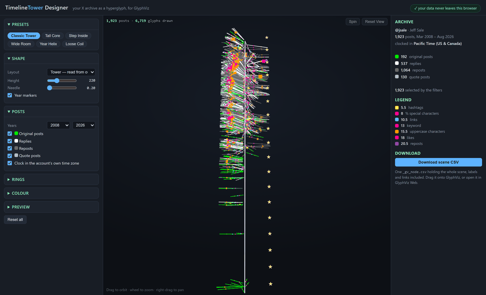
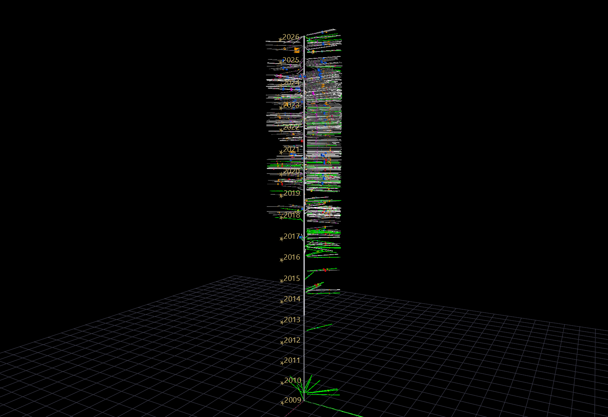
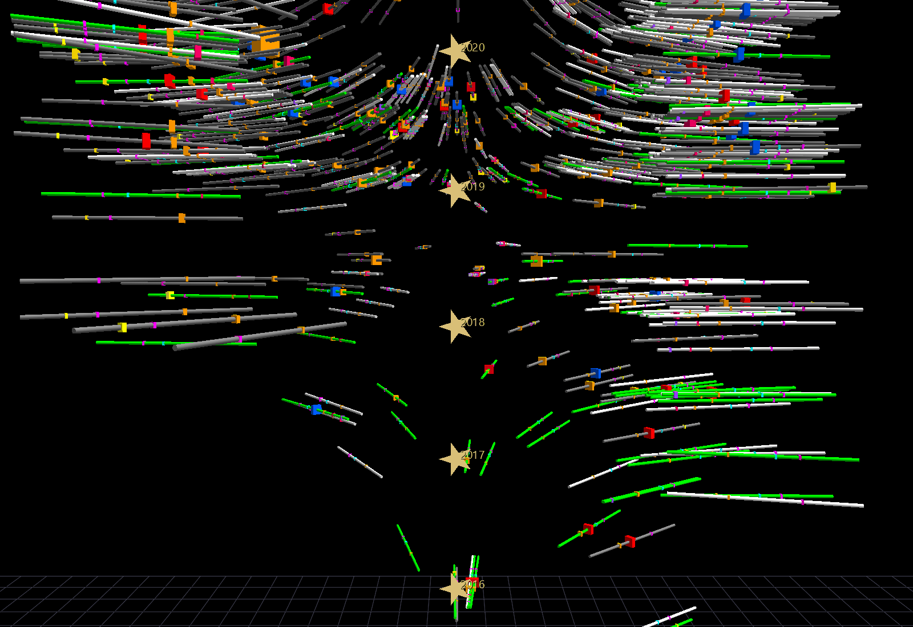
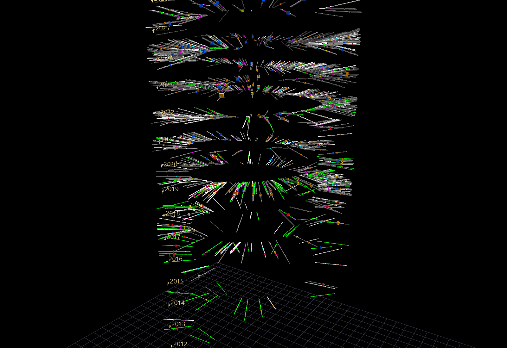

# Timeline Tower Designer

**[Open the Timeline Tower Designer →](../twitter_lab/tut_designer.html){ target=_blank }**

A browser tool that turns your X (Twitter) archive into a **Timeline Tower** — a
single hyperglyph of everything you have ever posted, which you can then open in
GlyphViz, fly through, and stand inside in VR.

Nothing to install, and **nothing is uploaded**. The page reads your archive
through the browser's own file API and never sends it anywhere; it has no
network code in it at all and works with the machine offline.



## What a Timeline Tower is

Every post becomes a **needle** radiating from a vertical time axis:

| Channel | Meaning |
| --- | --- |
| **height** | when it was posted — oldest at the base, newest at the top |
| **bearing** | what time of day it was posted, as a 24-hour clock face |
| **needle color** | what kind of post it was |

and each needle carries concentric **rings** of measurement at fixed radii. That
last part is what makes the tower a *reading* rather than a picture: because a
ring always sits at the same distance from the axis, one ring followed up the
whole tower is one variable followed across a whole life.



The design is older than GlyphViz — it was first built for ANTz in 2018, against
the Twitter API — and the color vocabulary is unchanged from that original
legend.

### Needle color

| Color | Kind |
| --- | --- |
| green | original post |
| white | reply |
| dark gray | repost |
| light gray | quote post |

### Rings, innermost to outermost

| Radius | Color | Measures |
| --- | --- | --- |
| 5.5 | yellow | hashtags |
| 8.0 | magenta | % special characters |
| 10.5 | cyan | links |
| 13.0 | red / blue | keyword 1 / keyword 2 hit |
| 15.5 | orange | uppercase characters |
| 18.0 | pink | likes |
| 20.5 | violet | reposts |

A ring is drawn only when it has something to measure, so an absent ring reads
as a zero — which is what it is. Counts that span orders of magnitude (likes,
reposts) are sized logarithmically, so one viral post enlarges its own ring
without flattening every ordinary one.

Every node in the scene is labelled with what it encodes, and every one carries
a link back to the post itself — so **U** (or **Alt+click**) on any needle opens
that actual post on X. See [Tags and labels](viewer-navigation.md).

## Getting your archive

1. On X: **Settings → Your account → Download an archive of your data**.
2. X emails you a `.zip` when it is ready. This commonly takes a day or two.
3. Unpack it. Inside is a `data` folder.
4. Drop that `data` folder onto the designer.

The tool needs `tweets.js`. It also uses `account.js`, `profile.js` and
`account-timezone.js` when they are present, to name the account and to clock
the tower in the account's own time zone rather than UTC. You can drop
`tweets.js` on its own if you prefer.

!!! note "Why the archive, and not the API"
    The X archive is both complete and richer than what the API returned. The
    API capped a user timeline at the last 3,200 posts, and did not carry a
    per-post repost count — which is why the reposts ring exists here and did
    not in the 2018 original.

## The three layouts

All three share the same time mapping and differ only in the shape time is wound
onto.

=== "Tower"

    The classic form: a straight vertical axis with the needles pointing
    outward, read from the outside like a core sample. This is the one that
    photographs well.

=== "Immersive"

    The same tower turned inside out. The axis becomes a cylindrical wall out
    around you and the needles hang *inward*, so you stand at the centre of your
    own history and the record surrounds you. Built for
    [VR](immersive-vr.md) — a marker on the floor shows where the account
    starts, and you climb through time.

    

=== "Helix"

    Time wound as a spiral, one turn per year, so seasons stack vertically and
    the record never doubles back on itself. It reads like tree rings. Time of
    day survives as the needle's **pitch**: dawn dips, midnight rises.

    

## The controls

| Group | What it does |
| --- | --- |
| **Presets** | Six starting points, two per layout. |
| **Shape** | Layout, overall height, needle thickness, year markers. The radius controls change with the layout, since only some apply — the helix takes its height from its rise per year, so that a longer account grows taller rather than winding tighter. |
| **Posts** | Which years, and which kinds of post, take part. Turning off reposts is the single biggest change most archives can make. Also the time-zone clock. |
| **Rings** | Which rings are drawn, plus the two keyword boxes. A keyword lights its ring red (first box) or blue (second) on every post whose text contains it. |
| **Colour** | The four post-kind colors, the background, and the label size. |
| **Preview** | How many posts the *preview* draws. |

!!! tip "The preview is sampled; the download is not"
    A large archive is sampled for the preview so the controls stay responsive.
    The downloaded scene always contains **every** post the filters let through,
    however low the preview is set.

## Opening the result

**Download scene CSV** writes one `_gv_node.csv` holding the whole scene, labels
and links included — there is no companion file to keep track of. Then either:

- **Drag it onto GlyphViz** (see [Drag and drop](drag-and-drop.md)), or
- open it in GlyphViz Web, or
- put it in a scene folder and open it the usual way.

A tower of a few thousand posts is a scene of a few tens of thousands of nodes,
which GlyphViz handles comfortably. If you want it lighter, turn off the rings
you are not reading, or narrow the year range.

## The command-line version

The designer is a port of `twitter_lab/tut.py` in the GlyphViz repository, which
is the reference implementation and which builds the same scenes from a
terminal:

```text
python tut.py --archive path/to/twitter-2026-08-19/data --out DIR
python tut.py --archive DIR --out DIR --layout helix --keywords data,art
```

Use it for batches, for scripting, or when you want a layout parameter the page
does not expose. The two are kept in step by a harness that extracts the page's
own JavaScript and diffs every column of every node against the script's output;
see `twitter_lab/README.md`.

## Privacy

The page makes no network requests of any kind. It has no `fetch`, no external
script, no font or asset loaded from anywhere else, and it runs from a `file://`
path with the machine offline. Your archive is read in the browser and stays
there.

It also deliberately ignores the parts of an X archive that a shared scene
should not carry — direct messages, ad and device data, deleted posts.

A generated scene **does** contain your post text, in the labels. Treat one as
being as public as the account it came from before you share it.
