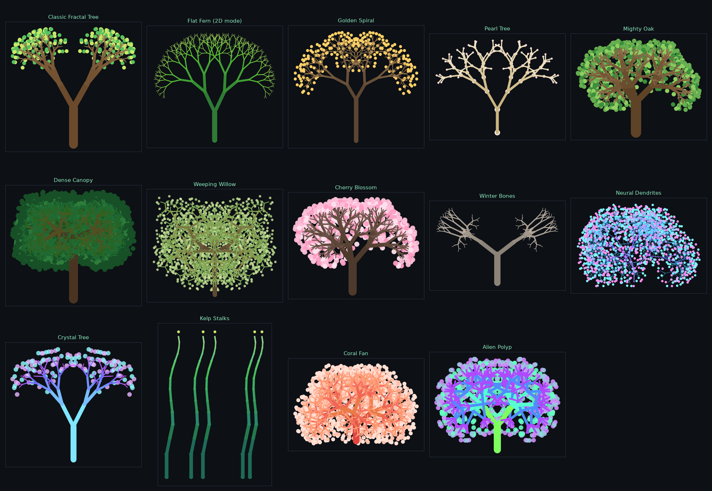

# Hyperglyph Tree Designer

**[Open the Tree Designer →](../hyperglyph_lab/hyperglyph_tree_designer.html){ target=_blank }**

A browser tool that designs branching, tree-like hyperglyphs and exports them as
[Glyph Composer](glyph-composer.md) templates. Nothing to install — it runs
entirely in the page, with a live 3-D preview and the template JSON updating as
you drag the sliders.

It is a 3-D port of the branching engine from the 2-D
[Fractal Forest](https://www.iluvdata.org/fractalforest/) drawing tool, and it
keeps that tool's vocabulary — Branch angle, Angle random, Length scale, Base
width, Width scale — so a tree you know how to describe in two dimensions
transfers directly.

## The idea

A tree here is built from two kinds of object:

- **Joints** — ordinary glyph nodes at every branching point.
- **Limbs** — [Link nodes](geometries.md#geometry-on-a-link-node) stretched
  between a joint and its parent. A link can be any geometry, so a limb may be a
  cylinder, a cone, a pin, or a cube.

That split is what makes the result read as a tree rather than as a cluster of
touching shells: the joints carry the structure, and the limbs are the visible
branches spanning the gaps between them.

## Workflow

1. Pick a preset, or start from *Classic Fractal Tree*.
2. Shape the tree with the **Branching** controls (see below).
3. Choose limb and joint geometries, colors, and blossoms.
4. **Download .json** (or **Copy**).
5. In GlyphViz: **Tools → Glyph Composer → Load Template…**, then **Insert into
   Scene** — or **Use as Draw Brush** to paint whole forests with
   [Draw Mode](viewer-navigation.md).

Press **🎲 New Seed** to re-roll the jitter, or **✨ Surprise Me** for a random
preset with mutated parameters.

## Branching

These are the controls that decide the tree's shape.

| Control | What it does |
| --- | --- |
| Branch levels | How many times the tree forks. Node count grows fast — see the object counter. |
| Branches / fork | Children at each fork. The 2-D tool always used 2. |
| **Branch angle** | How far each branch turns away from the direction its parent was heading. The single most important control. |
| **Angle random** | Per-level variation in that angle. A little makes a tree look grown rather than printed. |
| Fork twist | Rotates each fork's plane around the parent branch. **0 gives a flat, 2-D-style tree**; 90 gives alternating perpendicular forks; 137.5 approximates the golden angle. |
| Twist random | Per-level variation in the twist. |
| Length scale | How much shorter each generation is than its parent. |
| Length random | Per-level variation in that ratio. |
| Lean random | A small extra tilt per level, breaking up perfect symmetry. |
| Base / Branch length | Trunk length and branch length. |
| Tree size | Scales the whole tree in world units. |

Branching is **direction-relative**: every branch continues its parent's
heading, deviated by the branch angle, recursively. That is the mechanism the
2-D tool uses, and it is why the output reads as a tree.

!!! note "Jitter is per level, not per branch"
    A Glyph Composer template stores one specification per level, applied to
    every branch at that depth, so random variation is baked in level by level
    (the 2-D tool's "unify per level" mode) rather than branch by branch. Deeper
    trees therefore show more variety.

## Limbs

**Limb geometry** picks the shape stretched between each pair of joints, and
**Base width** / **Width scale** taper the limbs the way Length scale tapers the
branches. Limb color can either follow the joints or use its own two-color bark
ramp.

Limb thickness is expressed in world units, so it does *not* shrink with the
branch frame — that is what lets thickness taper on its own schedule.

## Joints

**Joint geometry** can be any glyph — sphere, cube, octahedron, torus, and so on.

**Joint size** has two modes:

- **Match limb thickness** (default) — each joint is exactly as thick as the
  limb arriving at it, so joints sit flush and the branches read as smooth
  tapered wood.
- **Follow branch taper** — joints take their size from the branch frame
  instead, growing large relative to thin limbs.

**Joint scale** multiplies whichever mode is active. At 1 the joints are flush;
at 3–5 they swell into pearls threaded on a stem.

!!! info "Resizing joints does not reshape the tree"
    In GlyphViz a node's rendered size and the coordinate frame its children are
    placed in are the same quantity, so naively resizing a joint would rescale
    everything below it. The Designer compensates: each level is written as a
    *ratio* that telescopes to the joint size you asked for, and each child's
    reach is divided back out. Branch lengths stay put no matter what Joint
    scale does.

**Limb origin** chooses whether limbs leave a joint's center (Point) or its
surface (Sphere).

## Blossoms

An optional final level of small glyphs at the branch tips — the 2-D tool's
blossoms. Size is in world units and stays constant however deep the tree, so
blossoms remain visible on a nine-level fern. **Stems** gives each blossom its
own little link.

## Grove

Repeats the whole tree in a ring, row, grid, or random scatter, in one template.

## Known limitation

A template level applies one branch angle to all of its children, so there is no
*leader* branch — one child continuing straight up while its siblings splay out.
Conical, spire-shaped conifers are therefore not expressible today; the
broad, rounded forms are.

## Next step

Return to the [Reference overview](index.md), or see the
[Glyph Composer](glyph-composer.md) page for what happens to a template once
it is loaded.
