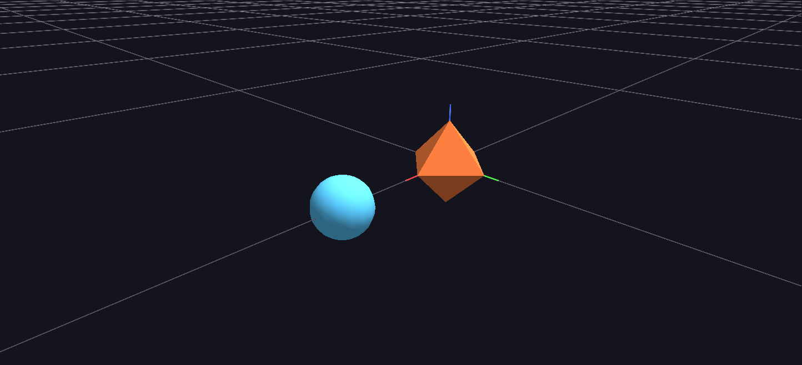

# 01 — Your First Scene

Quickstart and the Guided Tour both get you into GlyphViz by *opening* something — a provided example, or a scene built by clicking **N** in the GUI. This tutorial does the opposite, on purpose: you'll hand-type a real `gv_node.csv` in a plain text editor, a few bytes at a time, and watch GlyphViz render exactly what you wrote. That's the skill that actually matters once you're past the tutorials — every real GlyphViz scene, whether it comes from a Python script, a spreadsheet export, or the Claude Skill, is this same file format underneath. Knowing what the bytes mean is what lets you trust (and debug) whatever generates them for you later.

You need: GlyphViz installed ([Installation](../getting-started/installation.md)) and any plain text editor (Notepad is fine — just make sure it saves plain `.csv` text, not rich text).

## 1. Make a folder

Create a folder called `My_First_Scene`. Everything in this tutorial lives there. GlyphViz identifies a node CSV by its **columns**, not its filename, but naming it `gv_node.csv` matches the convention every example in the [Examples Gallery](../examples/index.md) uses, so stick with it.

## 2. The bare minimum: one node

A GlyphViz scene needs exactly **20 required columns** — no more, no less, and the loader refuses to open a file missing any of them. That sounds strict, but it's a short list once you see it laid out:

| Column | What you're setting |
|---|---|
| `id` | This node's unique number. Start at 1. |
| `type` | `5` — an ordinary glyph (the value every visible node in this tutorial uses). |
| `parent_id` | `0` means "no parent — this is a root." |
| `branch_level` | Tree depth. Roots are `0`. |
| `translate_x/y/z` | Position. With `topo=0` below, these are plain Cartesian offsets. |
| `rotate_x/y/z` | Orientation, in degrees. `0,0,0` is unrotated. |
| `scale_x/y/z` | Size per axis, rendered exactly as written. Anything much below **0.2** gets hard to click — turn on **View → Enforce Minimum Glyph Size** if you want tiny nodes clamped up to a grabbable size. |
| `color_r/g/b/a` | 0–255 each. |
| `geometry` | Which shape. `11` is a solid Octahedron — ANTz's traditional starter glyph. |
| `hide` | `0` = visible. |
| `topo` | How *this node's children* get placed. `0` = None (plain Cartesian) — the simplest option, and what this whole tutorial uses. [Tutorial 3](03-topology-geometry.md) is where this field gets interesting. |

Open your text editor and type this exactly — header row first, then one data row:

```csv
id,type,parent_id,branch_level,translate_x,translate_y,translate_z,rotate_x,rotate_y,rotate_z,scale_x,scale_y,scale_z,color_r,color_g,color_b,color_a,geometry,hide,topo
1,5,0,0,0,0,0,0,0,0,1,1,1,242,121,61,255,11,0,0
```

Save it as `My_First_Scene/gv_node.csv` — plain text, UTF-8 (Notepad's default "Save as type: Text Documents" is fine).

Now open it in GlyphViz: **File → Open**, or just drag the file onto the window. You should see one orange octahedron, sitting at the origin.

!!! warning "If nothing appears"
    The loader reads columns **by name**, not position — a misspelled header (`traslate_x`, `colour_r`) is the most common reason a hand-typed file fails to load, and pandas' error will name the exact column it choked on. Column *order* doesn't matter, so don't worry about matching the table above exactly, just the spelling.

## 3. Give it a child — hierarchy in one more row

Hierarchy in GlyphViz is nothing more than a second row pointing at the first. Add this line under the one you already have:

```csv
2,5,1,1,3,0,0,0,0,0,0.6,0.6,0.6,90,200,255,255,3,0,0
```

Before you reload, read what you just typed: `parent_id=1` points at your first node, and `branch_level=1` is one level deeper than the root. `translate_x=3` — because the parent's `topo` is `0` (None), that `3` is a plain offset of 3 units along the parent's local X axis, nothing fancier. Smaller `scale` (`0.6`), a different color, and geometry `3` (solid Sphere) so it's visually obvious which node is which.

Save the file, then **File → Open** it again. You should now see your octahedron with a small blue sphere sitting off to one side — and if you select the octahedron and move it (Move tool, or edit its `translate_x/y/z` in the Properties panel), the sphere rides along with it. That's the whole hierarchy model: `parent_id` builds the tree, and a child's position is always relative to its parent, not the world.



If your screen doesn't match — no sphere, wrong side, overlapping shapes — that's your cue to go back and check `parent_id`, `translate_x`, and `scale_x/y/z` on row 2 before moving on.

## 4. Close the loop: edit, save, watch it update

Re-opening the file by hand after every edit gets old fast, and it's not how you'll actually work once a script is generating this file for you. Turn on **File → Watch and Reload** (**Ctrl+R**) once — GlyphViz then polls the open file's timestamp and reloads automatically whenever it changes on disk, keeping your camera position and selection intact across the reload.

With that on, go back to your text editor, change node 1's color — try `color_r,color_g,color_b` = `80,220,120` — and save. Switch back to GlyphViz without touching anything in it: the octahedron should already be green. This edit → save → watch-it-update loop is the actual day-to-day GlyphViz workflow for anyone generating scenes from data, which is most real use.

## 5. What just happened

Everything you just did by hand is the same model every scene in GlyphViz uses, no matter how it's produced:

- A scene is rows in a CSV. Nothing about a node exists outside those columns.
- `parent_id` is the entire hierarchy — no separate tree structure to maintain.
- A child's `translate_x/y/z` is interpreted **in its parent's coordinate system**, and with `topo=0` that system is the simplest one: literal Cartesian offsets.
- Two nodes, twenty columns, one relationship — and it's already a real hierarchical scene, not a toy.

[Core Concepts](../getting-started/core-concepts.md) covers this same model in more depth if you want the full picture before moving on.

## Next step

[Tutorial 02 — Tags & Hierarchy](02-tags-hierarchy.md) builds directly on the two-node file you just made: giving your nodes readable labels, and going deeper on what a hierarchy can express beyond "one thing offset from another."

If hand-typing CSV rows isn't how you want to spend your time on a real dataset, that's exactly what the [Claude Skill](../getting-started/installation.md#claude-skill) is for — but everything it generates is still, underneath, exactly what you just wrote by hand.
