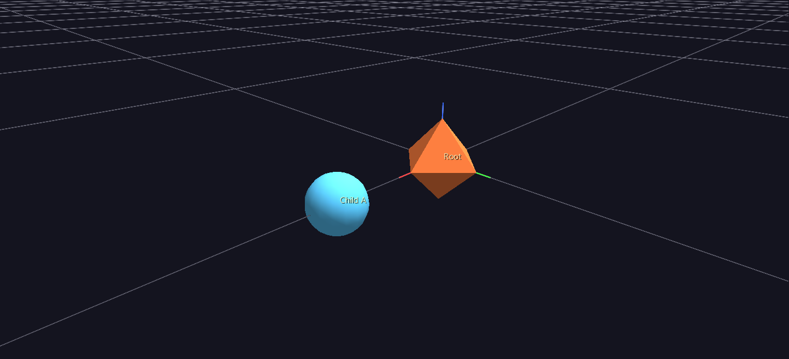
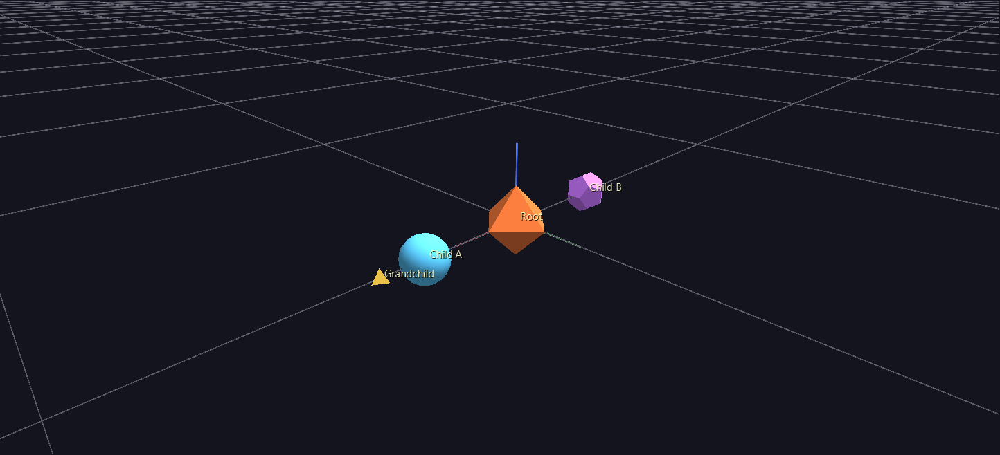

# 02 — Tags & Hierarchy

Your two-node scene from [Tutorial 1](01-first-scene.md) is correct, but it's mute — nothing on screen says which shape is which, or what either one means. This tutorial gives your nodes readable labels, then grows the hierarchy past a single parent/child pair into something with siblings and a grandchild, so you can see how a real tree reads once it's labeled. Same method as last time: edit the CSV by hand, reload, look at what changed.

## 1. Where you left off

If your `My_First_Scene/gv_node.csv` doesn't look like this anymore (Tutorial 1 had you change node 1's color partway through as a Watch-and-Reload demo), paste this in to get back in sync — colors don't matter for anything below, so don't worry if yours differ slightly:

```csv
id,type,parent_id,branch_level,translate_x,translate_y,translate_z,rotate_x,rotate_y,rotate_z,scale_x,scale_y,scale_z,color_r,color_g,color_b,color_a,geometry,hide,topo
1,5,0,0,0,0,0,0,0,0,1,1,1,242,121,61,255,11,0,0
2,5,1,1,3,0,0,0,0,0,0.6,0.6,0.6,90,200,255,255,3,0,0
```

## 2. Add labels the native way: `text`

A label is just one more column. Add `text` to the header, and a value to each row:

```csv
id,type,parent_id,branch_level,translate_x,translate_y,translate_z,rotate_x,rotate_y,rotate_z,scale_x,scale_y,scale_z,color_r,color_g,color_b,color_a,geometry,hide,topo,text
1,5,0,0,0,0,0,0,0,0,1,1,1,242,121,61,255,11,0,0,Root
2,5,1,1,3,0,0,0,0,0,0.6,0.6,0.6,90,200,255,255,3,0,0,Child A
```

Save and reload (you should still have **Watch and Reload** on from Tutorial 1 — if not, **File → Open** the file again). Nothing visibly changes yet — until you click a shape. **Tag labels are on by default but scoped to the selection**: the Properties panel's Display group ships with both *Show Tag Labels* and *Show Tag Labels of Selected* checked, so a label appears when you select the glyph it belongs to and a busy scene never fills up with text. Click the octahedron and its "Root" label appears beside it.

To see them all at once, uncheck **Show Tag Labels of Selected**. Both shapes should now show their label floating beside them, selected or not. (**T** toggles the other checkbox, *Show Tag Labels* — that one is the master switch.)

This is the one thing worth remembering about tags: the *data* (`text`) and the *display setting* (tags on/off, all/selected) are completely separate. A scene can be fully labeled and show nothing, or show nothing labeled and display empty space — check both before assuming a labeling bug.



## 3. Give a label somewhere to go: `link`

A `link` column turns a label into something clickable. Add it, and point Root's link at a URL:

```csv
id,type,parent_id,branch_level,translate_x,translate_y,translate_z,rotate_x,rotate_y,rotate_z,scale_x,scale_y,scale_z,color_r,color_g,color_b,color_a,geometry,hide,topo,text,link
1,5,0,0,0,0,0,0,0,0,1,1,1,242,121,61,255,11,0,0,Root,https://www.iluvdata.org/glyphviz/
2,5,1,1,3,0,0,0,0,0,0.6,0.6,0.6,90,200,255,255,3,0,0,Child A,
```

Child A's `link` cell is empty — that's fine, an empty link just means U/Alt+click do nothing on that node. Reload, select Root (click it), and press **U**: your browser should open the GlyphViz docs site. **Alt+click** on Root does the same thing in one gesture, no separate select step needed.

Two things worth knowing before you rely on this in real data: `http://`/`https://`/`ftp://` links open in your browser as-is, and a bare `www.…` address gets `https://` added automatically — but **anything else is treated as a local file path** and launched with whatever application your OS has associated with it. That's deliberate (it's how a label can launch a PDF, a video, or another program), but it means a typo'd URL without a scheme won't fail loudly — it'll try to open a file that doesn't exist. Prefer full URLs or absolute file paths in generated data.

## 4. Grow the tree: a sibling and a grandchild

Everything so far has been a straight line: one root, one child. Real hierarchies branch. Add two more rows — a second child of Root (a **sibling** of Child A), and a child *of Child A* (a **grandchild** of Root):

```csv
3,5,2,2,2,0,0,0,0,0,0.4,0.4,0.4,255,210,80,255,13,0,0,Grandchild,
4,5,1,1,-3,0,0,0,0,0,0.6,0.6,0.6,200,120,255,255,9,0,0,Child B,
```

Read the two new `parent_id`/`branch_level` pairs before you reload: node 3's `parent_id=2` — that's Child A, not Root, so node 3 is Child A's child, and its `branch_level=2` reflects being two levels down. Node 4's `parent_id=1` puts it back on Root, alongside Child A, at `branch_level=1` — a sibling, placed at `translate_x=-3` (the opposite side from Child A's `+3`) so the two don't overlap. Save, reload, press **T** if it's gone back off. You should have four labeled shapes: Root in the middle, Child A and Child B on either side of it, and Grandchild sitting off from Child A.



!!! note "Why Grandchild isn't exactly 5 units from Root"
    You wrote Grandchild's `translate_x` as `2`, and Child A sits at `translate_x=3` — so you might expect Grandchild to land at world x = 5. It actually lands at **x = 4.2**. The reason is [Core Concepts](../getting-started/core-concepts.md)' central rule made concrete: a child's translate is read in its *parent's* space, and Child A's own `scale` (`0.6`) shrinks that space before Grandchild's offset is measured in it — `3 + (2 × 0.6) = 4.2`. Scaling a parent doesn't just resize it visually; it rescales where every descendant ends up. This is exactly why a multi-level glyph stays proportional when you scale its root, and it's worth confirming for yourself: select Child A and change its scale in the Properties panel, and watch Grandchild's position shift along with it, without Grandchild's own numbers changing at all.

## 5. Finding your way around a bigger tree

Four nodes, you can still just click whichever one you want. Real scenes won't be four nodes, and two features exist specifically for that — one for stepping through the *structure*, one for jumping straight to a node by *label*.

**Walk the tree from the keyboard.** Select any node in the Viewer, then:

| Key | Moves selection to |
|---|---|
| **Tab** | Next sibling (same parent) |
| **Shift+Tab** | Previous sibling |
| **↓** (down arrow) | First child — one level deeper |
| **↑** (up arrow) | Parent — one level up |

Try it: select Root, press **↓** to drop onto its first child (Child A), **Tab** to step sideways to its sibling Child B, then **↓** again to reach Grandchild, and **↑** to climb back up. These keys aren't reading some separate tree structure GlyphViz maintains behind the scenes — they're recomputed from `parent_id` and row order every time, the exact same two columns you've been hand-typing all tutorial. (Like every other single-key shortcut, this needs the 3D Viewer itself to have keyboard focus — click once in the viewport first if a key seems to do nothing.)

**Search by label.** The Properties panel's **Select By** group has a **Tag contains:** field: type a substring and click **Select Matching Tags** (or press Enter) to select every node whose `text` contains it, anywhere in the tree, regardless of hierarchy. Try `Child` — both Child A and Child B get selected at once, because both labels contain it.

That second one is worth planning for while you're still choosing label text, not after the fact. `Child A` is something you can search for later; a label like `Node #47` mostly isn't. If you're generating hundreds or thousands of labels from a script, giving them a consistent, meaningful vocabulary — category names, ids that mean something, anything you'd actually type into that search box — is what makes a huge scene navigable instead of just pretty.

## 6. Don't drown the scene: pinning vs. the global toggle

Four labels is nothing, but real scenes can have thousands of tagged nodes, and turning every one of them on is how you get an unreadable wall of text. Two tools handle that: the **T** key is a scene-wide switch, and a node's own `show_text` column **pins** its label on regardless of that switch. Pin Root's:

```csv
1,5,0,0,0,0,0,0,0,0,1,1,1,242,121,61,255,11,0,0,Root,https://www.iluvdata.org/glyphviz/,1
2,5,1,1,3,0,0,0,0,0,0.6,0.6,0.6,90,200,255,255,3,0,0,Child A,,0
3,5,2,2,2,0,0,0,0,0,0.4,0.4,0.4,255,210,80,255,13,0,0,Grandchild,,0
4,5,1,1,-3,0,0,0,0,0,0.6,0.6,0.6,200,120,255,255,9,0,0,Child B,,0
```

(That's the same four rows with one more column, `show_text`, added — `1` on Root, `0` on the rest.) Reload, then press **T** to turn the global toggle *off*. Root's label stays on screen; the other three disappear.


That's the intended use of `show_text`: the handful of labels a scene should always carry — a legend, an origin marker, the one node worth naming no matter what — not a way to label everything. There's also a 500-tag cap in show-all mode, as a frame-rate safety valve for scenes with thousands of labeled nodes — pinned labels and a "selected only" display mode (which shows every selected tag, uncapped) are both exempt from it. See the [Properties Panel](../reference/properties-panel.md) reference for where these display toggles live in the GUI.

## 7. The other path: a companion tag file (good to know, not required)

Everything above used **inline** `text`/`link` columns, which is what you should default to for anything you're generating yourself. GlyphViz also reads the older ANTz/GaiaViz convention: a separate `gv_tag.csv` file, named by swapping your node file's trailing `node` for `tag` (`gv_node.csv` ↔ `gv_tag.csv`), with one row per labeled node:

```csv
id,table_id,record_id,title
0,0,1,<a href="https://www.iluvdata.org/glyphviz/">Root</a>
1,0,2,Child A
```

`table_id` must be `0`; `record_id` matches the node's `id`; `title` is either an HTML anchor (sets both link and text at once, as shown for Root), a bare URL, or plain text. You don't need to build this file — **inline columns always win when both are present**, so as long as `My_First_Scene/gv_node.csv` has `text`/`link` columns (which it does), a `gv_tag.csv` sitting next to it would simply be ignored. This path exists for reading and producing files that need to round-trip through genuine ANTz/GaiaViz tooling; it's not the one to reach for by default.

## 8. What just happened

- A label is data (`text`/`link`, or the same information in a companion tag file), completely separate from whether labels are currently *displayed* — two independent things that both have to be right.
- `parent_id` and `branch_level` are all it takes to branch a hierarchy: siblings just share a `parent_id`, and depth is just another row with a deeper `parent_id` chain.
- A child's position is measured in its parent's space — and that space is *shrunk by the parent's own scale*, which is why Grandchild landed at 4.2, not 5. This is the same rule that makes a whole multi-level glyph resize proportionally when you scale its root.
- Tab/Shift+Tab and the arrow keys walk the tree structurally; **Select By → Tag contains** jumps straight to a node by label instead — worth choosing searchable label text for, before you have thousands of nodes to look through.
- `show_text` pins a label past the scene-wide toggle — the tool for the few labels that should always be visible, not for labeling everything at once.

## Next step

[Tutorial 03 — Topology & Geometry Choices](03-topology-geometry.md) is where `topo` stops being `0` — the four shapes you just built are all sitting in plain Cartesian space, and the next tutorial changes what `translate_x/y/z` even mean.
