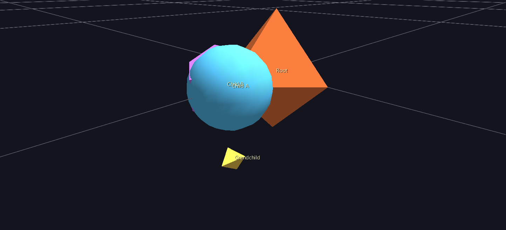
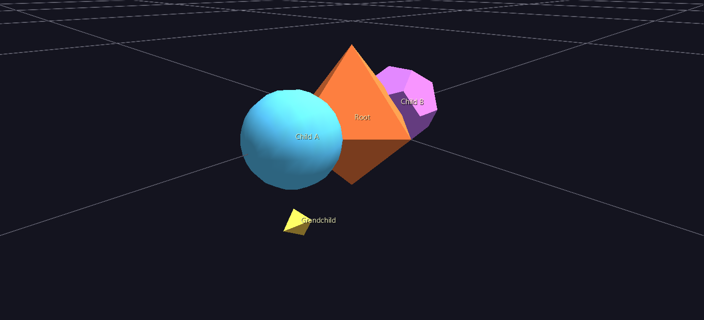
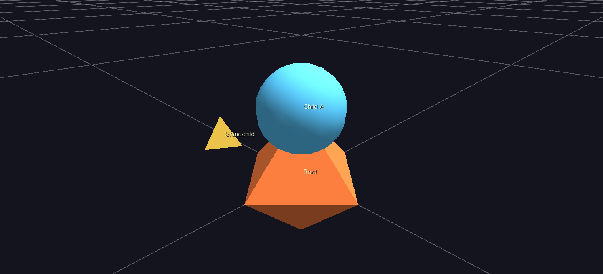
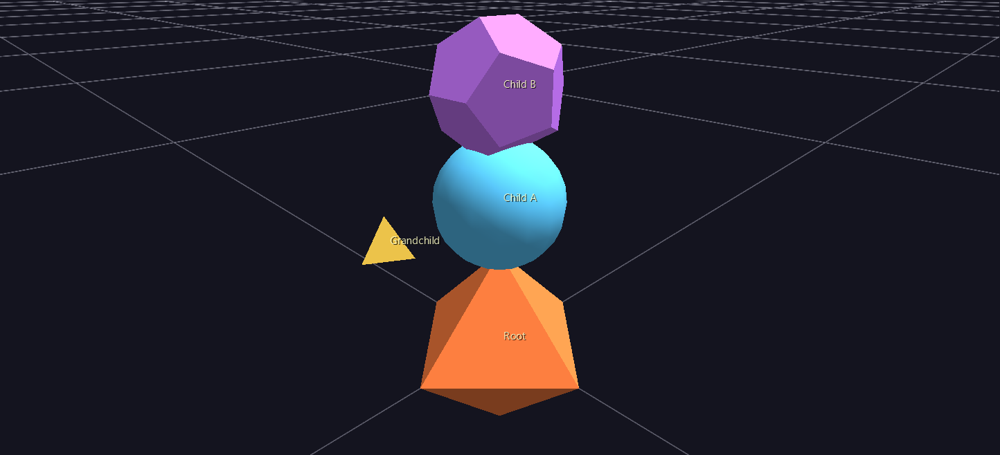

# 03 — Topology & Geometry Choices

Every `topo` value in Tutorials 1 and 2 was `0` — plain Cartesian, the "just place things where I say" option. That was deliberate: it let you learn hierarchy without also fighting a coordinate system that reinterprets your numbers. Today that changes. You'll flip Root's topology a few times without touching anything else, watch the exact same children rearrange (or, once, quietly break), and come out the other side with the one distinction that unlocks the rest of GlyphViz: **topology decides where a node's children go; geometry decides what any one node looks like — and they don't know about each other.**

## 1. Where you left off

Your file should have four labeled nodes, Root's label pinned on, and everything sitting in Cartesian space:

```csv
id,type,parent_id,branch_level,translate_x,translate_y,translate_z,rotate_x,rotate_y,rotate_z,scale_x,scale_y,scale_z,color_r,color_g,color_b,color_a,geometry,hide,topo,text,link,show_text
1,5,0,0,0,0,0,0,0,0,1,1,1,242,121,61,255,11,0,0,Root,https://www.iluvdata.org/glyphviz/,1
2,5,1,1,3,0,0,0,0,0,0.6,0.6,0.6,90,200,255,255,3,0,0,Child A,,0
3,5,2,2,2,0,0,0,0,0,0.4,0.4,0.4,255,210,80,255,13,0,0,Grandchild,,0
4,5,1,1,-3,0,0,0,0,0,0.6,0.6,0.6,200,120,255,255,9,0,0,Child B,,0
```

## 2. Same numbers, new meaning: flip Root to Torus

Change **only** Root's last column, `topo`, from `0` to `3` (Torus). Don't touch anything else — not even Child A's or Child B's `translate_x`, still `3` and `-3` from when those meant "3 units to the right" and "3 units to the left."

Save, reload. Two things happen, and both are worth sitting with:

- **Root still looks exactly like your Octahedron.** No donut shape appears. That's the whole point: topology is invisible structure, not a rendered shape — it governs where *children* go, and Root's own rendered geometry never changed.
- **Child A and Child B are now nearly on top of each other.** Not where you'd expect at all.



Here's why: under Torus, a child's `translate_x` isn't a Cartesian offset anymore — it's an **orbital angle around the ring**, in degrees. `3` and `-3` used to mean "3 units apart." Now they mean "3 degrees apart" — out of a full 360-degree circle, that's nothing. **Changing a parent's `topo` never rewrites its children's numbers for you.** The same file, reinterpreted, is usually not the file you actually want.

## 3. Give the ring real spread

Fix it by rewriting the two values that need it — Child A's `translate_x` from `3` to `0`, Child B's from `-3` to `180`:

```csv
2,5,1,1,0,0,0,0,0,0,0.6,0.6,0.6,90,200,255,255,3,0,0,Child A,,0
4,5,1,1,180,0,0,0,0,0,0.6,0.6,0.6,200,120,255,255,9,0,0,Child B,,0
```

Reload. Child A and Child B now sit on exactly opposite sides of the ring. (The other two Torus coordinates, which you left at `0`: `translate_y` is the tube angle — position around the ring's circular cross-section — and `translate_z` is a radial offset out from that tube surface. Both `0` means "right on the tube, at its default cross-section angle." There's also a `ratio` field, not in your file yet — it sets how fat the tube is relative to the ring, default `0.1` — worth adding and trying `0.3` if you want to see it.)



Now look at Grandchild. You didn't touch its row at all — and it moved anyway. In Tutorial 2 it sat offset along Child A's local X axis; now it's offset along Z instead. Nothing about Grandchild's own numbers changed, so what did? **Child A's orientation.** Torus (like Sphere) gives its children a base rotation that points them outward from the ring's surface, so a fixed local pose keeps "facing outward" as placement changes — and since Grandchild's position is measured in Child A's local frame, it inherits that rotation too. Grandchild's own `topo` is still `0` (Cartesian relative to Child A); what changed is which direction "Child A's X axis" now points in world space.

## 4. Same data, entirely different topology

Now change just Root's `topo` again — `3` to `2` (Sphere) — and change nothing else. Not Child A's or Child B's translate values; leave them at `0` and `180`.

Reload. Nothing moves. Same picture as the screenshot above, pixel for pixel.

That's not a coincidence specific to this exercise, and it's also not a universal guarantee — it's because `0`/`180` with the other two coordinates at `0` happen to name the same physical points under both interpretations: orbital angle `0`°/tube angle `0`° on the ring lands in the same place as longitude `0`°/latitude `0`°/altitude `0` on the sphere, and `180` does the same on the opposite side. Move Child A's latitude off `0` and Sphere and Torus would immediately disagree. But the demonstration still holds: **the same translate values can mean sensible things under more than one topology**, which is exactly what lets you redesign a glyph's overall shape without necessarily touching its data — the promise [Core Concepts](../getting-started/core-concepts.md) makes about topology in the abstract, now something you've watched happen.

## 5. When the same numbers don't carry over

One more swap, same rule as step 4 — change only `topo`, this time `2` to `5` (Pin) — but this time, brace yourself, because it won't go as cleanly.

Reload. Child A is still near Root. Child B is nowhere on screen.



Pin reads its child's coordinates completely differently again: `translate_x` is **height climbing up the pin from its base**, and `translate_y`/`translate_z` are lateral offsets. Child A's `translate_x=0` puts it right at the base — fine, if unremarkable. Child B's `translate_x=180` puts it **180 units up the pin** — which, at the scale everything else in this scene is built at, is so far above Root that it's off in the distance, well outside the camera's default framing. The same value that meant "opposite side of the ring" moments ago now means "almost a hundred times taller than Root."

Fix it the same way as step 3 — rewrite the values Pin actually needs, small heights instead of angles:

```csv
2,5,1,1,0.5,0,0,0,0,0,0.6,0.6,0.6,90,200,255,255,3,0,0,Child A,,0
4,5,1,1,1.5,0,0,0,0,0,0.6,0.6,0.6,200,120,255,255,9,0,0,Child B,,0
```



Look at Grandchild once more while you're here: it's back to offsetting along X, the same direction it used in plain Cartesian space, not Z like it did under Torus/Sphere. That's the flip side of step 3's discovery — Pin gives its children **no base rotation at all** (it's "identity" — no circular placement to orient around, per the [Topologies reference](../reference/topologies.md#orientation-facing-outward)), so Child A's local axes never got rotated, and Grandchild's offset along them never changed direction either.

## 6. What never moved: geometry

Read back over everything you just did. Root cycled through Cartesian, Torus, Sphere, and Pin. Child A and Child B got dragged all over the scene and briefly launched into the distance. And through every single one of those changes, not one `geometry` value in the file was touched — Child A is still a solid Sphere, Child B is still a solid Dodecahedron, Grandchild is still a solid Tetrahedron. Topology and geometry are answering two different questions, and this whole tutorial has been proof that neither one has to know the other exists. (If you want to see it from the other direction: select Child A in the GUI and press **O** a few times to cycle its geometry live — it keeps whatever position Root's current topology gives it the entire time.)

## 7. What just happened

- `topo` on a parent decides what its children's `translate_x/y/z` *mean* — not just where they end up, but the actual coordinate system: Cartesian offsets, orbital/tube angle, longitude/latitude/altitude, height-up-a-pin, and more, depending on the value.
- Changing a parent's topology never rewrites its children's numbers for you. The same file, reinterpreted, ranges from "barely different" to "completely broken," depending on how much the old and new coordinate systems have in common.
- Some topologies impose a base rotation on their children (Sphere, Torus — "face outward"); others don't (Pin — identity). That's why Grandchild's offset direction changed under Torus/Sphere but not under Pin, without Grandchild's own row ever being edited.
- Geometry never has to change when topology does, and vice versa — they're independent axes, not two names for the same setting.

## Next steps

You've now hand-authored every core piece of a GlyphViz scene: hierarchy, tags, and topology. From here:

- The [Topologies reference](../reference/topologies.md) has the exact placement math for all 18 topologies (you've only tried 4), plus a **downloadable animation set** that sweeps a probe glyph through every axis of every topology — the same kind of exploration you just did by hand, already built for you to load and watch.
- The [Examples Gallery](../examples/index.md) has 36 real scenes using this same model at real-data scale — a good next stop now that the small hand-typed version isn't a mystery anymore.
- For anything past a handful of hand-typed rows, the [Claude Skill](../getting-started/installation.md#claude-skill) generates and validates real scene CSVs from a description of your data — and everything it writes is exactly the format you've been typing yourself all tutorial.
