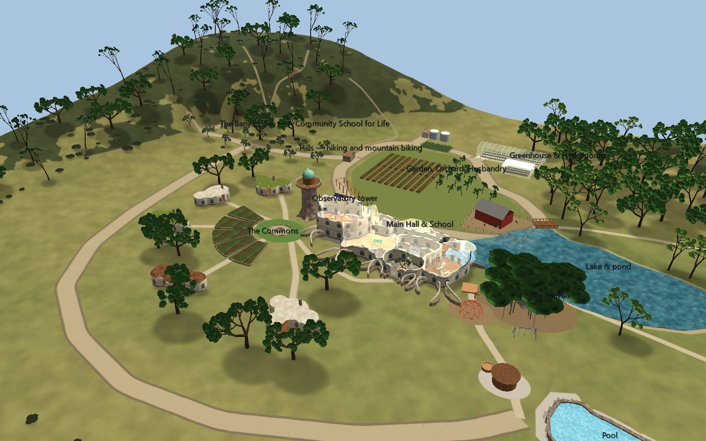
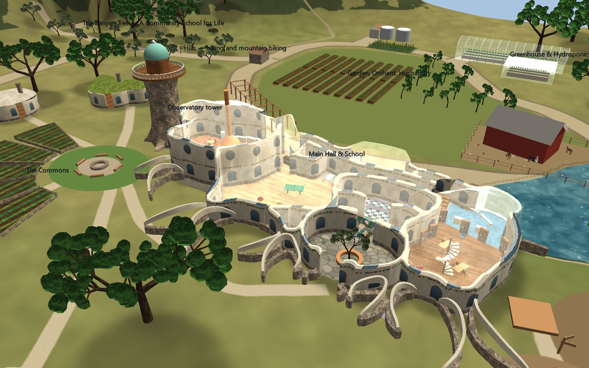
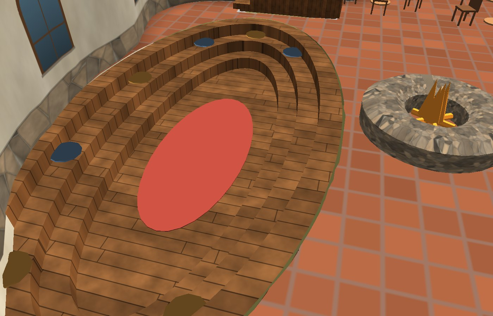
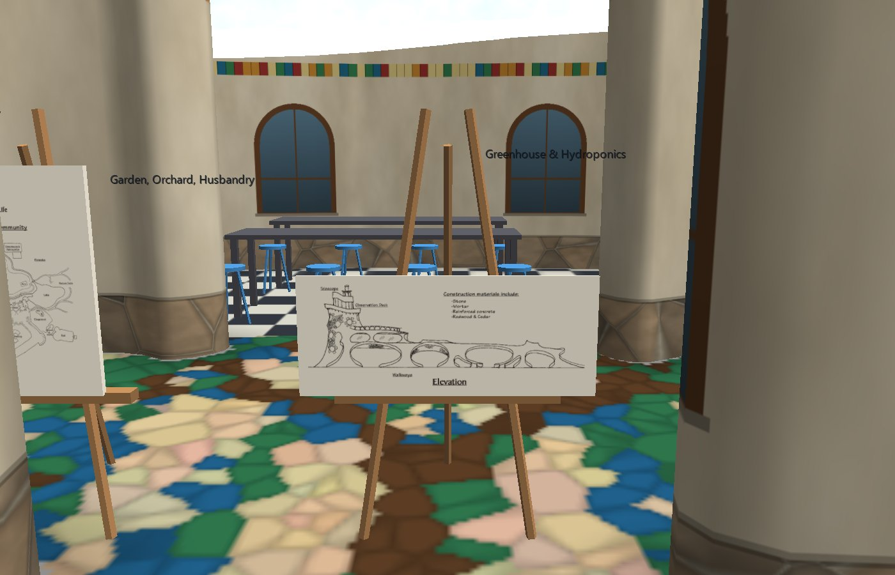
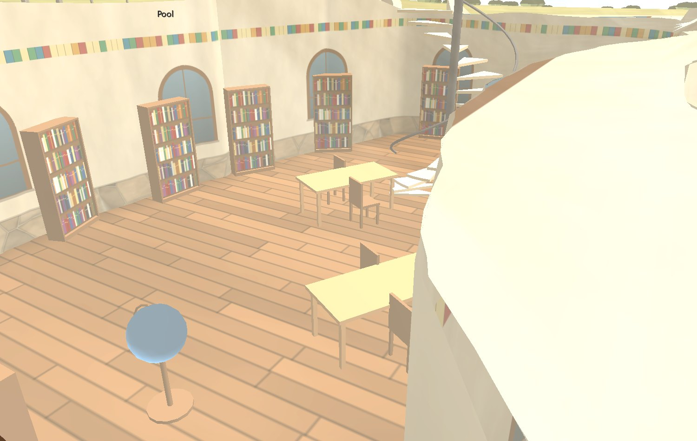
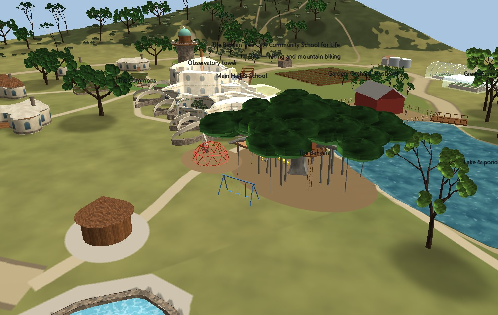

# The Banyan Tree Community School

A community and school that was drawn and never built, built here from its
drawings: a co-housing community for a few families in the hills north-east of
San Diego, with a school at its heart. The drawings are by Jeff Sale and Jodi
Reed.

**Build it first.** The repository carries the generator and the drawings,
not the output: the meshes, textures and node CSV (about 20 MB) are rebuilt
in about 30 seconds:

```
<glyphviz-env>\python.exe mesh_creation_lab/Banyan_Tree/build_banyan_tree.py
```

Then open `banyan_tree_gv_node.csv`. The `meshes/` and `media/` folders beside
it load automatically.



| What | How much |
|---|---|
| Site | ~11 acres, 303 m x 239 m, terrain from the community plan |
| School | 974 m² footprint, 12 rooms, walls traced from the floor plan |
| Homes | 5 family dwellings, the commons, a story circle |
| Grounds | Garden, orchard, barn, greenhouse, water reclamation, solar, lake, pool, sauna, playground |
| Trees | 202 trees (oak, pine, sycamore, olive, an avocado orchard), a Moreton Bay fig, 240 chaparral shrubs |
| Scene | 1,124 nodes, 125 mesh files (283k triangles), 26 textures |

Rendering is not a problem: the headless benchmark measures **3.8 ms a frame**
at 1280x720.

## Source material

`drawings/` holds the three originals, converted to PNG:

- **The Initial Community** (`banyan_community.png`) shows the site plan.
- **Top View** (`banyan_floor_plan.png`) is the school's floor plan.
- **Elevation** (`banyan_elevation.png`) shows the school's south front.

The text comes from the web page that carried the drawings: co-housing,
"pooling our resources", and the wish list for the school.

## What came from the drawings, and how

**The school's walls are the floor plan's ink.** `plan_trace.py` keeps every
dark stroke long enough to be a wall. It drops labels and underlines by size
and cuts out the three stair symbols, whose gaps become the doorways the
stairs pass through. It then thickens the double-line walls into solid
masonry. `organic.py` takes the smoothed outline of that mask as the faces of
the wall mesh. Every curve, doorway and the hook of the courtyard entrance is
therefore exactly what was drawn, at 0.06 m per pixel, which makes the Main
Hall 18 m across.

**Rooms are found, not drawn.** A flood fill runs after the doorways are
temporarily closed. Each enclosed space is named by the label written inside
it, and rooms joined by a wide opening (Lab, Lobby, Courtyard) are split by
nearest label. Each room gets its own floor, painted into one texture:

| Room | Floor |
|---|---|
| Main Hall | Terracotta |
| Indoor Recreation | Maple |
| Lab | Black-and-white checker |
| Lobby | A tree-of-life mosaic |
| Courtyard | Flagstone |
| Library | Oak |

**The roof is computed from the walls.** It is a height field that rises with
distance from the nearest wall, so it pillows up between the walls and dips
onto them. The Main Hall gets a dome.

**The community plan was digitized by hand**, because its scanned lines are too
broken to trace. Every coordinate in `site_plan.py` is a pixel on that drawing,
read at 0.39 m/px. At that scale the school is the same size on both drawings.



## What is interpretation

The drawings are black and white and say nothing about colour, material,
furniture, terrain or planting. Each decision below is labelled in the scene
(select a node, or press T) and named in the code.

- **The elevation is read as the south front.** The stone tower stands beside
  the Main Hall's Nook. Its foot is buttressed like a banyan's roots, and it
  carries an observation deck with a balustrade of rounded stones and a copper
  observatory dome. Hubbell-style plaster ribbon arches soar over the plan's
  scalloped garden arcs, which is how the elevation's oval "Walkways" are
  read.
- **The Main Hall's two levels** ("Upper Level: Kitchen & Dining", "Lower
  Level: Communal gatherings, Meditations, Relaxation") are one round room.
  Dining sits on the upper level, and the lower level is a sunken, stepped
  gathering floor south of the hearth, so the hearth overlooks both.
- **The pond is the lake.** The floor plan puts a POND and an Underwater
  Observation Area at the school's north-east corner, and the community plan
  puts the lake there. The lake's west lobe therefore runs up to a glass wall.
- **The playground's circled feature is the big tree** the school is named for.
  It is a Moreton Bay fig, the banyan-like fig that grows in San Diego, with
  aerial roots becoming new trunks. The kids-only tree house sits in its
  limbs.
- **The ring of wedges is the commons**: one raised garden terrace per family,
  around a story circle ("values taught primarily by stories").
- **Materials** follow the elevation's list (stone, mortar, reinforced
  concrete, redwood and cedar) and the James Hubbell influence the page names:
  lime plaster, fieldstone, and a band of coloured tile.
- **Furnishings** come from the page's wish lists wherever there is one: the
  hearth ("perfect for after-dinner discussions"), "a truly awesome library",
  computers, a science lab, music, crafts, an observatory, a tree house, a hot
  tub, goats and chickens. There is also a geodesic climbing dome for "Dare to
  be naive". The original drawings stand on easels in the lobby.

| | |
|---|---|
|  |  |
|  |  |

## Looking around

The **roof is translucent** (alpha 105) so that the rooms show from above.
Select it (its label is "Main Hall & School") and set alpha to 255 to see the
building solid, or hide it.

To walk through the building, fly in with **Camera Mode** (C). The furniture is
at real scale: seats at 0.45 m, tables at 0.75 m, bookcases 2 m tall.

## Rebuilding it

```
<glyphviz-env>\python.exe mesh_creation_lab/Banyan_Tree/build_banyan_tree.py
<glyphviz-env>\python.exe mesh_creation_lab/Banyan_Tree/build_banyan_tree.py --only school
```

The full build takes about 30 s. `--only school` builds the building and its
furniture alone, which is faster for iteration.

| File | What it does |
|---|---|
| `plan_trace.py` | Floor plan PNG to wall mask, rooms, stair cut-outs |
| `organic.py` | Masks to meshes: contour walls, edge-snapped slabs, ribbon arches |
| `school.py` | The building, tower, hearth and furniture placement |
| `site_plan.py` | Terrain, site map, roads, water, homes, grounds, trees |
| `furniture.py` | Every furnishing, modelled once in metres |
| `textures.py` | Plaster, fieldstone, floors, books, solar cells and more |
| `kit.py` | Deferred placement, so mesh ids resolve after every file exists |

## Things that bit

- **Ground hides anything below grade.** The terrain runs under the school at
  z = 0, so the sunken lower level first rendered as a flat green disc: the
  grass, seen through the floor's hole. The terrain is now carved under the
  lower level and the pool, over-cut by one terrain cell so that the slope
  back up stays beneath the floor slab.
- **Smoothed-mask snapping fails a cell away.** Snapping a slab's ragged cells
  onto a blurred mask's edge does nothing to a corner more than a couple of
  pixels outside, where the blur's gradient is zero. Those corners left a
  saw-toothed roof and floor edge. A signed distance field has a gradient
  everywhere and fixed it.
- **A pattern on a translucent roof covers every room below.** The first roof
  carried Hubbell-style tile mosaic, and seen through from above it scribbled
  over every floor. The roof is plain now, and the colour lives in the walls'
  tile band.
- **Translucent nodes go last.** GlyphViz draws in file order with depth
  writes on, so `kit.py` writes the roof, glass and water after every opaque
  node.
